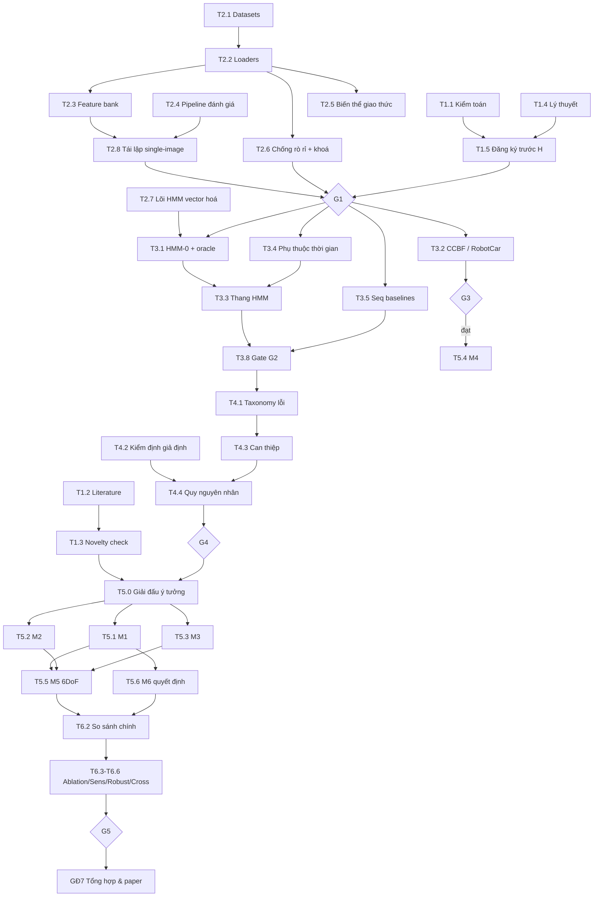

# MASTER RESEARCH PLAN
## HMM cho Monocular Sequence-based Visual Localization — từ kiểm chứng khả thi đến phương pháp mới

*Phiên bản 1.0 — 2026-11-24. Tài liệu điều phối xuyên suốt cho AI Research/Coding Agent và nhóm nghiên cứu.*
*Kế thừa trực tiếp repo `HMM-Develop` (DIVE-HMM / CCBF, commit `f376568`). Tài liệu này **không** chứa kết quả bịa:
mọi con số đều gắn mức bằng chứng (§0.3) và, khi có, một `run_id` trong `research/registry/runs.jsonl`.*

---

## Mục lục

0. [Cách sử dụng tài liệu này](#0-cách-sử-dụng-tài-liệu-này)
1. [Tóm tắt điều hành](#1-tóm-tắt-điều-hành)
2. [Kiểm toán repository hiện tại](#2-kiểm-toán-repository-hiện-tại)
3. [Khung lý thuyết và mô hình toán học](#3-khung-lý-thuyết-và-mô-hình-toán-học)
4. [Bản đồ tài liệu nghiên cứu](#4-bản-đồ-tài-liệu-nghiên-cứu)
5. [Research gaps, câu hỏi nghiên cứu và giả thuyết](#5-research-gaps-câu-hỏi-nghiên-cứu-và-giả-thuyết)
6. [Kế hoạch 7 giai đoạn (task cards)](#6-kế-hoạch-7-giai-đoạn)
7. [Phụ thuộc, thứ tự, song song hoá](#7-phụ-thuộc-thứ-tự-song-song-hoá)
8. [Research Operating System — cơ chế tự theo dõi và tự điều chỉnh](#8-research-operating-system)
9. [Kế hoạch tính toán và điều phối Kaggle](#9-kế-hoạch-tính-toán-và-điều-phối-kaggle)
10. [Sổ rủi ro tổng](#10-sổ-rủi-ro-tổng)
11. [Các điểm bắt buộc cần con người](#11-các-điểm-bắt-buộc-cần-con-người)
- [Phụ lục A — Đặc tả giao thức dữ liệu](#phụ-lục-a--đặc-tả-giao-thức-dữ-liệu)
- [Phụ lục B — Định nghĩa metrics](#phụ-lục-b--định-nghĩa-metrics)
- [Phụ lục C — Kiến trúc mã nguồn đề xuất](#phụ-lục-c--kiến-trúc-mã-nguồn-đề-xuất)
- [Phụ lục D — Tài liệu tham khảo (đã kiểm chứng)](#phụ-lục-d--tài-liệu-tham-khảo)

---

## 0. Cách sử dụng tài liệu này

### 0.1 Đối tượng
- **AI Research Agent / Coding Agent** chạy nhiều phiên (session) độc lập, có thể bị ngắt giữa chừng. Mọi trạng thái
  phải nằm trong repo (không nằm trong "trí nhớ" của agent).
- **Nhà nghiên cứu (con người)**: duyệt các quyết định ở các Decision Gate, xử lý các bước cần đăng ký/tài khoản (§11).

### 0.2 Quy trình bắt đầu và kết thúc mỗi phiên (bắt buộc)
**Bắt đầu phiên:**
1. Đọc `research/STATE.md` (trạng thái hiện tại, 3 việc tiếp theo, blocker).
2. Đọc mục của Giai đoạn đang chạy trong §6 và các giả thuyết liên quan trong `research/HYPOTHESES.md`.
3. Đọc `research/DASHBOARD.md` (tự sinh) và `research/ISSUES.md` (các lỗi đang mở có thể làm sai kết quả).
4. Chọn **một** task (hoặc một cặp task độc lập có thể song song), ghi "đang làm" vào `STATE.md`.

**Kết thúc phiên (kể cả khi thất bại):**
1. Mọi run đã chạy → một bản ghi trong `research/registry/runs.jsonl` qua `automation/log_run.py add` (kể cả run lỗi).
2. Cập nhật `HYPOTHESES.md` (bằng chứng mới), `FINDINGS.md` (nếu có phát hiện), `DECISIONS.md` (nếu ra quyết định),
   `ISSUES.md` (nếu phát hiện lỗi), `STATE.md` (việc tiếp theo).
3. `python automation/log_run.py dashboard`, commit, push lên nhánh làm việc.

### 0.3 Mức bằng chứng (dùng xuyên suốt, kể cả trong paper draft)
| Ký hiệu | Ý nghĩa | Được phép phát biểu |
|---|---|---|
| **[V]** Verified | Dữ liệu thật, giao thức đã khoá (§6 T2.6), split test chưa dùng để tune, có CI 95% (block bootstrap) | "Chúng tôi chứng minh/cho thấy…" |
| **[S]** Supported | Dữ liệu thật nhưng trên dev split, một dataset, hoặc chưa đủ CI | "Kết quả sơ bộ gợi ý…" |
| **[P]** Pilot | Mô phỏng/synthetic hoặc smoke test | "Trong mô phỏng…" — **không** dùng làm bằng chứng chính |
| **[R]** Reported | Con số có trong tài liệu cũ nhưng không tái kiểm được từ repo | Chỉ dùng làm tham chiếu, phải chạy lại |
| **[H]** Hypothesis | Chưa kiểm chứng | "Chúng tôi giả thuyết…" |
| **[L]** Literature | Phát biểu của paper đã trích dẫn | Kèm trích dẫn (Phụ lục D) |

### 0.4 Quy ước mã định danh
`T<giai đoạn>.<số>` task · `H<số>` giả thuyết · `F<số>` finding · `D<số>` quyết định · `A<số>` issue kiểm toán ·
`G<số>` decision gate · `M<số>` module/phương pháp · `R<yyyymmdd>-<nnn>_<task>` run · `L<nnn>_…` run cũ (legacy).

---

## 1. Tóm tắt điều hành

### 1.1 Hiện trạng (sau kiểm toán ngày 2026-11-24)
- Repo đã có một pipeline Kaggle offline chạy được (SALAD 8448-d nạp đúng từ bundle, cache descriptor, lọc Bayes
  place-only, CCBF = lọc factored (place, condition)), cùng bản methodology có 2 định lý.
- Kết quả đã báo cáo **[R]** (Nordland 4 mùa, 800 frame/mùa): single-image R@1 0.819 → fixed filter 0.889; CCBF 0.884
  ≈ fixed; ECE 0.076 → 0.028/0.030; off-map AUROC 0.99 (cả hai filter) vs SUE 0.935; condition tracking 0.974.
- **Kết luận của chính repo:** CCBF chưa tạo khác biệt vì τ theo điều kiện gần như bằng nhau trên Nordland+SALAD.
- **Kiểm toán của tài liệu này** (§2.4, `research/ISSUES.md`) phát hiện thêm: (A1) motion prior dùng chỉ số khung đã
  đồng bộ GT — một *oracle* về vận tốc; (A2) stride ≈45 khung làm mất gần hết tương quan thời gian — đúng chế độ mà
  lý thuyết "miscalibration propagation" khó xuất hiện nhất; (A3) τ theo điều kiện được fit trên cặp mùa sai so với
  map test (bất lợi cho CCBF); (A4) centroid điều kiện tính từ chính dữ liệu test. ⇒ **Các con số hiện có là cận trên
  về lợi ích của HMM và chưa kiểm định đúng giả thuyết của CCBF.**
- **Pilot mới P0 [P]** (synthetic, 2 seed, `research/pilots/`): khi nhiễu similarity tương quan theo thời gian (ρ),
  HMM "ngây thơ" mất độ chính xác mạnh (0.91 → 0.18–0.21) và sinh lỗi "tự tin mà sai" (conf>0.9 & sai: 0.2% → 18%);
  ρ ước lượng được **không cần nhãn** (sai số ±0.02); hệ số tempering tối ưu khớp với mô hình **bộ nhớ hiệu dụng hữu
  hạn** β = 1/VIF(ρ̂, L_eff) chứ **không** khớp công thức tiệm cận (1−ρ)/(1+ρ); và **ECE đơn lẻ có thể đánh lừa** (hai
  nguồn sai lệch ngược chiều triệt tiêu nhau).

### 1.2 Luận điểm trung tâm (thesis, ở mức [H])
> HMM (lọc Bayes rời rạc trên bản đồ topo) là khung suy luận *đúng về nguyên lý* cho định vị theo chuỗi: nó là
> Bayes chính xác dưới giả định của nó, xử lý được hậu nghiệm đa mode (perceptual aliasing), có trạng thái off-map và
> chạy thời gian thực. Giá trị thực tế của nó **bị chặn bởi chất lượng bằng chứng** đưa vào bộ lọc, theo ba trục:
> **(i) emission** phải là log-likelihood-ratio được hiệu chỉnh (không phải similarity thô/softmax);
> **(ii) phụ thuộc thời gian** của bằng chứng phải được đếm đúng (bộ nhớ hiệu dụng), nếu không bộ lọc tự tin quá mức và
> khoá vào quỹ đạo sai; **(iii) transition** phải phản ánh chuyển động thật (vận tốc/scale ẩn, VO đơn mắt), không dùng
> đồng bộ khung làm oracle. Khi ba trục này đúng, HMM trở thành **"bộ điều phối niềm tin"** cho cả VPR lẫn 6DoF: nó quyết
> định *giả thuyết nào* đáng chi phí geometric verification và khi nào được phép "cam kết" vị trí.

Tên làm việc của phương pháp: **DA-HMM** (*Dependence-Aware, calibrated HMM*). Tên chỉ là nhãn tạm; không được quảng bá
như đóng góp trước khi qua Gate G4.

### 1.3 Chiến lược 3 tầng
1. **Chẩn đoán (Giai đoạn 1–4):** HMM có ích không, ở đâu, vì sao thất bại — bằng thí nghiệm can thiệp có kiểm soát
   (oracle swap, stride sweep, time-warp, aliasing injection), trên ≥4 datasets và ≥3 descriptor.
2. **Sửa gốc (Giai đoạn 5, lõi):** M1 emission LLR hiệu chỉnh + null theo lý thuyết cực trị; M2 bằng chứng nhận biết phụ
   thuộc (effective-memory tempering, ước lượng ρ không nhãn); M3 trạng thái động học (vận tốc/scale ẩn, VO).
3. **Mở rộng (Giai đoạn 5–6, có điều kiện):** M5 lai rời rạc–liên tục cho 6DoF (posterior-guided verification); M6 quyết
   định được hiệu chỉnh (SPRT, conformal); M4 CCBF giữ lại **chỉ khi** Gate G3 (RobotCar ngày/đêm) cho thấy dị biệt điều
   kiện; M7/M8 khám phá (HMM học phân biệt; quan sát hình học từ foundation 3D models).

### 1.4 Các Decision Gate chính
| Gate | Thời điểm | Câu hỏi | Tiêu chí "đi tiếp" | Nếu không đạt |
|---|---|---|---|---|
| **G1** | cuối GĐ2 | Benchmark & protocol có đáng tin? | Leakage audit pass; tái lập single-image của ≥2 descriptor trong ±2 điểm so với số công bố (trên protocol chuẩn) | Sửa pipeline, không chạy GĐ3 |
| **G2** | cuối GĐ3 | HMM (không oracle) có lợi so với single-image? | ΔR@1 > 0 với CI95 không chứa 0 trên ≥2/4 datasets, **hoặc** cải thiện NLL/confident-wrong ≥20% tương đối | Chuyển trọng tâm sang phân tích thất bại + M5 (6DoF) + paper phân tích |
| **G3** | trong GĐ3 (sớm) | Tiền đề CCBF: dị biệt điều kiện có thật? | Trên RobotCar: tham số emission đêm/ngày khác ≥1.5× **và** emission theo điều kiện *oracle* giảm NLL ≥10% so với global (tiền đề); CCBF (điều kiện suy luận) giữ được ≥70% mức giảm đó | Lưu trữ CCBF (M4) trong DECISIONS; giữ condition tracking như công cụ phân tích |
| **G4** | cuối GĐ4 | Có nguyên nhân gốc được xác nhận nhân quả? | ≥1 giả thuyết nguyên nhân (H5/H7/H10/H3) đạt [S] trên ≥2 datasets bằng thí nghiệm can thiệp | Quay lại GĐ4 với giả thuyết mới; không nhảy vào GĐ5 bằng tuning |
| **G5** | giữa GĐ6 | Phương pháp mới vượt baseline mạnh nhất? | Cải thiện có ý nghĩa thống kê trên held-out datasets, không tune trên test, ablation chứng minh từng module | Thu hẹp claim; cân nhắc paper phân tích/benchmark |
| **G6** | cuối GĐ6 | Đủ cho paper venue nào? | Checklist A* (§6 T7.4) | Nhắm RA-L/ICRA/IROS thay vì CVPR/NeurIPS |

### 1.5 Đóng góp kỳ vọng (có điều kiện, chưa được phép khẳng định)
- **C1 (phân tích, [H]):** Bằng chứng định lượng, đa dataset về *khi nào* lọc thời gian giúp định vị với descriptor
  foundation-model; đường cong lợi ích dạng chữ U ngược theo độ chính xác single-image (H2); lượng hoá phần lợi ích bị thổi
  phồng bởi oracle đồng bộ (H3).
- **C2 (lý thuyết + phương pháp, [H]/[P]):** Lý thuyết "bộ nhớ hiệu dụng" cho bằng chứng tương quan trong HMM định vị và
  phương pháp tempering ước lượng không nhãn (H5/H6b), kèm emission LLR hiệu chỉnh với null cực trị (H7).
- **C3 (hệ thống, [H]):** HMM điều phối verification cho 6DoF theo chuỗi, cải thiện điều kiện đêm với ngân sách tính toán
  thấp hơn (H11/H12).
- **C4 (an toàn, [H]):** quyết định cam kết vị trí có đảm bảo tỉ lệ lỗi (SPRT/conformal) (H15/H16).

---

## 2. Kiểm toán repository hiện tại

### 2.1 Những gì đang có
| Thành phần | Nội dung | Giá trị kế thừa |
|---|---|---|
| `CCBF_methodology.md` | Factored HMM (place, condition), emission density-ratio §3.1, dạng temperature §3.2, fit bằng proper scoring §3.3, Lemma 1 (exponential tilt), Theorem 1 (KL ≥ vT/2), Prop. 2, Theorem 2 (consistency) | **Cao**: §3.1 (density ratio dưới giả định độc lập của non-match) là nền đúng cho M1; Lemma 1/Theorem 1 tái sử dụng được cho lý thuyết phụ thuộc (§3.5) bằng cách định nghĩa lại "true emission" là $p(d_t\mid p_t, d_{1:t-1})$ |
| `nb_src/`, `nb2_src/` → NB1, NB2 | Loader Nordland (đồng bộ frame-ID), extractor SALAD/DINOv2/placeholder, cache, single-image, fixed filter, CCBF, ECE, AUROC, SUE | **Cao** cho loader/extractor/cache; **trung bình** cho filter (đúng nhưng chậm, cần vector hoá) |
| `automation/` | build notebook từ `.src`, Kaggle push/poll/pull, tier T4/RTX, test harness numpy | **Cao**: giữ nguyên quy trình; bổ sung `log_run.py` (đã thêm) |
| `HANDOFF_CCBF.md` | Kết quả NB1/NB2, gotchas định dạng RobotCar/CMU, quy tắc stall | **Cao**: thông tin định dạng GT rất quý (§7 của handoff) |
| `hmm_datasets_environment_summary(1).pdf` | Cấu trúc 6 dataset trên Kaggle + bundle | **Cao**: nguồn sự thật về đường dẫn |
| `Research Workflow (1).pdf`, `HMM_Navigation.docx` | Quy trình nghiên cứu lặp, nguyên tắc, tài nguyên Kaggle (L4×4, 2 phiên GPU/tài khoản, quy tắc 10'/8' stall) | Quy tắc vận hành, đã đưa vào §8–§9 |

### 2.2 Kết quả đã báo cáo (mức [R]; registry: `L001_NB1v3`, `L002_NB2`)
| Thiết lập | Phương pháp | R@1 | ECE | Ghi chú |
|---|---|---|---|---|
| Nordland Short, summer→winter, 600 frame (stride≈2.9) | single-image SALAD | 0.617 | – | DINOv2 mean-pool lỗi cũ: 0.27 |
| Nordland Full 4 mùa, 800 frame/mùa (stride≈45), ref=summer | single-image | 0.819 | 0.076 | |
| | fixed filter | 0.889 | 0.028 | motion oracle (A1) |
| | CCBF | 0.884 | 0.030 | τ_spring/summer/fall=0.0309, τ_winter=0.0253 |
| Off-map (map=70% đầu tuyến) | CCBF null / fixed null / SUE | AUROC 0.992 / 0.993 / 0.935 | | block đuôi liên tục (A7) |
| Condition tracking (4 mùa) | CCBF | acc 0.974 | | centroid từ dữ liệu test (A4) |

### 2.3 Những gì đáng kế thừa (không làm lại)
1. Loader SALAD đã kiểm chứng (missing=0/unexpected=0), quy trình offline bundle, cache descriptor có manifest.
2. Ý tưởng density-ratio emission (§3.1 methodology) và khung Lemma 1 — nền cho M1 và lý thuyết §3.5.
3. Hạ tầng Kaggle (build→test local→push→poll→pull), kinh nghiệm về hàng đợi RTX và quy tắc stall.
4. Định dạng GT RobotCar/CMU (translation = chỉ số [3,7,11] của ma trận 4×4 phẳng; CMU = 3 số cuối).
5. Bằng chứng định tính: lọc thời gian **có** cải thiện R@1 và ECE trên Nordland (dù bị thổi phồng) — một điểm khởi đầu,
   không phải kết luận.

### 2.4 Các vấn đề kiểm toán quan trọng (chi tiết: `research/ISSUES.md`)
| ID | Mức | Vấn đề | Hệ quả |
|---|---|---|---|
| A1 | Cao | Motion prior v=1 trên chỉ số khung đã đồng bộ GT của Nordland | Lợi ích filter là cận trên; không đại diện robot thật |
| A2 | Cao | Stride ≈45 khung (800/35,768) | Mất tương quan thời gian → không kiểm định được chế độ video-rate |
| A3 | Cao | τ_k fit trên cặp mùa sai (fall→spring, winter→spring) trong khi map test là summer; τ global của baseline fit đúng cặp | So sánh thiên lệch **chống lại** CCBF |
| A4 | Cao | Centroid điều kiện = trung bình toàn bộ track query (gồm frame đánh giá) | Rò rỉ transductive; 0.974 lạc quan |
| A5 | TB | Split calib/eval = chẵn/lẻ cùng traversal | Rò rỉ nghiêm trọng ở stride 1 |
| A6 | TB | Tolerance ±2 *frame-ID* với stride 45 = khớp chính xác; khác protocol cộng đồng | Không so sánh được với literature |
| A7 | TB | Off-map = một khối đuôi duy nhất; SUE so sánh không công bằng (single-frame vs sequence) | Thí nghiệm off-map không phân biệt được phương pháp |
| A8 | TB | Null likelihood = quantile 0.98 / τ (ad hoc) | b(∅) không diễn giải được |
| A9 | TB | Parse pose RobotCar sai chỉ số (đã biết, chưa sửa code) | Probe RobotCar không hợp lệ |
| A10 | TB | Chỉ R@1 và ECE; không NLL/Brier/CI | Pilot P0 cho thấy ECE đơn lẻ đánh lừa được |
| A11–A13 | Thấp | Test hard-code đường dẫn Windows; không commit log/kết quả; filter Python-loop chậm | Tái lập & quy mô |

### 2.5 Diễn giải lại "kết quả âm" của CCBF
Repo kết luận đúng rằng CCBF ≈ fixed vì τ gần bằng nhau. Kiểm toán cho thấy thí nghiệm NB2 còn **không có khả năng**
phát hiện cơ chế mà Theorem 1 mô tả, vì ba lý do cộng dồn:
1. **Chế độ phi tương quan (A2):** Theorem 1 cần phương sai của sai số potential tích luỹ tăng tuyến tính; với stride 45
   và một điều kiện cố định trong mỗi episode, nguồn dị biệt duy nhất là giữa các mùa — mà SALAD lại bền với mùa.
2. **Oracle motion (A1):** prior quá mạnh và đúng tuyệt đối khiến emission ít quan trọng → sai số emission khó lộ ra.
3. **Fit lệch cặp (A3):** CCBF bị đặt vào thế bất lợi.

Do đó kết luận đúng là: *"CCBF chưa được kiểm định công bằng; tiền đề của nó (dị biệt điều kiện) yếu trên Nordland"*,
chứ chưa phải *"ý tưởng condition-aware vô giá trị"*. Thí nghiệm quyết định vẫn là RobotCar ngày→đêm (Gate G3), nay
được làm đúng giao thức (T3.2). Đồng thời, Theorem 1 có một "ngôi nhà" tổng quát hơn: **phụ thuộc thời gian của bằng
chứng** (§3.5) tồn tại ở *mọi* dataset video-rate, không cần dị biệt điều kiện.

### 2.6 Pilot P0 (mới, [P]) — `research/pilots/README.md`, runs `R20261124-001_P0`, `R20261124-002_P0`
Mô phỏng HMM 1-D (M=400, v=1) với trường nhiễu AR(1) dọc đường chéo. Kết quả (2 seed, nhất quán):
| ρ | acc HMM ngây thơ | conf>0.9 & sai | β tối ưu (NLL) | β = 1/VIF(ρ̂,L_eff) | β tiệm cận (1−ρ)/(1+ρ) | acc sau tempering |
|---|---|---|---|---|---|---|
| 0.0 | 0.91–0.92 | 0.1–0.2% | 0.85–0.95 | 0.99 | 1.00 | ≈ |
| 0.5 | 0.63–0.65 | 1.3–1.4% | 0.55 | 0.55 | 0.33 | 0.73–0.75 |
| 0.7 | 0.38–0.39 | 2.8–6.4% | 0.40–0.45 | 0.375–0.45 | 0.18 | 0.48–0.51 |
| 0.85 | 0.18–0.21 | 18–19% | 0.20–0.25 | 0.19–0.23 | 0.08 | 0.18–0.29 |

Bài học dùng cho kế hoạch: (1) ρ ước lượng không nhãn được; (2) công thức tiệm cận **sai** cho bộ lọc — cần mô hình bộ
nhớ hữu hạn; (3) whitening đường chéo đơn giản **tệ hơn** tempering (AR-HMM đúng cần pair-state); (4) **ECE đơn lẻ đánh
lừa** (ở ρ=0.5 HMM ngây thơ có ECE *tốt nhất* 0.03 nhưng NLL/acc tệ hơn) ⇒ luôn báo NLL + Brier + confident-wrong +
thí nghiệm can thiệp. Giới hạn: Gaussian, đồng nhất, chỉ tương quan đường chéo, không aliasing, không outage.

**Pilot P0b [P]** (`R20261124-003_P0b`, `-004_P0b`): kiểm một dự đoán *có thể bác bỏ* của cách hiểu "L_eff là bộ nhớ của bộ
lọc". Kết quả 2 seed: L_eff giảm đơn điệu khi motion kernel rộng ra (std 0.5 → 6–8; 1 → 3–4; 2 → 2–3) — **ủng hộ**; dự đoán
về leak (leak lớn ⇒ L_eff nhỏ) **không được ủng hộ**. Phát hiện phụ: motion prior càng sắc thì tác hại của bằng chứng tương
quan càng lớn (NLL 1.52→0.69 khi tempering ở std 0.5, so với 2.94→2.40 ở std 2) ⇒ giả thuyết tương tác **H18**: cải thiện
transition (M3) sẽ *làm tăng* nhu cầu hiệu chỉnh phụ thuộc (M2).

---

## 3. Khung lý thuyết và mô hình toán học

### 3.1 Phát biểu bài toán
**Bản đồ (map).** $\mathcal{M}=\{(r_j, \mathbf{x}_j, I_j, \mathcal{X}_j)\}_{j=1}^{M}$: descriptor toàn cục $r_j\in\mathbb{S}^{D-1}$,
pose tham chiếu $\mathbf{x}_j\in SE(3)$, ảnh $I_j$, tập điểm 3D quan sát được $\mathcal{X}_j$ (nếu có SfM model). Topo
$G=(V,E)$ với $V=\{1..M\}$ và cạnh nối các tham chiếu kề nhau (theo thời gian chụp map và theo khoảng cách không gian),
độ dài cạnh $\ell_{jj'}$ (mét, khi có pose).

**Luồng truy vấn.** Ảnh đơn mắt $I_{1:T}$, descriptor $d_t=f(I_t)$; tuỳ chọn chuyển động tương đối từ VO đơn mắt
$u_t=(\hat R_t,\hat{\mathbf t}_t)$ **chưa biết scale**.

**Trạng thái ẩn.** $z_t=(p_t, v_t, c_t)$ với $p_t\in V\cup\{\varnothing\}$ (place hoặc off-map), $v_t$ vận tốc/scale ẩn
(M3), $c_t$ điều kiện ngoại cảnh (M4, tuỳ chọn). Cho 6DoF: pose liên tục $\mathbf{x}_t$ có điều kiện theo $p_t$.

**Đầu ra.** (i) hậu nghiệm lọc $b_t(p)=P(p_t\mid I_{1:t},u_{1:t})$ hoặc làm mượt trễ cố định $P(p_{t-L}\mid I_{1:t})$;
(ii) MAP place, tập tin cậy (credible/conformal set), xác suất off-map; (iii) pose 6DoF + hiệp phương sai; (iv) quyết định
"cam kết/từ chối" với tỉ lệ lỗi mục tiêu.

**Hai bài toán, một khung:**
$$
p(\mathbf{x}_t, p_t \mid \cdot)=\underbrace{P(p_t\mid\cdot)}_{\text{HMM: VPR topo}}\;\cdot\;\underbrace{p(\mathbf{x}_t\mid p_t,\cdot)}_{\text{local features + PnP / refinement}}
$$
— phân rã Rao-Blackwell: HMM xử lý phần rời rạc đa mode (đâu là vùng đúng), phần liên tục được ước lượng có điều kiện
cho một số ít giả thuyết hàng đầu.

### 3.2 HMM là Bayes chính xác — dưới những giả định nào?
Đệ quy lọc: $b_t(j)\propto g_t(j)\sum_{i}T(j\mid i,u_t)\,b_{t-1}(i)$. Nó **chính xác** khi các giả định sau đúng:

| # | Giả định | Vi phạm trong VPR thực tế | Kiểm định chẩn đoán (GĐ4) | Biện pháp |
|---|---|---|---|---|
| A-Mk | Markov bậc 1 trên $p_t$ | Vận tốc bền (quán tính) → bậc 2 | So log-lik held-out của mô hình bậc 1 vs (p,v) | M3: tăng trạng thái (p,v) |
| A-CI | Quan sát độc lập có điều kiện: $d_t\perp d_{t'}\mid p_{1:T}$ | Điều kiện ánh sáng, che khuất, aliasing kéo dài nhiều frame; ảnh kề nhau chồng FOV | ACF/Ljung–Box của phần dư LLR; ρ̂ không nhãn (§3.5) | M2: effective-memory tempering; pair-state AR emission |
| A-Em | Emission đúng dạng | Similarity ≠ likelihood; đuôi nặng; phụ thuộc place (distinctiveness) và điều kiện | KS/AD test phân phối match/non-match; phân rã phương sai theo place/condition | M1: density-ratio LLR, null theo place; M4 (điều kiện) |
| A-Tr | Transition đúng | Tốc độ khác map, dừng ga/đèn đỏ, lùi, rẽ nhánh, đi lệch map | Phân tích sai số theo tỉ lệ tốc độ; time-warp | M3: vận tốc/scale ẩn, VO, đồ thị topo |
| A-St | Không gian trạng thái đúng | Off-map; query nằm giữa 2 tham chiếu; lệch làn/viewpoint | Lỗi theo khoảng cách query–tham chiếu gần nhất | Null state + LLR null; mật độ map |
| A-Prior | Prior khởi tạo hợp lý | Kidnapped robot; khởi động lạnh | Thời gian hội tụ, tỉ lệ khoá sai ở đầu chuỗi | leak η; khởi tạo từ top-K retrieval |
| A-Stat | Tham số dừng theo thời gian | Ngày→hoàng hôn→đêm, vào hầm | Tham số theo cửa sổ trượt | M4 (regime/condition latent) |

### 3.3 Emission: từ similarity đến likelihood
**(a) Scaled likelihood.** Với bộ phân loại cho hậu nghiệm một-khung $q(p\mid d)$, $p(d\mid p)\propto q(p\mid d)/\pi(p)$
(nguyên lý hybrid HMM/ANN trong nhận dạng tiếng nói — Bourlard & Morgan [L]). Softmax(s/τ) dưới prior đều chính là
dạng này — nên τ chỉ đúng nếu $q$ đã hiệu chỉnh.

**(b) Density ratio (kế thừa methodology §3.1).** Nếu điểm tại place đúng ~ $h_1$ và điểm tại mọi place khác ~ $h_0$, độc
lập, thì log-potential duy nhất phụ thuộc place là
$\ell_t(j)=\log h_1(s_t[j])-\log h_0(s_t[j])$ (LLR). Softmax-temperature ⇔ $h_1,h_0$ Gaussian **cùng phương sai**. Dữ liệu
thật thường vi phạm (phương sai khác nhau, đuôi phải nặng ở non-match do aliasing) → LLR phi tuyến (lõm/lồi) trong $s$.
Ước lượng: hồi quy logistic trên đặc trưng spline của $s$ (đơn điệu), hoặc isotonic + làm mượt, fit bằng log-loss trên
vùng hiệu chỉnh tách biệt không gian.

**(c) Null theo place (distinctiveness).** Non-match không đồng nhất: place nằm trong đoạn lặp cấu trúc (rừng, hành lang,
đường ray) có nhiều "anh em" giống nhau. Đặt $h_{0,j}$ phụ thuộc place qua thống kê tự-tương đồng của map
($\mu_j=$ trung bình similarity của $r_j$ tới k láng giềng gần nhất trong map, bỏ các láng giềng không gian ±w) — liên hệ
với hiệu chỉnh hubness kiểu CSLS [L]: $s'_{tj}=2s_{tj}-\bar s_t-\mu_j$.

**(d) Off-map theo lý thuyết cực trị (sửa A8).** Khi $p_t=\varnothing$, mọi M điểm là non-match, nên
$m_t=\max_j s_t[j]$ tuân theo phân phối cực trị (xấp xỉ Gumbel với tham số phụ thuộc M và $h_0$). Emission cho ∅ là
$g_t(\varnothing)\propto \mathrm{Gumbel}(m_t;\hat a_M,\hat b_M)$ so với mật độ của $m_t$ khi on-map — một tỉ số likelihood
có nguyên lý thay cho "quantile 0.98".

**(e) Quan sát hình học (M5).** Với giả thuyết $j$, số inlier $n^{\text{in}}_{tj}$ của local matching + RANSAC có phân phối
tách biệt mạnh giữa đúng/sai → $\ell^{\text{geo}}_t(j)=\log \frac{P(n^{\text{in}}\mid \text{đúng})}{P(n^{\text{in}}\mid\text{sai})}$; chỉ
tính cho top-K giả thuyết theo hậu nghiệm (chi phí có kiểm soát).

### 3.4 Khi nào tích hợp thời gian có lợi? (góc nhìn thông tin)
Xét log-odds giữa quỹ đạo đúng và một quỹ đạo thay thế $a$: $\Lambda_T=\sum_t \lambda_t$, $\lambda_t=\ell_t(p^\star_t)-\ell_t(a_t)$.
- **Tốc độ thông tin** $D_a=\mathbb{E}[\lambda_t]$ (với emission đúng, $D_a$ là một phân kỳ KL ≥ 0). Thời gian để đạt
  log-odds $\log\frac{1-\alpha}{\alpha}$ xấp xỉ $\log(1/\alpha)/D_a$ (Wald, SPRT) [L].
- **Single-image gần hoàn hảo:** margin một khung đã đủ → lợi ích biên của chuỗi ≈ 0.
- **Single-image gần ngẫu nhiên:** $D_a\approx 0$ với nhiều $a$ → tích hợp không tạo được thông tin.
- **Ở giữa:** lợi ích lớn nhất. ⇒ **H2 (chữ U ngược)** theo độ chính xác single-image.
- **Aliasing có cấu trúc:** nếu tồn tại quỹ đạo sai $a$ mà $s_t[a_t]$ *nhất quán* gần $s_t[p^\star_t]$ (đoạn lặp, làn
  song song, đoạn đường ngược chiều), $D_a\approx 0$ bất kể T — HMM **không thể** tách nếu không có thông tin mới
  (hình học, nhất quán odometry dài hạn, topo). Đây là giới hạn *bản chất của quan sát*, không phải của HMM.

### 3.5 Phụ thuộc thời gian của bằng chứng — lý thuyết bộ nhớ hiệu dụng
**Mô hình.** Viết $\lambda_t=D+e_t$ với $e_t$ dừng, tự tương quan $\rho_k$. HMM ngây thơ cộng $\lambda_t$ như độc lập.
Với LLR Gaussian, hậu nghiệm *được hiệu chỉnh* khi thoả đồng nhất thức $\mathbb{E}[\Lambda]=\tfrac12\mathrm{Var}[\Lambda]$.
Trên cửa sổ L bước, $\mathrm{Var}[\sum_{t\le L}e_t]=L\sigma^2\,\mathrm{VIF}(L)$, với
$$\mathrm{VIF}(L)=1+2\sum_{k=1}^{L-1}\Big(1-\tfrac{k}{L}\Big)\rho_k\quad(\text{AR(1)}: \rho_k=\rho^k).$$
Nhân emission bởi $\beta$ cho trung bình $\beta LD$ và phương sai $\beta^2 L\sigma^2\mathrm{VIF}$; khôi phục đồng nhất thức
khi $\beta=1/\mathrm{VIF}(L)$. Giới hạn $L\to\infty$ cho $(1-\rho)/(1+\rho)$ (effective sample size cổ điển).

**Điểm mấu chốt (từ pilot P0 [P]):** bộ lọc HMM *không* tích luỹ vô hạn — khuếch tán của motion kernel và renormalization
(leak: P0b không cho thấy ảnh hưởng rõ) tạo một **bộ nhớ hiệu dụng** $L_\text{eff}$ hữu hạn; β tối ưu khớp $1/\mathrm{VIF}(\hat\rho,L_\text{eff})$ với một
tham số $L_\text{eff}\in[2,8]$, còn công thức tiệm cận tempering quá tay. Pilot P0b cho thấy $L_\text{eff}$ co lại khi motion kernel rộng ra — đúng hướng của một "bộ nhớ bộ lọc". **Bài toán lý thuyết mở (mục tiêu đóng góp C2):**
dẫn xuất $L_\text{eff}$ từ $(\sigma_m,\eta,D)$ — ví dụ qua hằng số trộn (mixing/forgetting) của bộ lọc HMM (tính quên của
bộ lọc dưới điều kiện mixing — Cappé, Moulines & Rydén [L]) — và chứng minh cận sai số hiệu chỉnh.

**Ước lượng ρ không cần nhãn:** che top-k của mỗi hàng similarity (khả năng là match thật) và tính tương quan
$R[t,j]$ với $R[t-1,j-1]$ (dọc hướng tích luỹ của v=1), cũng như $R[t,j]$ với $R[t-1,j]$ (cùng tham chiếu). Pilot: sai
số ±0.02.

**Liên hệ với Theorem 1 của repo:** định nghĩa lại emission "đúng" là $p(d_t\mid p_t,d_{1:t-1})$; sai số potential
$\varepsilon_t=\tilde\ell_t-\ell_t$ khi đó có phương sai không suy biến chính vì phụ thuộc thời gian ⇒ Lemma 1/Theorem 1
áp dụng nguyên vẹn mà không cần dị biệt điều kiện. **Tiền lệ cần trích dẫn khi viết** (để không tuyên bố quá mức): hệ
số "acoustic scale" trong ASR hybrid (bù tương quan khung), power/tempered likelihood trong generalized Bayes (Bissiri et
al.; Miller & Dunson) [L], covariance inflation trong Kalman filtering. **Tính mới cần kiểm chứng:** dẫn xuất cho HMM
định vị, $L_\text{eff}$ hữu hạn, ước lượng không nhãn từ ma trận similarity, và kiểm định đa dataset theo frame-rate.

### 3.6 Transition: thoát khỏi oracle
- **Vấn đề oracle (A1):** trên Nordland, chỉ số khung của mọi mùa đã được đồng bộ ⇒ $p_t=p_{t-1}+1$ đúng tuyệt đối.
  Một HMM với v=1 khi đó dùng thông tin GT. Kiểm định bằng **time-warp**: tái mẫu query theo hồ sơ tốc độ ngẫu nhiên
  (dừng, tăng/giảm tốc) trong khi map giữ nguyên.
- **Trạng thái (p, v):** $v\in\{0,0.25,\dots,3\}$ (tỉ lệ tốc độ query/map), chuyển $v$ dính (sticky) + bước nhỏ; $p_t$ dịch
  theo $v_t$. Chi phí $O(M\cdot|V|\cdot w)$. HSMM (hidden semi-Markov, Yu [L]) cho thời gian dừng.
- **VO đơn mắt có scale ẩn:** $T(j'\mid j,u_t,s_t)\propto\exp\!\big(-|d_G(j,j')-s_t\|\hat{\mathbf t}_t\||/\beta_d\big)$ — tương tự
  HMM map-matching GPS (Newson & Krumm [L]) với $s_t$ scale ẩn (chuỗi dính). Hướng quay $\hat R_t$ giúp chọn nhánh tại
  ngã rẽ.
- **Đồ thị không 1-D** (RobotCar, CMU có vòng lặp/giao lộ): transition trên $G$ với độ dài cạnh mét.

### 3.7 Vai trò của HMM: VPR vs 6DoF
```
 ảnh I_t ──► descriptor d_t ──► similarity s_t (M) ──► emission LLR ℓ_t (M1, M2) ─┐
 VO u_t  ──► scale ẩn s_t ──► transition T (M3) ────────────────────────────────┤
                                                                                   ▼
                                 HMM forward / fixed-lag smoother: b_t(p), b_t(∅), credible set
                                                                                   │ top-K theo hậu nghiệm (không theo retrieval)
                                                                                   ▼
                       local features (SuperPoint/ALIKED + LightGlue) + PnP-RANSAC với 3D map (M5)
                                 │ inliers → ℓ^geo (quan sát thứ 2, quay lại HMM)
                                 ▼
                       pose 6DoF + làm mượt liên tục (pose graph với VO) → quyết định cam kết (M6)
```
- **Trong VPR:** HMM là bộ ước lượng chính.
- **Trong 6DoF:** HMM là *bộ chọn giả thuyết và cấp phát tính toán*. Lỗi 6DoF trong điều kiện khó (đêm) thường bắt nguồn
  từ retrieval sai (giả thuyết đúng không nằm trong top-K) — đúng chỗ mà hậu nghiệm chuỗi có thể sửa. Sau khi có giả
  thuyết đúng, độ chính xác mét/độ do local matching quyết định.

### 3.8 Quan hệ với các phương pháp khác
| Họ phương pháp | Tương đương/khác HMM | Điểm mạnh | Điểm yếu | Dùng trong kế hoạch |
|---|---|---|---|---|
| SeqSLAM / SMART [L] | Viterbi-xấp xỉ: tổng điểm dọc quỹ đạo tuyến tính với tập vận tốc rời rạc, không xác suất | Đơn giản, mạnh khi descriptor yếu | Không hậu nghiệm, không off-map, giả định tốc độ không đổi trong cửa sổ | Baseline bắt buộc |
| Network flow / online graph search (Naseer; Vysotska & Stachniss) [L] | Tối ưu quỹ đạo toàn cục/online trên đồ thị dữ liệu-gắn kết, có trạng thái "hidden" cho mất dấu | Xử lý lệch map | Không hiệu chỉnh xác suất | Baseline |
| HMM VPR (Hansen & Browning; Doan et al.) [L] | Chính là HMM, emission ad hoc | Có nguyên lý | Emission/độc lập chưa được kiểm | Baseline trực tiếp (HMM-0) |
| Topometric Bayes filter (Badino; Xu et al.) [L] | HMM với odometry + trạng thái new-place | Gần nhất với M3 | Emission chưa hiệu chỉnh, phụ thuộc thời gian chưa xử lý | Baseline mạnh |
| CAT-SLAM / Particle filter / MCL [L] | Lọc trạng thái liên tục bằng mẫu | Liên tục, đa mode | Suy biến mẫu, khó hiệu chỉnh | Baseline cho 6DoF/topometric |
| Learned sequence descriptors (SeqNet, SeqVLAD, JIST) [L] | Gộp ở mức đặc trưng, không trạng thái | Học được bất biến | Cần train, không hậu nghiệm, tổng quát hoá chéo dataset? | Baseline học; có thể làm observation cho HMM |
| CRF tuyến tính / neural CRF [L] | Phiên bản phân biệt của HMM, bỏ giả định CI | Học được phụ thuộc | Cần dữ liệu chuỗi có nhãn | M7 (khám phá) |
| Pose-graph / VO + absolute pose (MapNet; Stenborg 2020) [L] | Làm mượt liên tục unimodal | Chính xác mét | Không đa mode khi retrieval sai | Baseline 6DoF; tầng cuối của M5 |

---

## 4. Bản đồ tài liệu nghiên cứu

*Ký hiệu trạng thái trích dẫn (chi tiết ở Phụ lục D):* **✓** đã kiểm chứng trong phiên lập kế hoạch (DOI/arXiv/trang chính
thức) · **◦** tài liệu kinh điển, chưa kiểm lại trong phiên này (kiểm ở T1.2) · **⚠** được báo cáo nhưng chưa xác nhận độc lập —
**không được trích dẫn trước khi kiểm lại**.

### 4.1 Tài liệu nền tảng của đề tài
**Sattler et al., "Benchmarking 6DOF Outdoor Visual Localization in Changing Conditions", CVPR 2018** ✓ (đọc trực tiếp bản
CVPR + bản arXiv 1707.09092 có bảng bổ sung; số liệu dưới đây là [L] trích từ các bảng của paper).
- **Ba dataset:** *Aachen Day-Night* (4,328 ảnh tham chiếu; 824 query ngày + 98 query đêm); *RobotCar Seasons* (traversal
  overcast 28/11/2014: 26,121 ảnh tại 8,707 vị trí cách nhau ~1 m, chia **49 submap không chồng nhau ~100 m**; 11,934 query =
  3,978 bộ ba camera, nhóm thành **460 chuỗi thời gian**; 9 điều kiện dawn/dusk/night/night-rain/rain/overcast-summer/
  overcast-winter/snow/sun; GT bằng căn chỉnh LIDAR–ICP, sai số trung vị < 0.10 m, 0.5°); *CMU Seasons* (tuyến 8.5 km, 17 submap,
  7,159 ảnh tham chiếu, 75,335 query từ 11 traversal; điều kiện thời tiết × thảm thực vật × đô thị/ngoại ô/công viên).
- **Metric:** % query trong (0.25 m, 2°) / (0.5 m, 5°) / (5 m, 10°), báo cáo theo điều kiện; sai số quay từ
  $2\cos|\alpha|=\mathrm{tr}(R_{gt}^{-1}R_{est})-1$.
- **Phương pháp:** structure-based (Active Search, City-Scale Localization), retrieval (DenseVLAD, NetVLAD — lấy pose ảnh top-1),
  FAB-MAP, OpenSeqSLAM, và **đa ảnh**: Active Search + generalized camera (AS+GC) cho *bộ ba camera* và cho *chuỗi* (pose tương
  đối lấy từ GT — tác giả gọi là cận trên; một biến thể dùng VO thật trên RobotCar đêm). PoseNet "không cạnh tranh", DSAC không
  train được → không báo cáo.
- **Kết quả then chốt cho đề tài (RobotCar, tất cả đêm, ba ngưỡng):** AS 0.9/2.1/4.3 → AS+GC bộ ba 2.7/6.9/12.1 → **AS+GC chuỗi
  (pose tương đối GT) 5.8/21.0/43.1** → **AS+GC chuỗi (VO thật) 1.5/7.4/22.9**. Khi cho *prior vị trí* (chỉ submap liên quan):
  AS 3.2/7.9/12.0; AS+GC chuỗi GT **13.3/35.9/61.8**. SeqSLAM rất kém (ban ngày 1.3/6.1/15.3). CMU: AS → AS+GC chuỗi tăng vọt (vd.
  park 12.7/16.3/20.8 → 71.0/84.0/99.2).
- **Kết luận/hướng mở của tác giả:** đêm "rất khó, kể cả khi có prior vị trí"; thay đổi thảm thực vật khó; "có lợi ích rõ ràng khi
  dùng nhiều ảnh… ít công trình về định vị đa ảnh… hướng hứa hẹn"; nhược điểm của chuỗi: cần pose tương đối chính xác, VO trôi,
  "chuỗi ngắn tốt hơn để tránh trôi". Bản TPAMI tiếp nối (Toft et al. 2022) không chạy particle filter (PFSL) trên RobotCar vì chuỗi
  quá ngắn so với thời gian hội tụ.

**Ba bài học trực tiếp cho kế hoạch:**
1. **Prior vị trí tốt nhân đôi hiệu năng 6DoF** (full model → submap): đây chính là vai trò của hậu nghiệm HMM trong M5 — một
   *prior vị trí mềm, đa mode, có hiệu chỉnh*, thay cho "submap đúng" mà benchmark cho sẵn.
2. **Chất lượng chuyển động tương đối là nút cổ chai của 6DoF theo chuỗi** (GT 43.1 vs VO 22.9 ở ngưỡng thô, đêm) → M3 (VO đơn
   mắt, scale ẩn, bền vững với trôi) phải được đánh giá với VO thật, không bao giờ với pose tương đối GT.
3. **Độ dài chuỗi bị giới hạn bởi dataset** (RobotCar Seasons ≈ 9 frame/chuỗi) → các thí nghiệm về phụ thuộc thời gian và hội tụ
   (H5, H6b, H15) phải chạy trên dataset có chuỗi dài (Nordland, Extended CMU, 4Seasons, MSLS, SFU Mountain…).

**Toft et al., "Long-Term Visual Localization Revisited", TPAMI 2022** ✓ — RobotCar Seasons v2 và Extended CMU Seasons
(split train/test theo vị trí, test GT ẩn, chấm điểm qua visuallocalization.net), takeaway "tích hợp các phương pháp vào pipeline
định vị theo chuỗi là hứa hẹn".

**Bảng xếp hạng visuallocalization.net (đọc 2026-11-24, RobotCar v2, đêm, ba ngưỡng)** — để định vị claim 6DoF một cách trung
thực: HLoc SuperPoint+SuperGlue một camera 39.2/80.0/92.3; đa camera 45.0/86.2/94.6; các entry ẩn danh 2026 cao nhất ~66.2/95.3/100,
trong đó có một entry tên "seq_gate" (có thể là phương pháp chuỗi — nội dung không công bố) 60.8/94.9/100. **Hệ quả:** ở ngưỡng thô
(5 m, 10°) đêm đã gần bão hoà với phương pháp mạnh; dư địa nằm ở ngưỡng chính xác cao và ở *pipeline cùng thành phần*. H11 được
phát biểu so với cùng pipeline (cùng retrieval/matcher/ngân sách), không phải so với SOTA của bảng xếp hạng. Extended CMU: phương
pháp chuỗi PFSL đạt 94–100% nhưng dùng IMU mô phỏng từ GT → chuỗi giúp 6DoF trên CMU là điều đã biết; đóng góp phải nằm ở
chuyển động *thực tế* và hiệu chỉnh.

### 4.2 Sequence-based VPR không xác suất
| Công trình | Cơ chế | Lấy gì cho kế hoạch |
|---|---|---|
| SeqSLAM (Milford & Wyeth, ICRA 2012) ✓ | Ma trận khác biệt chuẩn hoá cục bộ + tìm quỹ đạo tuyến tính với tập vận tốc | Baseline bắt buộc; chuẩn hoá cục bộ (contrast enhancement) ≈ một dạng hiệu chỉnh emission |
| SMART (Pepperell et al., ICRA 2014) ✓ | SeqSLAM + odometry, chuẩn hoá ảnh | Dùng odometry trong khớp chuỗi — tiền lệ cho M3 |
| Network flows (Naseer et al., AAAI 2014) ✓ | Khớp chuỗi như luồng chi phí nhỏ nhất, nút "hidden" khi mất dấu | Baseline toàn cục; ý tưởng trạng thái mất dấu |
| Online graph search (Vysotska & Stachniss, RA-L 2016; RA-L 2019 multi-sequence maps) ✓ | Tìm đường lazy trên đồ thị dữ liệu-gắn kết; map nhiều chuỗi | Baseline online mạnh, xử lý lệch tuyến |
| Binary sequences (Arroyo et al., ICRA 2015) ✓ | Mô tả nhị phân của chuỗi | Baseline nhẹ (tuỳ chọn) |
| Neurologically inspired sequence processing (Neubert et al., RA-L 2019) ✓; ICM graph optimization (Schubert et al., RSS 2021) ✓ | Xử lý chuỗi kiểu lan truyền/ICM trên đồ thị | Baseline hiệu quả bộ nhớ; tutorial của Schubert et al. (IEEE RAM 2024) ✓ là nguồn chuẩn hoá đánh giá |

### 4.3 Bộ lọc xác suất / HMM / topometric cho VPR (họ phương pháp trung tâm)
| Công trình | Cơ chế | Hạn chế liên quan đến giả thuyết | Lấy gì |
|---|---|---|---|
| FAB-MAP (Cummins & Newman, IJRR 2008; FAB-MAP 2.0 IJRR 2011) ✓ | Mô hình sinh của BoW + Chow-Liu tree (mô hình hoá phụ thuộc *giữa từ*), xác suất place mới | Phụ thuộc giữa *frame* không mô hình hoá | Tiền lệ mô hình hoá phụ thuộc trong likelihood; trạng thái place mới |
| CAT-SLAM (Maddern et al., IJRR 2012) ✓ | Particle filter trên quỹ đạo liên tục + appearance + odometry | Emission từ FAB-MAP | Baseline PF topometric |
| Visual topometric localization (Badino et al., IV 2011) ✓ | Bayes rời rạc trên map topometric, odometry | Emission ad hoc | Khung (p, khoảng cách dọc tuyến) |
| HMM sequence matching (Hansen & Browning, IROS 2014) ✓ | HMM + Viterbi cho VPR | Emission chưa hiệu chỉnh | Baseline HMM gốc |
| Multi-Process Fusion (Hausler et al., RA-L 2019) ✓ (arXiv 1903.03305) | HMM gộp nhiều descriptor | **Tự thừa nhận** quan sát phụ thuộc có điều kiện nhưng vẫn giả định độc lập | Bằng chứng rằng vấn đề phụ thuộc đã được nhận ra nhưng chưa được xử lý — động lực cho M2 |
| Scalable place recognition (Doan et al., ICCV 2019) ✓; filtering approaches (Doan et al., Neural Comput. & Appl. 2021) ✓; HM⁴ (Doan et al., RA-L 2021) ✓ | HMM trên map lớn, quản lý bộ nhớ; emission $\exp(-d/\sigma)$ | σ "bandwidth" có tác dụng như tempering nhưng chọn heuristic | Baseline; **có code MATLAB** (HMM + MCL) ở `dadung/Visual-Localization-Filtering` |
| Probabilistic topometric localization with new place awareness (Xu et al., RA-L 2021) ✓; hierarchical (Xu et al., RA-L 2021) ✓ | HMM + odometry + trạng thái off-map | Emission/độc lập chưa phân tích hiệu chỉnh | **Baseline mạnh nhất cùng họ**; code `mingu6/TopometricLoc` |
| ALLOM — Sequential Monte Carlo in topometric appearance maps (Jaenal et al., IJRR 2023) ✓ | PF trên map topometric descriptor | – | Baseline PF hiện đại |
| PlaceNav (Suomela et al., ICRA 2024) ✓ | Bayes filter rời rạc cho chọn subgoal điều hướng | – | Ứng dụng robot thực |
| Topometric + feed-forward 3D (Quemada-Torres et al., arXiv 2608.06021, 2026, preprint) ✓ | VPR xác suất + pose mét từ mô hình 3D feed-forward | **Rủi ro novelty cho M5/M8** | Phải so sánh/định vị khác biệt |

### 4.4 Học descriptor theo chuỗi (gộp ở mức đặc trưng)
SeqNet (Garg & Milford, RA-L 2021) ✓ · SeqMatchNet (Garg et al., CoRL 2021) ✓ · Delta Descriptors (Garg, Harwood, Anand,
Milford, RA-L 2020) ✓ · SeqVLAD (Mereu et al., RA-L 2022) ✓ · JIST (Berton et al., RA-L 2024) ✓ · CaseVPR (Li et al., RA-L
2025) ✓ · Spatio-temporal attention (Zhao et al., RA-L 2024) ✓ · Adapt-STformer (Lau et al., ICRA 2026) ⚠ · TRAIL (ECCV 2026,
CRF + nhất quán chuyển động, cơ sở dữ liệu không có thứ tự) ⚠ *không tìm thấy qua 2 lần tìm kiếm* · UniPR-3D (ECCV 2026) ⚠.
**Lấy gì:** baselines học được; khác biệt bản chất: không có hậu nghiệm/trạng thái/off-map → câu hỏi "học descriptor chuỗi vs lọc
xác suất trên descriptor ảnh đơn" là một trục so sánh của RQ2. TRAIL (nếu xác nhận) là đối thủ gần nhất của M7.

### 4.5 Descriptor ảnh đơn (nguồn quan sát cho HMM)
NetVLAD (Arandjelović et al., CVPR 2016) ◦ · CosPlace (Berton et al., CVPR 2022) ◦ · EigenPlaces (Berton et al., ICCV 2023) ◦ ·
MixVPR (Ali-bey et al., WACV 2023) ✓ · AnyLoc (Keetha et al., RA-L 2024) ✓ · SALAD (Izquierdo & Civera, CVPR 2024) ✓ · BoQ
(Ali-bey et al., CVPR 2024) ✓ · CricaVPR (Lu et al., CVPR 2024) ✓ · SelaVPR (Lu et al., ICLR 2024) ✓ · EffoVPR (Tzachor et al.,
ICLR 2025) ✓ · MegaLoc (Berton & Masone, CVPRW 2025) ✓ · DINOv2 (Oquab et al., TMLR 2024) ◦. Benchmarks/khảo sát: Lowry et al.
(T-RO 2016) ✓, VPR-Bench (Zaffar et al., IJCV 2021) ✓, Deep VG benchmark (Berton et al., CVPR 2022) ✓, MSLS (Warburg et al.,
CVPR 2020) ✓. **Lấy gì:** thang descriptor từ yếu đến mạnh cho H2; HMM phải *descriptor-agnostic*.

### 4.6 Bất định, hiệu chỉnh, integrity trong VPR
Bayesian Triplet Loss (Warburg et al., ICCV 2021) ✓ · STUN (Cai et al., IROS 2022) ✓ · *On the estimation of image-matching
uncertainty in VPR* (Zaffar et al., CVPR 2024) ✓ — SUE/L2 baseline · Self-supervised domain calibration (Lajoie & Beltrame, RA-L
2023) ✓ · Integrity measures (Carson et al., RA-L 2022) ✓ · Unsupervised quality prediction for weighted sequential VPR (Carson
et al., ICRA 2023) ✓ · Verifying localization estimates (Claxton et al., RA-L 2024) ✓ · Through the lens of doubt (Miller et al.,
RA-L 2026) ✓ · Quantile transfer (Rajani et al., IROS 2026) ⚠ · **Sequence-matching receptiveness prediction (Hussaini et al.,
arXiv 2503.06840, 2025)** ✓ · Dynamic sequence length (Malone et al., IROS 2024) ✓. Nền tảng: temperature scaling (Guo et al.,
ICML 2017) ◦, proper scoring rules (Gneiting & Raftery, JASA 2007) ◦.
**Lấy gì:** baselines bất định một-khung và theo chuỗi; **rủi ro novelty**: Hussaini et al. (khi nào chuỗi giúp) gần H2; Carson
et al. (trọng số chất lượng) và Malone et al. (độ dài chuỗi thích nghi) gần M2/M6 — delta của ta phải là *lý thuyết phụ thuộc +
ước lượng không nhãn + hiệu chỉnh hậu nghiệm*, không phải "trọng số frame" chung chung.

### 4.7 Conformal prediction và Bayes bền vững
ACI (Gibbs & Candès, NeurIPS 2021) ✓ · ACI by particle filtering under HMMs (Su, Zhou, Luo, arXiv 2411.01558, 2024) ✓ ·
Conformal prediction for HMMs via de Finetti (Nettasinghe et al., arXiv 2210.02271) ✓ · Conformal aerial geo-localization via
VPR (Silva et al., ICUAS 2026) ⚠ (chỉ DOI) · Conformalized VO (Stutts et al., IROS 2023) ✓ · Conformal keypoint/pose (Yang &
Pavone, CVPR 2023) ✓ · Generalized Bayes / power likelihood (Bissiri et al., JRSS-B 2016) ✓ · Coarsened posterior (Miller &
Dunson, JASA 2019) ✓. **Lấy gì:** M6 có prior art trực tiếp (Su et al.; Silva et al.) → M6 là thành phần hỗ trợ, không phải
đóng góp chính; tempered likelihood có nền lý thuyết sẵn (Bissiri; Miller & Dunson) → đóng góp của M2 nằm ở *chọn β có nguyên lý
cho bộ lọc định vị* (L_eff) chứ không phải ở ý tưởng tempering.

### 4.8 6DoF visual localization
Active Search (Sattler et al., TPAMI 2017) ◦ · HLoc (Sarlin et al., CVPR 2019) ✓ · SuperPoint (DeTone et al., CVPRW 2018) ◦ ·
SuperGlue (Sarlin et al., CVPR 2020) ✓ · LightGlue (Lindenberger et al., ICCV 2023) ✓ · RoMa (Edstedt et al., CVPR 2024) ✓ ·
MASt3R (Leroy et al., ECCV 2024) ✓ · ACE (Brachmann et al., CVPR 2023) ✓ · Reloc3r (Dong et al., CVPR 2025) ✓ · VGGT (Wang et
al., CVPR 2025) ✓ · LaMAR (Sarlin et al., ECCV 2022) ✓ · MapNet (Brahmbhatt et al., CVPR 2018) ✓ · CoordiNet (Moreau et al.,
WACV 2022) ✓ · Semantic sequences (Stenborg et al., ICRA 2018) ✓ · **Using image sequences for long-term visual localization
(Stenborg et al., 3DV 2020)** ✓ · Long-term visual localization revisited (Toft et al., TPAMI 2022) ✓ · SG2Loc (ICML 2026) ⚠.
**Lấy gì:** HLoc + LightGlue (đã có trong bundle) là xương sống M5; Stenborg 2020 và Sattler 2018 (đa ảnh) là baselines chuỗi
6DoF; LaMAR cung cấp tiền lệ đánh giá chuỗi/rig.

### 4.9 VO/SLAM đơn mắt (nguồn transition cho M3)
ORB-SLAM3 (Campos et al., T-RO 2021) ◦ · DROID-SLAM (Teed & Deng, NeurIPS 2021) ✓ · DPVO (Teed et al., NeurIPS 2023) ✓ ·
MASt3R-SLAM (Murai et al., CVPR 2025) ✓. **Lấy gì:** DPVO (nhẹ, có weights) là lựa chọn mặc định cho VO offline; scale không
xác định → biến ẩn trong M3.

### 4.10 Lý thuyết HMM, mô hình đồ thị xác suất và các biến thể
Rabiner (Proc. IEEE 1989) ◦ · Cappé, Moulines & Rydén, *Inference in Hidden Markov Models* (Springer 2005) ◦ · Factorial HMM
(Ghahramani & Jordan, ML 1997) ✓ · HSMM (Yu, AI 2010) ✓ · CRF (Lafferty et al., ICML 2001) ◦ · Hybrid HMM/ANN, scaled likelihood
(Bourlard & Morgan, 1994) ◦ · HMM map matching (Newson & Krumm, SIGSPATIAL 2009) ✓ · SPRT (Wald, 1945) ◦ · IMM (Blom &
Bar-Shalom, IEEE TAC 1988) ◦ · *Probabilistic Robotics* (Thrun, Burgard & Fox, 2005) ◦ · Differentiable PF (Jonschkowski et al.,
RSS 2018) ✓ · PF-net (Karkus et al., CoRL 2018) ✓ · KalmanNet (Revach et al., IEEE TSP 2022) ✓ · Hubness (Radovanović et al.,
JMLR 2010) ✓ · CSLS (Conneau et al., ICLR 2018) ✓.
**Lấy gì:** tính quên của bộ lọc HMM (Cappé et al.) cho dẫn xuất L_eff; HSMM/FHMM cho M3/M4; CRF/differentiable filters cho M7;
map-matching HMM cho transition VO; IMM là tương tự liên tục của regime latent (M4).

### 4.11 Tổng hợp: điều đã được giải quyết tốt, chưa được giải quyết, giả định chưa hợp lý
- **Đã tốt:** descriptor ảnh đơn bền mùa ở mức cao (Nordland gần bão hoà với DINOv2-based — kiểm lại ở T2.8); local matching
  6DoF ban ngày; khớp chuỗi trên dữ liệu đồng bộ.
- **Chưa giải quyết:** đêm/thời tiết khắc nghiệt ở 6DoF; aliasing có cấu trúc; hậu nghiệm *được hiệu chỉnh* khi tích hợp thời gian;
  quyết định khi nào tin vị trí; tổng quát hoá chéo dataset của phương pháp chuỗi học được.
- **Giả định chưa hợp lý thường gặp:** quan sát độc lập có điều kiện (đã được thừa nhận bởi Hausler et al. 2019 nhưng không
  xử lý); vận tốc hằng/khớp đồng bộ; similarity = likelihood; tune trên test với Nordland.

---

## 5. Research gaps, câu hỏi nghiên cứu và giả thuyết

### 5.1 Khoảng trống nghiên cứu (cần xác nhận bằng novelty check T1.3 trước khi viết vào paper)
| ID | Khoảng trống | Vì sao quan trọng | Bằng chứng hiện có |
|---|---|---|---|
| **G1** | Thay đổi chế độ: descriptor foundation-model (DINOv2-based: SALAD, BoQ, MegaLoc…) đã rất mạnh; thiếu đánh giá nghiêm ngặt, đa dataset về *lợi ích biên* của lọc xác suất trên chúng dưới chuyển động thực tế | Quyết định HMM còn đáng dùng không | Phần lớn seq-VPR báo cáo recall với descriptor cũ hoặc trên Nordland đồng bộ [L] |
| **G2** | Lọc xác suất cho VPR dùng emission ad hoc (exp(−dist/σ), softmax) và giả định độc lập có điều kiện; **hiệu chỉnh** của hậu nghiệm và sự phụ thuộc vào frame-rate chưa được nghiên cứu hệ thống | Hậu nghiệm sai → quyết định sai, khoá quỹ đạo sai | Pilot P0 [P]; kiểm toán A2 |
| **G3** | Pipeline 6DoF chủ yếu xử lý từng ảnh; phương pháp chuỗi thường làm mượt liên tục unimodal (VO + pose graph), không suy luận đa giả thuyết rời rạc khi retrieval thất bại, cũng không cấp phát ngân sách verification theo hậu nghiệm | Đêm/mùa đông: lỗi bắt nguồn từ retrieval | Sattler 2018 [L]: prior vị trí (submap đúng) gần như nhân đôi kết quả đêm; chuỗi với pose tương đối GT 43.1% vs VO thật 22.9% (5 m,10°) — prior và chuyển động là hai đòn bẩy |
| **G4** | Rủi ro giao thức: đồng bộ khung Nordland làm motion prior thành oracle; tolerance không thống nhất; tune trên test | Lợi ích của phương pháp chuỗi có thể bị thổi phồng | Kiểm toán A1, A6 |
| **G5** | Thiếu tầng quyết định có đảm bảo: khi nào robot được phép "cam kết" vị trí, tỉ lệ lỗi có kiểm soát dưới drift điều kiện | An toàn ứng dụng | [H] |
| **G6** | Đặc thù đơn mắt: VO không scale chưa được tích hợp có nguyên lý vào transition của HMM topo | Camera đơn là thiết lập rẻ và phổ biến | [H] |

### 5.2 Câu hỏi nghiên cứu (ánh xạ trực tiếp từ yêu cầu)
| RQ | Câu hỏi | Giả thuyết | Task chính |
|---|---|---|---|
| RQ1 | HMM có thực sự phù hợp với Visual Localization? | H1, H10 | T3.3, T4.4 |
| RQ2 | Khai thác thời gian bằng HMM có lợi đáng kể so với từng ảnh độc lập? | H1, H2, H3 | T3.1, T3.3, T4.3 |
| RQ3 | HMM tốt ở điều kiện nào, thất bại ở điều kiện nào? | H2, H4, H8 | T4.1, T4.3 |
| RQ4 | Nguyên nhân cốt lõi (toán học, xác suất, dữ liệu, bản chất bài toán)? | H5, H7, H10, H3 | T4.2–T4.4 |
| RQ5 | Hạn chế đến từ bản chất HMM, cách mô hình hoá, dữ liệu, hay pipeline? | khung quy nguyên nhân §5.3 | T4.4 |
| RQ6 | Cơ chế nào bổ trợ HMM khắc phục hạn chế? | H6b, H9, H11, H12, H15–H18 | GĐ5–6 |
| RQ7 | Tổng quát hoá và thời gian thực? | H13, H14 | T6.6, T3.7 |

### 5.3 Khung quy nguyên nhân (trả lời RQ5 một cách khoa học)
Với mỗi lớp lỗi $F_k$ (taxonomy T4.1), chạy bốn phép thử theo thứ tự; lớp lỗi được gán cho tầng **đầu tiên** sửa được nó:
1. **Pipeline:** lỗi còn không khi (a) sửa các issue mở, (b) chạy lại bằng implementation thứ hai độc lập (numpy vs torch),
   (c) qua leakage audit? Nếu biến mất → *lỗi pipeline*.
2. **Mô hình hoá trong họ HMM:** lỗi còn không khi dùng mô hình HMM giàu hơn (LLR emission, (p,v), tempering, AR pair-state,
   HSMM, regime latent) với tham số fit trên dev? Nếu biến mất → *lựa chọn mô hình hoá*, không phải bản chất HMM.
3. **Giới hạn thông tin của dữ liệu:** lỗi còn không với "oracle-fitted HMM" (tham số fit trên chính test — cận trên không
   công bằng, chỉ dùng chẩn đoán) và với emission oracle i.i.d. cùng độ chính xác một-khung? Nếu oracle-fitted vẫn sai
   nhưng oracle i.i.d. đúng → *phụ thuộc/thiếu thông tin trong quan sát* (dữ liệu/descriptor). Nếu cả hai đều sai → giới
   hạn thông tin bản chất (aliasing $D\approx0$).
4. **Bản chất HMM:** lỗi chỉ biến mất khi dùng mô hình *ngoài* họ HMM với **cùng thông tin đầu vào** (CRF với đặc trưng
   tầm xa, transformer chuỗi) → *giới hạn nội tại của cấu trúc Markov/generative*.

Kết quả là bảng "lớp lỗi × tầng nguyên nhân × % frame lỗi" cho từng dataset — câu trả lời định lượng cho RQ5.

### 5.4 Bảng giả thuyết (đăng ký trước — mọi ngưỡng được khoá ở T1.5 trước khi chạm vào test split)
| ID | Phát biểu | Dự đoán định lượng (tiêu chí ủng hộ) | Tiêu chí bác bỏ | Thí nghiệm | Trạng thái |
|---|---|---|---|---|---|
| **H1** | HMM được đặc tả tốt (M1+M3, không oracle) cải thiện so với descriptor single-image tốt nhất trên chuỗi chưa bão hoà | ΔR@1 > 0, CI95 không chứa 0, trên ≥3/4 dataset ở các ô có single-image R@1 ∈ [0.3, 0.95] | CI chứa 0 hoặc âm trên ≥2 dataset | T3.3 | [R] gợi ý (L002), chưa kiểm |
| **H2** | Lợi ích theo độ chính xác single-image có dạng chữ U ngược | Hồi quy bậc 2 trên ≥30 ô (descriptor × điều kiện × dataset) có hệ số bậc 2 âm, CI95 < 0; cực đại trong [0.3, 0.8]; ΔR@1 ≤ 2 điểm khi single ≥ 0.95 | Quan hệ đơn điệu hoặc phẳng | T4.3 (descriptor ladder) | [H] |
| **H3** | Đồng bộ khung Nordland thổi phồng lợi ích của HMM v=1 | Time-warp làm giảm ΔR@1 của HMM v=1 ≥ 50% | Giảm < 20% | T3.1 | [H] |
| **H17** | Trạng thái động học khôi phục lợi ích | (p,v)-HMM hoặc VO-HMM khôi phục ≥70% lợi ích oracle khi time-warp; trên 4Seasons/Extended CMU (chuyển động thật, chuỗi dài) VO-HMM ≥ (p,v)-HMM | Khôi phục < 40% | T3.3, T5.3 | [H] |
| **H4** | Với descriptor mạnh, lỗi còn lại của HMM chủ yếu là aliasing lock-in + observation outage | ≥ 60% frame lỗi thuộc hai lớp này | < 40% | T4.1 | [H] |
| **H5** | Lỗi quan sát tương quan theo thời gian → HMM ngây thơ quá tự tin và khoá sai, tăng theo frame-rate | ρ̂ tăng đơn điệu khi stride giảm; ở stride 1, ρ̂ ≥ 0.3 trên ≥3 dataset; NLL và confident-wrong của HMM ngây thơ tăng khi stride giảm (cùng tuyến) | ρ̂ < 0.1 ở stride 1, hoặc không có xu hướng | T3.4 | [P] ủng hộ (P0) |
| **H6a** | β tối ưu = (1−ρ̂)/(1+ρ̂) | – | – | P0 | **Bác bỏ [P]** (over-temper) |
| **H6b** | β tối ưu ≈ 1/VIF(ρ̂, L_eff), L_eff fit trên dev | \|β* − β̂\| ≤ 0.1 ở ≥ 80% cấu hình dataset×stride; tempering giảm confident-wrong ≥ 50%, NLL ≥ 15%, R@1 không giảm quá 1 điểm | Sai lệch > 0.2 ở > 50% cấu hình | T3.4, T5.2 | [P] ủng hộ (P0) |
| **H7** | Emission softmax-τ bị đặc tả sai; LLR density-ratio + null theo place tốt hơn | KS bác bỏ Gaussian cùng phương sai (p<0.01) trên mọi dataset; LLR giảm NLL held-out ≥ 10%; null theo place cải thiện R@1 trên đoạn aliasing | NLL cải thiện < 3% | T4.2, T5.1 | [H] |
| **H8** | (Tiền đề CCBF) Dị biệt điều kiện đáng kể trên RobotCar ngày/đêm | Tỉ lệ tham số emission đêm/ngày ≥ 1.5 và emission theo điều kiện oracle giảm NLL ≥ 10% so với global; CCBF giữ ≥ 70% mức giảm của oracle | Tỉ lệ < 1.2 hoặc oracle giảm NLL < 3% | T3.2 (Gate G3) | [R] âm trên Nordland |
| **H9** | Hiệu chỉnh hubness/distinctiveness giảm aliasing lock-in | Tần suất lock-in giảm ≥ 30% | < 10% | T5.1 | [H] |
| **H10** | Với descriptor mạnh và motion không oracle, nguyên nhân thuộc emission (phụ thuộc + đặc tả sai) chiếm phần lớn lỗi hơn nguyên nhân thuộc transition | Oracle-emission swap loại bỏ nhiều frame lỗi hơn oracle-transition swap trên ≥3/4 dataset | Ngược lại | T4.3–T4.4 | [H] |
| **H11** | HMM điều phối verification cải thiện 6DoF đêm **so với cùng pipeline** (cùng retrieval, matcher, ngân sách) | Tỉ lệ (0.25 m, 2°) và (0.5 m, 5°) đêm tăng ≥ 5 điểm tuyệt đối so với retrieval top-K cùng K; hoặc bằng độ chính xác với ≤ 50% số lần matching; dùng VO thật (không pose tương đối GT) | < 2 điểm và không tiết kiệm | T5.5 | [H] — lưu ý (5 m,10°) đêm đã gần bão hoà ở SOTA bảng xếp hạng |
| **H12** | Emission hình học (inlier) loại bỏ aliasing lock-in | Lock-in giảm ≥ 50% | < 20% | T5.5 | [H] |
| **H13** | Tổng quát hoá chéo dataset | Hyperparameter fit trên dev (leave-one-dataset-out) mất ≤ 20% lợi ích so với fit in-domain | Mất > 50% | T6.6 | [H] |
| **H14** | Thời gian thực | Cập nhật HMM ≤ 10 ms/frame với M = 10^5 trên T4 (không tính trích descriptor), RAM ≤ 1 GB | > 50 ms | T3.7 | [H] |
| **H15** | Quyết định SPRT trên hậu nghiệm đã hiệu chỉnh đạt tỉ lệ lỗi mục tiêu | Với α = 5%: tỉ lệ lỗi thực ≤ 6% (DA-HMM) trong khi HMM ngây thơ > 10% | DA-HMM > 8% | T5.6 | [H] |
| **H16** | Conformal thích nghi (ACI) cho tập place có coverage dài hạn dưới drift | Coverage trong [1−α−2%, 1−α+2%]; tập từ hậu nghiệm ngây thơ thiếu coverage ≥ 5% | Sai lệch > 5% | T5.6 | [H] |
| **H18** | Tương tác M2×M3: motion model càng chính xác, tác hại của bằng chứng tương quan và lợi ích của M2 càng lớn | Trong ablation 2×2 (±M2, ±M3), ΔNLL do M2 khi có M3 lớn hơn khi không có M3, CI95 của hiệu tương tác > 0 trên ≥ 2 dataset | Hiệu tương tác ≤ 0 | T6.3 | [P] ủng hộ (P0b) |


### 5.5 Phản biện trước (pre-mortem): reviewer sẽ tấn công ở đâu, và thí nghiệm nào trả lời
| # | Phản biện có thể gặp | Vì sao nguy hiểm | Câu trả lời đã được lên kế hoạch |
|---|---|---|---|
| P1 | "Tempering likelihood là mẹo cũ (acoustic scale trong ASR, power posterior)." | Đánh vào novelty của C2 | Không claim ý tưởng tempering; claim *cách chọn β có nguyên lý cho bộ lọc định vị* (L_eff), *ước lượng không nhãn từ ma trận similarity*, và *kiểm định đa dataset theo frame-rate* (T1.3, T3.4) |
| P2 | "Lợi ích chỉ có trên Nordland đồng bộ." | Đe doạ tính tổng quát | Time-warp (H3), ≥ 4 dataset với chuyển động thật, leave-one-dataset-out (T6.6) |
| P3 | "Với descriptor mạnh, single-image đã đủ; chuỗi không cần." | Đe doạ ý nghĩa của toàn bộ hướng | H2 cho câu trả lời định lượng *khi nào* cần; nếu G2 thất bại, báo cáo trung thực như một finding (C1) |
| P4 | "So sánh không công bằng: baselines không được tune." | Phổ biến ở seq-VPR | Cùng ngân sách tune trên dev, báo cáo cả tham số mặc định của tác giả (T3.5) |
| P5 | "Tune trên test / rò rỉ không gian." | Hủy kết quả | T2.6 + checklist §8.6 + đếm số lần chạy test |
| P6 | "Learned sequence models (JIST, SeqVLAD, TRAIL…) đã giải quyết." | Đe doạ vị trí của HMM | So sánh trực tiếp; chỉ ra khác biệt về hậu nghiệm, off-map, hiệu chỉnh, không cần train; thử dùng chúng làm observation cho HMM |
| P7 | "ECE thấp không có nghĩa là hữu ích." | Metric yếu | NLL làm chính, confident-wrong, AURC, và *metric quyết định* (SPRT, conformal coverage) (D3) |
| P8 | "6DoF gain chỉ do K lớn hơn." | Đe doạ C3 | So sánh ở cùng K và cùng số lần matching; đường cong accuracy–ngân sách (T5.5) |
| P9 | "Lý thuyết chỉ đúng cho Gaussian/AR(1)." | Giới hạn C2 | Phát biểu giả định rõ; kiểm định đuôi nặng và tương quan thực nghiệm (T1.4, T4.2); thu hẹp claim nếu cần |
| P10 | "Đóng góp là ghép nhiều module." | Workflow của người dùng cảnh báo điều này | Mỗi module phải qua gate riêng với giả thuyết và ablation; câu chuyện paper xoay quanh *một* insight (bằng chứng phụ thuộc + bộ nhớ hiệu dụng), các module khác là hệ quả |

---

## 6. Kế hoạch 7 giai đoạn

**Mẫu task card:** *Mục tiêu & lý do · Cơ sở · Các bước · Công cụ/dữ liệu · I/O & bàn giao · Đánh giá · Tài nguyên ·
Rủi ro → thay thế · Done khi · Go/Adjust/Kill · Phụ thuộc & ưu tiên.* Ưu tiên: **P0** (đường găng) · **P1** (cần cho paper)
· **P2** (khám phá). Đơn vị công sức: *phiên agent* (≈ 2–4 giờ làm việc tự động) và *GPU-h* (giờ GPU T4 tương đương).

### GIAI ĐOẠN 1 — Khảo sát và xác định vấn đề nghiên cứu

#### T1.1 — Hoàn tất kiểm toán repo và đóng băng trạng thái cũ · P0
- **Mục tiêu:** biết chính xác cái gì dùng lại được, cái gì sai; tránh làm lại. **Lý do:** các con số [R] hiện có bị ảnh hưởng
  bởi A1–A8.
- **Các bước:** (1) xác nhận từng issue A1–A13 bằng đọc code và một test nhỏ (vd. in stride thực tế; in cặp mùa dùng fit
  τ_k); (2) đăng ký các run cũ dạng `L…` mức [R] (đã làm: `L001_NB1v3`, `L002_NB2`); (3) gắn tag git `legacy-ccbf-v1`.
- **I/O:** repo → `research/ISSUES.md` (đã tạo), registry, tag.
- **Done khi:** mỗi issue có trạng thái, ảnh hưởng, task sửa. **Tài nguyên:** CPU, 1 phiên.
- **Go/Adjust/Kill:** không áp dụng (task nền).

#### T1.2 — Tổng quan tài liệu có hệ thống · P0
- **Mục tiêu:** bản đồ SOTA và "lấy gì từ mỗi paper". **Cơ sở:** §4, Phụ lục D.
- **Các bước:** (1) bắt đầu từ danh sách đã kiểm chứng (Phụ lục D); (2) snowballing xuôi/ngược từ 6 paper hạt giống: Xu et
  al. 2021 (topometric), Doan et al. 2019/2021 (HMM), Stenborg et al. 2020 (chuỗi 6DoF), Berton et al. JIST, Schubert et al.
  (VPR tutorial), Zaffar et al. 2024 (uncertainty); (3) với mỗi paper: bài toán, giả định, emission/transition, dataset,
  metric, kết quả chính, hạn chế, *thứ dùng lại*; (4) cập nhật bảng so sánh §3.8.
- **Công cụ:** Google Scholar, Semantic Scholar API, arXiv, DBLP, CVF open access; GitHub (stars, license, weights).
- **I/O:** → `research/LITERATURE.md` (bảng: id, trích dẫn chuẩn, link, trạng thái kiểm chứng, ghi chú đọc, liên quan H/M).
- **Đánh giá:** mỗi trích dẫn có link kiểm chứng; không trích dẫn nào ở trạng thái "chưa kiểm chứng" được vào paper.
- **Tài nguyên:** 2–3 phiên, không GPU. **Rủi ro:** paper mới (2025–2026) chưa có trong kiến thức agent → bắt buộc tìm
  kiếm web theo năm.
- **Done khi:** ≥ 40 paper được ghi chú, đủ 8 nhóm chủ đề §4. **Phụ thuộc:** không. **Song song:** với T1.4, T2.1.

#### T1.3 — Kiểm tra tính mới (novelty check) cho từng module M1–M8 · P0
- **Mục tiêu:** tránh đề xuất ý tưởng đã có. **Lý do:** yêu cầu của Research Workflow (Phase 2.3).
- **Các bước:** với mỗi module, ≥ 5 truy vấn (vd. M2: "tempered likelihood place recognition", "correlated observations
  HMM localization overconfidence", "effective sample size Bayes filter visual localization", "acoustic scale factor HMM
  correlation", "power likelihood sequential filtering"); ghi công trình gần nhất, điểm khác biệt thật, mức rủi ro
  (thấp/trung/cao).
- **I/O:** → `research/NOVELTY.md`. **Done khi:** mỗi M có ≥ 1 công trình gần nhất và đánh giá delta.
- **Go/Adjust/Kill:** nếu cơ chế lõi của một M đã được công bố trong cùng bối cảnh → hạ thành baseline/engineering, chuyển
  ưu tiên sang M khác; nếu ở bối cảnh khác (vd. ASR) → giữ, nhưng claim phải là "chuyển giao + lý thuyết + kiểm định".

#### T1.4 — Xây dựng cơ sở lý thuyết và mô hình toán học · P0
- **Mục tiêu:** biến §3 thành ghi chú chứng minh được, có kiểm chứng số.
- **Các bước:** viết `docs/theory/` gồm: (a) Mệnh đề variance-matching tempering và điều kiện; (b) VIF hữu hạn và *thử* dẫn
  xuất $L_\text{eff}$ từ $(\sigma_m,\eta,D)$ (bắt đầu bằng xấp xỉ: bộ lọc tuyến tính hoá quanh quỹ đạo đúng → hệ số quên
  hiệu dụng); (c) emission off-map theo Gumbel; (d) mô hình hoá H2 (lợi ích theo margin một-khung); (e) khung quy nguyên
  nhân §5.3. Mỗi mệnh đề kèm script mô phỏng (mở rộng P0: thêm aliasing có cấu trúc, outage, đuôi nặng, tương quan cùng
  tham chiếu).
- **Đánh giá:** mô phỏng khớp dự đoán lý thuyết (sai số tương đối < 10%) trong miền giả định; nêu rõ miền không khớp.
- **Tài nguyên:** CPU, 3–4 phiên. **Rủi ro:** không dẫn xuất được $L_\text{eff}$ dạng đóng → chấp nhận ước lượng thực nghiệm
  (1 tham số) + cận trên/dưới; claim lý thuyết thu hẹp.
- **Done khi:** mỗi mệnh đề ở trạng thái "chứng minh / chứng minh phác thảo / chỉ thực nghiệm".

#### T1.5 — Khoá câu hỏi nghiên cứu và đăng ký trước giả thuyết · P0
- **Mục tiêu:** chống "p-hacking"/tune theo test. **Các bước:** chép bảng §5.4 vào `research/HYPOTHESES.md`; điều chỉnh ngưỡng
  nếu T1.2–T1.4 cho lý do; commit; ghi hash commit vào `DECISIONS.md` (D-prereg).
- **Done khi:** commit pre-registration tồn tại *trước* run đầu tiên dùng test split. **Quy tắc:** sửa giả thuyết sau đó phải
  ghi lý do và đánh dấu "post-hoc".

### GIAI ĐOẠN 2 — Môi trường thực nghiệm và benchmark

#### T2.1 — Kiểm kê và lựa chọn datasets · P0
- **Mục tiêu:** bộ dataset bao phủ đủ trục biến thiên (mùa, ngày/đêm, thời tiết, đô thị/nông thôn/công viên, tốc độ, frame
  rate, có/không 6DoF GT). **Cơ sở:** Phụ lục A.
- **Lựa chọn (tầng):**
  - **Tầng 1 (đã có trên Kaggle):** Nordland Full (4 mùa, đồng bộ — dùng cho stride/time-warp có kiểm soát); RobotCar
    Seasons v2 (ngày/đêm/thời tiết; 6DoF; GT công khai chỉ trên phần train); Extended CMU Seasons (đô thị/ngoại ô/công
    viên, thảm thực vật/tuyết; 6DoF); 4Seasons (chuỗi tốc độ cao, GT pose chính xác, nhiều traversal theo mùa — tốt cho
    VO đơn mắt + 6DoF).
  - **Tầng 2 (bổ sung nên có):** MSLS (chuỗi đường phố đa thành phố — chuẩn của seq-VPR học; test GT đã công bố 04/2026),
    **SFU Mountain** (đêm/hoàng hôn/ẩm với chuỗi liên tục 30 Hz — bù cho việc chuỗi RobotCar Seasons chỉ ~9 frame), Oxford
    RobotCar (traversal dài, RTK) — **trang dataset báo rút dataset ngày 2026-10-22 (cần xác minh)**, chỉ dùng nếu còn truy cập.
  - **Tầng 3 (tuỳ chọn, tổng quát hoá):** St Lucia, Gardens Point Walking (smoke test), NCLT, Boreas (người dùng có nhắc tới
    Boreas). **Lưu ý cấu trúc:** RobotCar Seasons v2 có map là 49 submap rời nhau và query là ~460 đoạn ~9 frame — chỉ phù hợp
    cho G3 và 6DoF chuỗi ngắn, không cho nghiên cứu hội tụ/phụ thuộc.
- **Các bước:** với mỗi dataset: đếm ảnh/điều kiện/traversal, xác định GT (pose/khung), cấu trúc chuỗi (timestamp, khoảng
  cách không gian giữa frame), license, dung lượng, khả năng đưa lên Kaggle; viết "dataset card" (ưu/nhược/rủi ro).
- **I/O:** → `research/DATASETS.md`. **Tài nguyên:** 1 kernel CPU kiểm kê/dataset (≤ 30'), 2 phiên.
- **Rủi ro:** dataset cần đăng ký (MSLS, Oxford RobotCar) → §11 (con người tải); test GT bị giữ kín (RobotCar/CMU) →
  dùng split train/public cho dev+test nội bộ, nộp server cho số chính thức nếu có thể (§11).
- **Done khi:** mỗi dataset tầng 1 có card + quyết định dùng cho H nào. **Kill:** dataset không xác định được GT hoặc
  không tạo được chuỗi → loại.

#### T2.2 — Loader và lược đồ dữ liệu thống nhất · P0
- **Mục tiêu:** một định dạng cho mọi dataset để mọi phương pháp chạy chung một code. **Lý do:** loại bỏ lỗi đặc thù
  (A9) và giúp cross-dataset.
- **Lược đồ (`frames.parquet`):** `dataset, traversal, condition, camera, frame_idx, timestamp, image_relpath, x,y,z,
  qw,qx,qy,qz (nếu có), gt_place_id (nếu dùng khung), region_id, split` + `episodes/*.yaml` (map traversal(s), query
  traversal(s), tolerance, stride, biến thể giao thức).
- **Các bước:** (1) adapter cho Nordland, RobotCar v2 (sửa A9: translation = [3,7,11]; poses reference từ NVM), CMU
  (3 số cuối — **kiểm tra là tâm camera hay t của world→camera** trước khi dùng), 4Seasons; (2) dựng chuỗi theo timestamp (ngắt chuỗi khi khoảng cách thời gian > ngưỡng); (3) định nghĩa
  "đúng" theo mét (VPR: ≤ 5 m / ≤ 10 m; 6DoF: ngưỡng chuẩn) hoặc theo khung cho Nordland (±k khung ở tốc độ gốc);
  (4) unit test: pose biết trước, số lượng, thứ tự, đồng bộ.
- **I/O:** dataset thô (Kaggle) → parquet + yaml (commit nhỏ; parquet lớn lên Kaggle dataset `hmmloc-episodes`).
- **Done khi:** mọi test pass; in thống kê từng episode. **Tài nguyên:** CPU kernel, 3–4 phiên.

#### T2.3 — Feature bank (trích một lần, thí nghiệm nhiều lần) · P0
- **Mục tiêu:** mọi thí nghiệm HMM chạy trên descriptor cache trong vài phút trên CPU/GPU. **Lý do:** trích descriptor là
  phần đắt duy nhất (đo được: SALAD ~20 ảnh/s trên T4 [R]).
- **Descriptors:** SALAD (đã có), DINOv2 CLS+mean (đã có, *yếu hơn có chủ đích* — cần cho H2), NetVLAD (yếu), và tối thiểu
  2 trong {BoQ, MegaLoc, CosPlace/EigenPlaces, MixVPR} nếu tải được weights vào bundle (§11). Mục tiêu: trải rộng trục độ
  chính xác single-image cho H2.
- **Các bước:** (1) mở rộng bundle (kernel có internet để tải weights, hoặc con người tải và upload); (2) trích theo lô,
  BF16, DataLoader nhiều worker, nhiều GPU (DDP/`torch.nn.DataParallel` trên 4×L4 hoặc 2×T4, chia shard theo traversal);
  (3) lưu float16 + manifest (extractor, weights SHA, img size, danh sách frame); (4) top-K (K=256) chỉ số similarity cho
  map lớn; (5) publish Kaggle dataset `hmmloc-featbank-<dataset>`.
- **Đánh giá:** kiểm tra single-image R@1 tái lập (T2.8). **Tài nguyên (ước lượng, cần đo):** Nordland 143k ảnh ≈ 2 GPU-h
  T4/descriptor [R: handoff]; các dataset khác đo ở T2.1.
- **Rủi ro:** quota GPU → ưu tiên SALAD + 1 descriptor mạnh + 1 yếu; OOM ở 8448-d → float16 + chia khối.
- **Done khi:** manifest đầy đủ, checksum, R@1 khớp T2.8.

#### T2.4 — Pipeline đánh giá thống nhất và metrics · P0
- **Mục tiêu:** một hàm `evaluate(pred, episode) → metrics.json` cho mọi phương pháp. **Cơ sở:** Phụ lục B.
- **Định dạng dự đoán:** mỗi frame query: top-K place + điểm/hậu nghiệm, $b(\varnothing)$, (tuỳ chọn) pose 6DoF, thời gian xử lý.
- **Metrics:** R@1/5/10; PR-AUC & recall@100% precision; ECE (equal-mass + debiased), NLL, Brier, reliability; AURC (risk–
  coverage), tỉ lệ confident-wrong; off-map AUROC/AUPR/FPR@95, độ trễ phát hiện; thời gian hội tụ, thời gian hồi phục sau
  kidnap, chuỗi sai-tự-tin dài nhất; 6DoF: % trong (0.25 m,2°)/(0.5 m,5°)/(5 m,10°), sai số trung vị; ms/frame, RAM.
- **Thống kê:** CI95 bằng **block bootstrap** theo đoạn (block = đoạn không gian ~ 200 m hoặc ≥ 2×L_eff frame) — vì frame kề
  nhau không độc lập; so sánh cặp bằng paired block bootstrap; nhiều so sánh → Holm–Bonferroni.
- **Done khi:** test với dự đoán tổng hợp có đáp án biết trước; tái tạo đúng số của run cũ L002 khi dùng cấu hình cũ.

#### T2.5 — Bộ sinh biến thể giao thức có kiểm soát · P0
- **Mục tiêu:** tạo các "can thiệp" cho GĐ3–4, có seed, tái lập được.
- **Biến thể:** (1) **stride** s ∈ {1,2,5,10,45} ở tốc độ gốc (H5/H6b); (2) **time-warp** query theo hồ sơ tốc độ ngẫu nhiên
  có dừng (H3/H17); (3) **off-map detours** — chèn đoạn từ vùng không có trong map, độ dài ngẫu nhiên, có quay lại (A7);
  (4) **outage** — thay đoạn frame bằng ảnh tối/nhiễu/che (H4); (5) **aliasing injection** — nhân bản đoạn map (H9/H12);
  (6) **condition concatenation** — nối đoạn các điều kiện khác nhau (M4); (7) **kidnapping** — nhảy vị trí.
- **Done khi:** mỗi biến thể có unit test + hình minh hoạ; seed ghi vào episode yaml.

#### T2.6 — Chống rò rỉ dữ liệu và khoá giao thức · P0
- **Quy tắc bắt buộc:**
  1. **Tách không gian:** chia tuyến thành vùng `dev/calib/test` theo khoảng cách dọc tuyến với **vùng đệm** ≥ max(200 m,
     2×L_eff frame); mọi tham số (τ, LLR, ρ̂ nếu fit có nhãn, L_eff, σ_m, η, ngưỡng) chỉ fit trên `calib`/`dev`.
  2. **Tách điều kiện cho cross-condition:** khi kiểm tổng quát hoá điều kiện, điều kiện test không xuất hiện trong calib.
  3. **Không đọc nhãn điều kiện/thư mục ở test-time** (đã là quy tắc của repo).
  4. **Không dùng đồng bộ khung làm motion** trừ khi chạy biến thể "oracle" có nhãn rõ.
  5. **Test split chỉ chạy sau khi cấu hình đã khoá** (`protocol_lock.json` gồm hash cấu hình + commit); mỗi lần chạy
     test ghi vào registry; số lần chạy test cho một phương pháp được báo cáo.
  6. **Ước lượng ρ̂ không nhãn** được phép chạy online trên query (vì không dùng GT) — ghi rõ là test-time adaptation.
- **I/O:** → `research/PROTOCOL.md` + `protocol_lock.json`. **Done khi:** checklist audit (§8.6) pass.

#### T2.7 — Kỹ thuật: lõi HMM vector hoá + test · P0
- **Mục tiêu:** chạy hàng nghìn cấu hình trên M ≈ 3·10^4 trong vài phút; sửa A11, A13.
- **Các bước:** package `hmmloc/` (Phụ lục C): forward (log-space), forward–backward, fixed-lag smoother, Viterbi; motion
  band bằng `conv1d`; trạng thái (p,v) dạng tensor [V, M]; null state; batch nhiều chuỗi; GPU/CPU. Test: so với cài đặt
  numpy của repo (sai khác < 1e-6), Viterbi khớp brute-force trên bài toán nhỏ, chuẩn hoá xác suất, không NaN.
  `automation/build_nb.py` chèn package vào notebook (Kaggle offline).
- **Done khi:** pytest pass trên CPU; benchmark tốc độ in ra (cho H14). **Tài nguyên:** 3–4 phiên.

#### T2.8 — Tái lập baseline single-image (Gate G1) · P0
- **Mục tiêu:** chứng minh pipeline đúng trước khi kết luận gì về HMM. **Các bước:** chạy SALAD (+1 descriptor khác) trên
  giao thức chuẩn có số công bố — **Nordland\*\*** (27,592 ảnh, summer map / winter query, ±10 khung; số của BoQ/Patch-NetVLAD)
  và/hoặc **Nordland\*** (VPR-Bench 2,760 query, số của MixVPR/SALAD), MSLS val; so sánh với bảng cụ thể của paper gốc. Ghi rõ
  giao thức nào — hai giao thức Nordland cho số rất khác nhau.
- **Done khi / Gate G1:** sai khác ≤ 2 điểm R@1 (cho phép do resize/khác bản dataset — phải giải thích); leakage audit pass.
  **Nếu không đạt:** debug transform/resize/chuẩn hoá trước mọi thí nghiệm HMM.

### GIAI ĐOẠN 3 — Kiểm chứng tính khả thi của HMM

**Thang phiên bản HMM** (mỗi bậc thêm *một* thay đổi, để quy được lợi ích):
| Bậc | Thành phần | Mục đích |
|---|---|---|
| HMM-0 | Repo fixed filter: softmax-τ, band v=1, null quantile | Tái lập/so sánh với cũ |
| HMM-0* | HMM-0 + motion oracle tắt (time-warp) | Lượng hoá A1 (H3) |
| HMM-1 | + emission LLR density-ratio + null Gumbel (M1) | H7 |
| HMM-2 | + trạng thái (p,v) / HSMM (M3) | H17 |
| HMM-3 | + tempering bộ nhớ hiệu dụng, ρ̂ online (M2) | H5/H6b |
| HMM-4 | + fixed-lag smoothing (trễ L) / Viterbi offline | Đánh đổi trễ–chính xác |
| HMM-5 | + transition từ VO đơn mắt, scale ẩn, đồ thị topo (M3) | H17, G6 |
| HMM-C | + regime/condition latent (CCBF tổng quát, M4) | H8 (chỉ khi G3 đạt) |
| HMM-G | + emission hình học (M5) | H11/H12 |

#### T3.1 — Tái lập HMM-0 và lượng hoá oracle · P0
- **Các bước:** chạy HMM-0 (vector hoá) trên Nordland 4 mùa ở tốc độ gốc (27,592 hoặc toàn tuyến trừ hầm/dừng theo
  protocol), stride {1,5,45}, có/không time-warp; trên RobotCar/CMU/4Seasons với v ước lượng từ khoảng cách map.
- **Đánh giá:** ΔR@1, ΔNLL so với single-image; mức giảm khi time-warp. **Done khi:** bảng H3 đầy đủ với CI.
- **Go/Adjust:** nếu ΔR@1 giảm ≥ 50% khi time-warp → ghi F (H3 ủng hộ), ưu tiên M3. **Tài nguyên:** CPU/1 GPU-h.

#### T3.2 — Thí nghiệm quyết định cho CCBF (Gate G3) · P0 · *chạy sớm, song song T3.1*
- **Mục tiêu:** trả lời dứt điểm H8 với giao thức đúng (sửa A3, A4).
- **Các bước:** (1) RobotCar: map = overcast-reference (pose từ NVM), query = từng điều kiện (dawn, dusk, night,
  night-rain, rain, snow, sun, overcast-summer/winter) — dùng GT của phần train (~190–240 ảnh rear/điều kiện,
  ~25 chuỗi/điều kiện); chia calib/test **theo submap** (49 submap rời nhau là đơn vị tách tự nhiên); CI bằng bootstrap theo chuỗi
  (mẫu nhỏ → báo cáo CI rộng trung thực);
  (2) fit trên calib: τ_c (temperature) **và** LLR (h1_c, h0) theo điều kiện; (3) so sánh NLL/ECE/Brier/R@1 của: global vs
  per-condition-oracle (nhãn điều kiện thật) vs CCBF (điều kiện suy luận); (4) lặp lại trên CMU (thảm thực vật/tuyết).
- **Gate G3:** tỉ lệ tham số đêm/ngày ≥ 1.5 **và** per-condition-oracle giảm NLL ≥ 10% so với global; CCBF đạt nếu giữ ≥ 70%
  mức giảm của oracle. Nếu oracle không
  giúp thì CCBF không thể giúp → lưu trữ M4. Nếu oracle giúp mà CCBF không → vấn đề nằm ở suy luận điều kiện → sửa M4.
- **Tài nguyên:** trích descriptor RobotCar (~vài nghìn ảnh, < 1 GPU-h T4), còn lại CPU.

#### T3.3 — Thang HMM-1…HMM-5 trên mọi dataset · P0
- **Các bước:** cài đặt từng bậc; fit trên calib/dev; chạy dev → chọn cấu hình → khoá → chạy test một lần.
- **Đánh giá:** toàn bộ metric T2.4; mỗi bậc so với bậc trước (paired block bootstrap). **Done khi:** bảng thang × dataset.
- **Go/Adjust/Kill:** một bậc không cải thiện NLL hoặc R@1 trên ≥ 2 dataset → giữ làm ablation, không đưa vào phương pháp chính.

#### T3.4 — Nghiên cứu phụ thuộc thời gian (H5, H6b) · P0
- **Datasets:** Nordland (tốc độ gốc), Extended CMU (slice công khai), 4Seasons (frame-rate cao), SFU Mountain (đêm), MSLS —
  **không** dùng RobotCar Seasons (chuỗi ~9 frame).
- **Các bước:** (1) với mỗi dataset × stride, ước lượng ρ̂ không nhãn (dọc đường chéo và cùng tham chiếu) và ρ có nhãn
  (từ phần dư LLR trên calib) — kiểm tra khớp nhau; (2) đo NLL/confident-wrong của HMM ngây thơ theo stride; (3) fit β*
  bằng NLL trên calib; so với 1/VIF(ρ̂, L_eff) với L_eff fit trên dev datasets khác (leave-one-dataset-out).
- **Đánh giá:** Spearman(β*, β̂) và \|β*−β̂\|; đường cong NLL theo stride. **Done khi:** ≥ 12 cấu hình dataset×stride.
- **Kill (cho phần lý thuyết):** nếu \|β*−β̂\| > 0.2 ở > 50% cấu hình → bỏ claim lý thuyết, giữ tempering như engineering.

#### T3.5 — Baselines dựa trên chuỗi · P1
- **Danh sách:** SeqSLAM (với descriptor hiện đại, tìm vận tốc), sequence matching kiểu tích chập ma trận similarity (như
  bước SeqMatch của SeqNet), tìm kiếm đồ thị online kiểu Vysotska & Stachniss (tái hiện nếu không có code), bộ lọc topometric
  kiểu Xu et al. 2021 (tái hiện từ paper), particle filter trên tuyến, (tuỳ chọn) SeqNet/JIST nếu có weights tương thích.
- **Công bằng:** cùng descriptor, cùng map, cùng độ dài cửa sổ/trễ; tham số tune trên dev với cùng ngân sách tìm kiếm như
  phương pháp của ta; báo cáo cả bản "tham số mặc định của tác giả".
- **Done khi:** mỗi baseline chạy trên ≥ 3 dataset, có sanity check trên một kết quả công bố nếu có.

#### T3.6 — Open-set, off-map và hồi phục · P1
- **Các bước:** dùng biến thể T2.5 (3) và (7); so sánh null-state các phiên bản HMM, SUE/L2 một-khung **và** SUE gộp theo
  chuỗi (trung bình trượt), conformal (nếu M6 sẵn sàng). **Metrics:** AUROC/AUPR/FPR@95, độ trễ phát hiện, thời gian hồi phục.

#### T3.7 — Chi phí và thời gian thực (H14) · P1
- Đo ms/frame và RAM theo M ∈ {10^3, 10^4, 10^5, 10^6} (map tổng hợp ghép từ nhiều dataset), |V|, độ rộng band, trên CPU/T4/L4;
  phiên bản top-K thưa (chỉ cập nhật vùng lân cận của các mode chính).

#### T3.8 — Tổng kết GĐ3 và Gate G2 · P0
- Viết `research/reports/phase3.md`: bảng chính, kết luận theo H1/H3/H5/H6b/H7/H8/H17, mức bằng chứng. Quyết định G2 ghi vào
  `DECISIONS.md`.

### GIAI ĐOẠN 4 — Phân tích chuyên sâu hạn chế và nguyên nhân thất bại

#### T4.1 — Taxonomy lỗi và bộ phân loại tự động · P0
- **Lớp lỗi** (gán cho mỗi *đoạn* frame sai liên tiếp):
  - **F-OUT (observation outage):** place đúng có rank > K ở ≥ 50% frame của đoạn (descriptor thất bại: đêm, hầm, che khuất).
  - **F-ALI (aliasing lock-in):** dự đoán đi theo một quỹ đạo nhất quán (vận tốc ≈ thật) lệch > tolerance và có điểm ≥ điểm
    của place đúng.
  - **F-MOT (motion mismatch):** place đúng rank ≤ 5 nhưng MAP trễ/sớm, tương quan với thay đổi tỉ lệ tốc độ.
  - **F-INI (khởi tạo/hội tụ chậm):** đầu chuỗi hoặc sau reset.
  - **F-REC (không hồi phục):** sau off-map/kidnap.
  - **F-CAL (sai-tự-tin thuần):** đúng/sai không đổi nhưng độ tin cậy sai lệch (chỉ ảnh hưởng metric hiệu chỉnh).
- **I/O:** dự đoán + GT → `failures.parquet` (đoạn, lớp, độ dài, điều kiện, đặc trưng ảnh). **Done khi:** kiểm tay 50 đoạn
  ngẫu nhiên, độ đồng thuận ≥ 85%.

#### T4.2 — Kiểm định các giả định toán học/xác suất · P0
| Giả định | Phép thử | Đầu ra |
|---|---|---|
| A-CI | ACF + Ljung–Box của phần dư LLR dọc quỹ đạo đúng và quỹ đạo sai mạnh nhất; ρ̂ theo stride | Bảng ρ̂, hình ACF |
| A-Em | KS/Anderson–Darling: match/non-match vs Gaussian cùng phương sai; hình dạng LLR thực nghiệm (isotonic) | Hình LLR(s) theo dataset/điều kiện |
| A-Em (place) | Phân rã phương sai điểm match/non-match theo place (mô hình hiệu ứng hỗn hợp); tương quan với distinctiveness μ_j | % phương sai do place |
| A-Mk | Log-lik held-out: bậc 1 vs (p,v) vs HSMM | Δlog-lik |
| A-Tr | Phân bố tỉ lệ tốc độ query/map (từ GT) theo dataset | Hình |
| A-Stat | Tham số emission theo cửa sổ trượt dọc chuỗi | Độ trôi |
| A-St | Lỗi theo khoảng cách query → tham chiếu gần nhất | Đường cong |

#### T4.3 — Thí nghiệm can thiệp có kiểm soát · P0
1. **Oracle-emission swap:** thay emission bằng mô phỏng i.i.d. được hiệu chỉnh hoàn hảo *cùng* độ chính xác một-khung →
   đo lỗi còn lại (lỗi do transition/động học).
2. **Oracle-transition swap:** dùng tỉ lệ tốc độ thật từ GT → đo lỗi còn lại (lỗi do emission).
3. **Phá phụ thuộc:** ghép mỗi frame query với một quan sát *cùng place* lấy từ traversal khác cùng điều kiện (nếu có) hoặc
   xáo trộn khối → nếu confident-wrong giảm mạnh, phụ thuộc là nguyên nhân (H5).
4. **Thang descriptor:** NetVLAD → DINOv2 → SALAD → BoQ/MegaLoc, và suy giảm có kiểm soát (blur, tối, nhiễu, JPEG) để quét
   trục độ chính xác single-image (H2).
5. **Aliasing injection / outage injection / time-warp** (T2.5) với cường độ tăng dần.
- **Done khi:** mỗi can thiệp có đường cong liều–đáp ứng (dose–response) với CI.

#### T4.4 — Quy nguyên nhân (RQ5) · P0
- Áp dụng khung §5.3 cho từng lớp lỗi × dataset → bảng "tầng nguyên nhân" (pipeline / mô hình hoá / thông tin dữ liệu /
  bản chất HMM). **Đây là bảng trả lời trực tiếp câu hỏi của đề tài.**

#### T4.5 — Phân tích định tính · P1
- Với 20 đoạn lỗi tiêu biểu/lớp: crop ma trận similarity + đường GT + MAP + heatmap hậu nghiệm + dải ảnh query/ref. Lưu
  `research/runs/<id>/figures/`.

#### T4.6 — Gate G4 · P0
- Chỉ sang GĐ5 khi ≥ 1 nguyên nhân gốc đạt [S] trên ≥ 2 dataset bằng can thiệp (không chỉ tương quan). Ghi `DECISIONS.md`.

### GIAI ĐOẠN 5 — Đề xuất và phát triển phương pháp mới

#### T5.0 — Giải đấu ý tưởng và ma trận ưu tiên · P0
Chấm 1–5: **N** (novelty, sau T1.3), **E** (lợi ích kỳ vọng, dựa trên GĐ4), **F** (khả thi), **C** (chi phí, 5 = rẻ),
**B** (bằng chứng hiện có). Ưu tiên = N·E·F·C·B (hoặc tổng có trọng số — ghi rõ). Điểm khởi đầu (sẽ cập nhật sau GĐ4):
| Module | N | E | F | C | B | Ghi chú |
|---|---|---|---|---|---|---|
| M1 LLR emission + null Gumbel + distinctiveness | 3 | 4 | 5 | 5 | 2 | Nền cho mọi thứ |
| M2 Bằng chứng nhận biết phụ thuộc (L_eff, ρ̂ không nhãn) | 4 | 4 | 5 | 5 | 3 (P0) | Lõi lý thuyết C2 |
| M3 Trạng thái động học / VO đơn mắt scale ẩn | 3 | 4 | 4 | 4 | 2 | Bắt buộc cho đánh giá trung thực |
| M4 Regime/condition latent (CCBF tổng quát) | 3 | ? | 5 | 5 | 1 (âm trên Nordland) | Chỉ khi G3 đạt |
| M5 Lai rời rạc–liên tục 6DoF, verification theo hậu nghiệm | 3 | 5 | 3 | 2 | 2 | Lợi ích thực tế lớn nhất |
| M6 Quyết định hiệu chỉnh (SPRT, ACI conformal) | 3 | 3 | 5 | 5 | 1 | Rẻ, câu chuyện an toàn |
| M7 HMM phân biệt/học được (neural CRF, forward khả vi) | 3 | 3 | 3 | 2 | 1 | Khám phá |
| M8 Quan sát hình học từ foundation 3D (MASt3R/VGGT-kiểu) | 3 | 3 | 2 | 1 | 1 | Khám phá |

#### T5.1 — M1: Emission LLR hiệu chỉnh · P0
- **Giả thuyết:** H7, H9. **Cơ sở:** §3.3 (b)(c)(d); proper scoring (Gneiting & Raftery); CSLS/hubness.
- **Thiết kế:** $\ell_t(j)=\phi_\theta(s_{tj}, \mu_j, \bar s_t, \mathrm{rank}_{tj})$ với $\phi$ đơn điệu theo $s$ (spline I-spline hoặc
  logistic trên cơ sở spline), fit log-loss trên calib (cặp (query frame, place) với nhãn match). Null: $g_t(\varnothing)$ theo
  Gumbel của $m_t$. Biến thể: theo điều kiện (nếu G3 đạt).
- **Ablation:** softmax-τ → LLR(s) → +μ_j → +null Gumbel. **Kill:** NLL cải thiện < 3% trên ≥ 2 dataset → giữ softmax-τ.
- **Tài nguyên:** CPU; 2–3 phiên.

#### T5.2 — M2: Bằng chứng nhận biết phụ thuộc · P0
- **Giả thuyết:** H5, H6b. **Cơ sở:** §3.5, P0.
- **Thiết kế (3 mức tăng dần):** (a) β toàn cục = 1/VIF(ρ̂, L_eff) với ρ̂ không nhãn trên cửa sổ trượt, L_eff từ dev;
  (b) β_t thích nghi theo ρ̂_t cục bộ (cửa sổ 50–200 frame) — test-time adaptation không nhãn; (c) AR pair-state emission
  đúng nghĩa trên cặp (p_{t−1}, p_t) trong band (chi phí O(M·w²)) — chỉ thử nếu (a)/(b) chưa đủ.
- **Đánh giá:** NLL, confident-wrong, R@1, thời gian hồi phục sau kidnap (dự đoán: tempering giúp hồi phục nhanh hơn).
- **Kill:** không cải thiện NLL/confident-wrong trên ≥ 2 dataset thật → H5 bị bác bỏ trên dữ liệu thật; ghi nhận và chuyển.

#### T5.3 — M3: Trạng thái động học và VO đơn mắt · P0
- **Giả thuyết:** H3, H17. **Cơ sở:** §3.6; Newson & Krumm (HMM map matching); HSMM.
- **Thiết kế:** (a) (p,v) với v rời rạc, chuyển sticky; (b) HSMM cho dừng; (c) VO đơn mắt (DPVO hoặc ORB-SLAM3 mono — chạy
  offline 1 lần/chuỗi, lưu vào feature bank) cung cấp $\|\hat{\mathbf t}_t\|$ và $\hat R_t$; scale ẩn $s_t$ (chuỗi dính, log-scale
  random walk); transition trên đồ thị G (mét).
- **Đánh giá:** time-warp Nordland; 4Seasons/Extended CMU với chuyển động thật (RobotCar chuỗi ~9 frame chỉ để tham khảo). **Kill:** VO-HMM không hơn (p,v)-HMM trên
  ≥ 2 dataset có chuyển động thật → dùng (p,v) làm mặc định (rẻ hơn, không cần VO).

#### T5.4 — M4: Regime/condition latent (CCBF tổng quát) · P1 · *chỉ khi Gate G3 đạt*
- **Ý tưởng tổng quát hoá:** regime $c_t$ điều khiển *cả* tham số emission (độ sắc, hình dạng LLR) *và* độ phụ thuộc ρ_c
  (đêm/mưa có thể vừa nhiễu hơn vừa tương quan hơn) — tương tự IMM trong lọc Kalman chuyển chế độ. Suy luận điều kiện chỉ từ
  calib (sửa A4). **Kill:** không vượt M1+M2 global trên RobotCar/CMU → lưu trữ.

#### T5.5 — M5: Lai rời rạc–liên tục cho 6DoF · P0 (sau khi GĐ3 có HMM tốt)
- **Giả thuyết:** H11, H12. **Cơ sở:** §3.7; HLoc; Stenborg et al. 2020; Sattler et al. 2018 (đa ảnh/generalized camera).
- **Thiết kế:** (1) top-K giả thuyết theo hậu nghiệm HMM (thay cho top-K retrieval); (2) SuperPoint + LightGlue (đã có trong
  bundle) với ảnh tham chiếu của giả thuyết → PnP-RANSAC với 3D model (RobotCar NVM, CMU sparse, 4Seasons point cloud);
  (3) inlier → $\ell^{\text{geo}}$ hiệu chỉnh, đưa lại vào HMM; (4) ngân sách verification theo **giá trị thông tin**: chỉ verify
  khi entropy hậu nghiệm > ngưỡng hoặc mode mới xuất hiện; (5) làm mượt pose liên tục (pose graph cửa sổ trượt với VO).
- **Baselines:** HLoc per-frame (cùng retrieval/matcher), retrieval top-K + VO pose graph, đa-frame kiểu AS+GC của Sattler 2018
  và particle filter kiểu Stenborg et al. 2020 — **với VO thật**, không dùng pose tương đối/IMU suy từ GT (các số công bố dùng GT
  là cận trên). Định vị với bảng xếp hạng: chỉ so sánh trực tiếp khi nộp được lên server (§11).
- **Đánh giá:** % (0.25 m,2°)/(0.5 m,5°)/(5 m,10°) theo điều kiện, số lần matching/frame, ms/frame.
- **Tài nguyên:** đắt nhất kế hoạch — LightGlue trên T4/L4; đo throughput thật ở T2.1 rồi lập ngân sách; dùng 4×L4 song song
  theo chuỗi. **Rủi ro:** test GT kín → dev trên train split, test chính thức qua server (§11).
- **Kill:** lợi ích < 2 điểm ở đêm và không tiết kiệm tính toán → giữ ở mức VPR, 6DoF chỉ là ứng dụng minh hoạ.

#### T5.6 — M6: Tầng quyết định được hiệu chỉnh · P1
- **SPRT:** cam kết vị trí khi $\max_j b_t(j)\ge 1-\alpha$; báo tỉ lệ lỗi thực và độ trễ trung bình (H15).
- **Conformal thích nghi (ACI, Gibbs & Candès):** điểm phi phù hợp = $1-b_t(p^\star_t)$ (hoặc rank), cập nhật ngưỡng online để
  coverage dài hạn = 1−α dưới drift (H16). Lưu ý: GT chỉ có trễ/không có ở test-time → dùng phiên bản "trễ nhãn" hoặc nhãn từ
  verification hình học tin cậy cao; nêu rõ giả định.
- **Kill:** không đạt coverage/tỉ lệ lỗi tốt hơn hậu nghiệm thô → bỏ.

#### T5.7 — M7: HMM phân biệt/học được · P2
- **Ý tưởng:** giữ cấu trúc chuỗi của HMM nhưng học potential (emission LLR từ đặc trưng lân cận của ma trận similarity,
  β_t, transition theo VO) bằng cách lan truyền ngược qua thuật toán forward (log-sum-exp khả vi), loss = NLL của place
  đúng (CRF tuyến tính). Train trên MSLS/Nordland dev, test chéo dataset.
- **Kill:** không tổng quát hoá chéo dataset (mất > 50% lợi ích) → bỏ, ghi lại bài học (overfitting dataset).

#### T5.8 — M8: Foundation 3D models làm quan sát · P2
- **Ý tưởng:** mô hình feed-forward 3D (họ DUSt3R/MASt3R/VGGT) cho pose tương đối query–tham chiếu và scale cho VO đơn
  mắt → emission hình học dày đặc hơn inlier đếm. **Rủi ro:** nặng, chưa có trong bundle, license. **Kill:** chi phí > 5×
  M5 mà lợi ích < 2 điểm.

### GIAI ĐOẠN 6 — Thực nghiệm, đánh giá và cải tiến liên tục

#### T6.1 — Giao thức vòng lặp nghiên cứu · P0
Mỗi vòng lặp (*iteration*) có đúng **một** giả thuyết, ghi trước trong run card (`research/templates/run_card.md`):
1. **Giả thuyết + dự đoán định lượng** (trước khi chạy). 2. **Thiết kế tối thiểu** để bác bỏ được. 3. **Smoke test** trên
subset (≤ 10 phút). 4. **Chạy dev** → registry. 5. **Phân tích** (so với dự đoán; nếu lệch → vì sao). 6. **Cập nhật**
HYPOTHESES/FINDINGS/DECISIONS. 7. **Quyết định**: tiếp tục / điều chỉnh / dừng (theo tiêu chí Kill của task). Chỉ chạy test
sau khi cấu hình được khoá (T2.6).

#### T6.2 — So sánh chính trên test split (toàn quy mô) · P0
- Phương pháp tốt nhất (theo dev) vs mọi baseline T3.5 + single-image tốt nhất, trên mọi dataset tầng 1 (+ tầng 2 nếu có),
  ≥ 3 descriptor. Bảng chính: R@1, NLL, confident-wrong, AURC, off-map AUROC, (6DoF) % ngưỡng; CI95 block bootstrap.

#### T6.3 — Ablation · P0
- Bỏ từng module (M1, M2, M3, M4, M5, M6) và từng thành phần con (μ_j, null Gumbel, β_t thích nghi, v ẩn, VO, smoothing).
  Mỗi dòng ablation phải có dự đoán trước (module này giúp metric nào, bao nhiêu).
- **Thiết kế giai thừa 2×2 bắt buộc cho M2×M3** (H18): dự đoán từ P0b là lợi ích của hiệu chỉnh phụ thuộc *tăng* khi transition
  tốt hơn — nếu chỉ ablate từng module riêng lẻ sẽ bỏ sót tương tác này.

#### T6.4 — Độ nhạy (sensitivity) · P1
- Quét σ_m, η, prior null, L_eff, β, K top-K, |V|, ngưỡng SPRT; báo cáo vùng ổn định (metric thay đổi < 1 điểm). Mục tiêu:
  chứng minh *không cần tune theo dataset*.

#### T6.5 — Độ bền (robustness) · P1
- Theo biến thể T2.5: frame rate, time-warp, outage, aliasing, off-map, condition drift, kidnapping; cộng thêm nhiễu ảnh có
  kiểm soát. Đường cong liều–đáp ứng so với baselines.

#### T6.6 — Đánh giá chéo dataset (H13) · P0
- Leave-one-dataset-out: fit mọi tham số trên các dataset còn lại → test trên dataset bị giữ lại. Báo cáo mất mát so với fit
  in-domain.

#### T6.7 — Phân tích thống kê · P0
- Paired block bootstrap (10,000 mẫu), Holm–Bonferroni cho họ so sánh chính; kích thước hiệu ứng; báo cáo số lần chạy test.

#### T6.8 — Phân tích định tính & thất bại của phương pháp cuối · P1
- Lặp lại T4.1/T4.5 cho phương pháp cuối: lớp lỗi nào còn lại, vì sao (đây là phần "Limitations" của paper).

#### T6.9 — Gate G5 · P0
- Đạt: cải thiện có ý nghĩa trên held-out, ablation xác nhận từng module, không tune trên test. Không đạt: thu hẹp claim,
  cân nhắc định hướng paper phân tích/benchmark (vẫn có giá trị khoa học nếu G4 đạt).

### GIAI ĐOẠN 7 — Tổng hợp và hoàn thiện nghiên cứu

#### T7.1 — Chọn phương pháp/framework tốt nhất theo bằng chứng · P0
- Ma trận quyết định: hiệu năng (test), độ bền, tổng quát hoá, chi phí, độ phức tạp, tính mới. Ghi `DECISIONS.md`.

#### T7.2 — Tổng hợp findings và đóng góp · P0
- Mỗi đóng góp C1–C4: phát biểu, mức bằng chứng, run_ids, hạn chế. Chỉ những gì ở mức [V] được gọi là "kết quả chính".

#### T7.3 — Khả thi cho robot thực · P1
- Ngân sách thời gian/khung (descriptor + HMM + verification) trên GPU nhúng ước lượng; bộ nhớ map; hành vi khi mất dấu; an
  toàn (tỉ lệ lỗi cam kết); yêu cầu cảm biến (đơn mắt ± IMU); cập nhật map dài hạn.

#### T7.4 — Checklist A* và chọn venue (Gate G6) · P0
- Novelty rõ (T1.3), lý thuyết có phát biểu & giả định, thực nghiệm ≥ 4 dataset + cross-dataset, baselines SOTA, ablation,
  thống kê, code công khai, hạn chế trung thực. Venue: CVPR/ICCV/ECCV (nếu C3 mạnh), NeurIPS/ICLR (nếu C2 lý thuyết mạnh),
  RA-L/ICRA/IROS/RSS (nếu trọng tâm robotics/hệ thống), T-RO/IJRR (bản đầy đủ).

#### T7.5 — Gói tái lập · P0
- Một lệnh tái lập mỗi bảng từ feature bank (`make reproduce TABLE=main`); README; cấu hình đã khoá; registry; hash dataset;
  hướng dẫn trích feature lại từ ảnh gốc.

#### T7.6 — Bản thảo paper · P1
- Cấu trúc: Intro (G1–G2), Related work (§4), Problem & theory (§3), Method (các M đã qua gate), Experiments (T6.2–T6.6),
  Analysis (GĐ4 — có thể là đóng góp lớn), Limitations, Conclusion. Danh sách hình/bảng sinh tự động từ registry.

#### T7.7 — Hạn chế và hướng tiếp theo · P1
- Ghi rõ những gì chưa giải quyết (vd. aliasing D≈0 không có thông tin hình học), hướng tiếp theo có cơ sở.

---

## 7. Phụ thuộc, thứ tự, song song hoá

### 7.1 Đồ thị phụ thuộc


### 7.2 Đường găng (critical path)
T2.1 → T2.2 → T2.3 → T2.8 → **G1** → T3.4 ∥ T3.1 → T3.3 → **G2** → T4.1 → T4.3 → T4.4 → **G4** → T5.1/T5.2/T5.3 → T5.5 →
T6.2 → T6.6 → **G5** → GĐ7. Mọi thứ khác chạy song song quanh đường này.

### 7.3 Các luồng song song (phân công khi có nhiều agent/phiên GPU)
| Luồng | Nội dung | Tài nguyên chủ yếu | Có thể bắt đầu |
|---|---|---|---|
| **A — Lý thuyết & literature** | T1.2, T1.3, T1.4, mở rộng pilot P0 | CPU, web | Ngay |
| **B — Dữ liệu & feature bank** | T2.1–T2.3, VO offline cho chuỗi | GPU (trích feature), CPU | Ngay |
| **C — Lõi phần mềm** | T2.4, T2.5, T2.7 (package `hmmloc`, test) | CPU | Ngay |
| **D — CCBF quyết định** | T3.2 (RobotCar), chỉ cần descriptor RobotCar | GPU nhỏ + CPU | Sau T2.2 cho RobotCar |
| **E — 6DoF** | Chuẩn bị HLoc/LightGlue/PnP, đo throughput (phục vụ T5.5) | GPU | Sau T2.2 (RobotCar/CMU/4Seasons) |

### 7.4 Ước lượng công sức (ước lượng ban đầu — cập nhật sau T2.1; *không phải cam kết*)
| Giai đoạn | Phiên agent | GPU-h (T4-tương đương) | Ghi chú |
|---|---|---|---|
| GĐ1 | 8–12 | 0 | Song song với GĐ2 |
| GĐ2 | 15–25 | 10–40 | Phụ thuộc số descriptor × dataset; Nordland 143k ≈ 2 GPU-h/descriptor [R] |
| GĐ3 | 12–20 | 2–10 | Chủ yếu CPU trên feature bank |
| GĐ4 | 10–15 | 0–5 | Can thiệp chạy trên cache |
| GĐ5 | 20–35 | 20–100 | M5 (local matching) chiếm phần lớn |
| GĐ6 | 15–25 | 20–80 | Toàn quy mô + 6DoF |
| GĐ7 | 8–12 | 0–5 | |

---

## 8. Research Operating System

Mục đích: agent có thể **tự** theo dõi tiến độ, lưu kết quả, ghi findings, phát hiện lỗi, phân tích thất bại và điều chỉnh kế
hoạch — mà không phụ thuộc trí nhớ phiên.

### 8.1 Cấu trúc thư mục (đã khởi tạo trong commit này)
```
research/
  STATE.md            ← trạng thái sống: giai đoạn, gate, task đang làm, 3 việc tiếp theo, blocker, câu hỏi cho người
  HYPOTHESES.md       ← bảng giả thuyết + lịch sử bằng chứng (run_ids)
  FINDINGS.md         ← sổ phát hiện F#, mỗi cái có mức bằng chứng và run_ids
  DECISIONS.md        ← nhật ký quyết định D# (bối cảnh, phương án, quyết định, lý do, điều kiện xem lại)
  ISSUES.md           ← lỗi/rò rỉ/đe doạ giao thức A# và trạng thái
  LITERATURE.md       ← (T1.2) tài liệu đã kiểm chứng + ghi chú đọc
  NOVELTY.md          ← (T1.3) công trình gần nhất cho từng M
  DATASETS.md, PROTOCOL.md   ← (T2.1, T2.6)
  DASHBOARD.md        ← TỰ SINH từ registry (không sửa tay)
  registry/runs.jsonl ← một dòng / run (kể cả run lỗi, run bị vô hiệu)
  runs/<run_id>/      ← config.yaml, metrics.json, stdout.log, figures/ (nhỏ; artifact lớn lên Kaggle dataset)
  reports/phaseN.md   ← báo cáo cuối mỗi giai đoạn + quyết định gate
  templates/          ← run_card.md, hypothesis_card.md, phase_review.md
  pilots/             ← thí nghiệm synthetic (P0 đã có)
```

### 8.2 Lược đồ bản ghi run (`automation/log_run.py` kiểm tra tự động)
Trường bắt buộc: `run_id, date_utc, task_id, hypothesis_ids[], dataset, method, config{}, metrics{}, status
(ok|failed|invalid|running), verdict (supports|refutes|inconclusive|n/a), evidence_level (V|S|P|R), notes`. Khuyến nghị:
`descriptor, episode_id, split (dev|calib|test), git_commit, config_hash (tự tính), seed, compute{platform,gpu,minutes},
artifacts[], kaggle_kernel`. Lệnh: `new-id`, `add`, `invalidate`, `dashboard`, `check`.

### 8.3 Quy tắc toàn vẹn (không có ngoại lệ)
1. **Không con số nào** xuất hiện trong FINDINGS/báo cáo/paper mà không có `run_id`.
2. Run thất bại vẫn được ghi (`status=failed`, lý do). Run bị phát hiện lỗi → `invalidate`, **không xoá**.
3. Sau khi sửa một issue A#: liệt kê run bị ảnh hưởng, vô hiệu hoá, chạy lại.
4. Giả thuyết chỉ đổi ngưỡng sau khi ghi lý do; đánh dấu post-hoc.
5. Test split: chỉ chạy với cấu hình khoá; số lần chạy test được đếm và báo cáo.
6. Phân biệt rõ [V]/[S]/[P]/[R]/[H]/[L] trong mọi văn bản.

### 8.4 Trigger tự điều chỉnh (agent phải kiểm tra sau mỗi run)
| Trigger | Điều kiện | Hành động bắt buộc |
|---|---|---|
| **T-TooGood** | Lợi ích > 3× dự đoán, hoặc metric gần hoàn hảo, hoặc phương pháp đơn giản vượt SOTA lớn | Chạy checklist rò rỉ §8.6 trước khi ghi finding; thử trên dataset khác |
| **T-Stall** | 3 vòng liên tiếp "inconclusive" trên cùng giả thuyết | Dừng tuning; quay lại GĐ4 (chẩn đoán) hoặc phát biểu lại giả thuyết |
| **T-Conflict** | Kết quả trái ngược giữa datasets | Tạo giả thuyết điều tiết (moderator: frame rate, độ aliasing, điều kiện) và kiểm định |
| **T-Kill** | Tiêu chí Kill của task đạt | Ghi D# (lưu trữ hướng), bài học, chuyển ưu tiên theo T5.0 |
| **T-Bug** | Phát hiện lỗi code/giao thức | Ghi A#, vô hiệu hoá run, sửa, chạy lại, thêm unit test tái hiện lỗi |
| **T-Budget** | Task vượt 2× ước lượng tính toán | Tạm dừng, ghi lý do, lập lại kế hoạch (giảm quy mô/subset) |
| **T-Drift** | Phát hiện mình đang tối ưu metric thay vì kiểm giả thuyết | Viết lại run card với giả thuyết rõ hoặc dừng |
| **T-Novelty** | Tìm thấy paper mới trùng ý tưởng | Cập nhật NOVELTY.md, chạy lại T5.0 |

### 8.5 Mẫu run card (`research/templates/run_card.md`)
Giả thuyết · Dự đoán định lượng (viết *trước*) · Thiết kế (dataset, split, biến thể, baseline) · Tiêu chí ủng hộ/bác bỏ ·
Kết quả (run_ids) · So với dự đoán · Diễn giải · Quyết định tiếp theo.

### 8.6 Checklist rò rỉ & hợp lệ (chạy trước khi ghi bất kỳ finding [S]/[V] nào)
- [ ] Tham số nào được fit trên vùng/điều kiện test? (phải: không)
- [ ] Motion model có dùng đồng bộ khung/GT tốc độ? (chỉ cho biến thể "oracle")
- [ ] Mô hình điều kiện/centroid có dùng frame test? (phải: không)
- [ ] Vùng đệm không gian giữa calib và test có đủ?
- [ ] Tolerance đúng giao thức dataset? Tính theo mét hay khung?
- [ ] Baseline được tune với ngân sách tương đương?
- [ ] CI tính bằng block bootstrap (không phải i.i.d.)?
- [ ] Kết quả tái lập với implementation thứ hai (numpy vs torch) trên một subset?
- [ ] Kết quả còn đúng khi đổi seed / đổi descriptor?

### 8.7 Giao thức phiên (tóm tắt cho agent)
Đọc STATE → chọn task → viết run card → smoke → chạy → `log_run.py add` → cập nhật H/F/D/A → `dashboard` → cập nhật STATE →
commit & push. Một phiên không được kết thúc với thay đổi chưa commit hoặc run chưa ghi.

---

## 9. Kế hoạch tính toán và điều phối Kaggle

### 9.1 Kiến trúc "trích một lần, thí nghiệm nhiều lần"
- **GPU** chỉ cho: trích descriptor (T2.3), VO đơn mắt offline (T5.3), local features + LightGlue + PnP (T5.5), mô hình M7/M8.
- **CPU (container cục bộ hoặc Kaggle CPU session)** cho: mọi thí nghiệm HMM trên feature bank (phút).
- Feature bank là Kaggle Dataset có version; notebook thí nghiệm chỉ attach feature bank + package (không attach ảnh gốc).

### 9.2 Tầng GPU (theo tài liệu vận hành của người dùng)
| Tầng | Dùng cho | Quy tắc |
|---|---|---|
| T4 (×2) | Smoke, dev, trích nhỏ | Mặc định; cấp ngay |
| L4 ×4 (96 GB phân tán) | Trích feature quy mô, LightGlue theo lô | Chia shard theo traversal/chuỗi; mỗi GPU một process; không coi 96 GB là một khối |
| RTX PRO 6000 (96 GB) | Toàn quy mô Nordland/M7/M8 | Chỉ khi cần; dễ kẹt hàng đợi |
| CPU session | HMM trên cache, phân tích | Tối đa 5 phiên CPU/tài khoản |

**Quy tắc stall:** không có output 10' (T4) / 8' (L4/CPU) → kiểm tra trạng thái; kẹt hàng đợi → huỷ và đẩy lại (≤ 5 lần) →
nếu vẫn lỗi: kiểm tra code/logic → chuyển 2×T4. **Ưu tiên** dồn luồng lên một tài khoản đến khi hết slot (2 GPU + 5 CPU) rồi
mới sang tài khoản khác. **Token Kaggle không bao giờ được commit vào git** (kể cả khi người dùng không yêu cầu bảo mật — đây
là điều kiện để repo có thể công khai khi nộp paper).

### 9.3 Tối ưu throughput (trích feature)
BF16 autocast; DataLoader `num_workers` = số CPU, `pin_memory`, prefetch; resize trên GPU nếu decode là nút cổ chai (đã đo:
decode 16 ảnh/s vs forward 21 ảnh/s trên T4 [R] ⇒ **decode là nút cổ chai** → dùng nhiều worker/`torchvision.io.decode_jpeg`
trên GPU); batch lớn nhất không OOM (dò tự động); ghi kết quả từng shard để có thể resume.

### 9.4 Mở rộng automation hiện có
- `kaggle_run.py`: thêm bước sau pull → trích `metrics.json` từ output → tạo bản ghi registry nháp (status/verdict để agent
  điền) → in đường dẫn. Chạy nền để nhận thông báo khi xong (không polling thủ công).
- `make_meta.py`: thêm tier `l4x4`. `build_nb.py`: chèn package `hmmloc` vào notebook (offline).

---

## 10. Sổ rủi ro tổng
| # | Rủi ro | Xác suất | Ảnh hưởng | Giảm thiểu / phương án thay thế |
|---|---|---|---|---|
| R1 | HMM không mang lại lợi ích đáng kể với descriptor mạnh (G2 thất bại) | TB | Cao | Đóng góp chuyển sang phân tích (C1) + 6DoF (C3) + an toàn (C4); vẫn trả lời được RQ1–RQ5 — đó là kết quả khoa học hợp lệ |
| R2 | H5/H6b không đúng trên dữ liệu thật (ρ̂ nhỏ hoặc β* không khớp) | TB | Cao (cho C2) | Giữ tempering như engineering; tìm nguyên nhân khác ở GĐ4 (H7, H10) |
| R3 | Novelty bị trùng (TRAIL, Quemada-Torres, conformal VPR…) | TB | Cao | T1.3 sớm; định vị delta rõ; ưu tiên đóng góp lý thuyết + phân tích khó bị trùng |
| R4 | Test GT RobotCar/CMU kín; server không nhận nộp | TB | TB | Đánh giá trên phần GT công khai với split không gian; báo cáo minh bạch; nộp server khi có thể (§11) |
| R5 | Quota/ hàng đợi GPU | Cao | TB | Feature bank; T4 mặc định; ưu tiên descriptor; subset cho dev |
| R6 | Dataset bổ sung cần đăng ký (MSLS, Oxford RobotCar) | Cao | Thấp–TB | Tầng 1 đã đủ cho kết luận chính; con người tải khi có thể |
| R7 | Rò rỉ dữ liệu khó thấy (vùng kề nhau, cùng traversal) | TB | Cao | T2.6 + checklist §8.6 + T-TooGood |
| R8 | Overfit hyperparameter theo dataset | TB | Cao | Leave-one-dataset-out (T6.6), sensitivity (T6.4), một bộ tham số chung |
| R9 | Weights descriptor mới không tải offline được | TB | TB | SALAD + DINOv2 + NetVLAD đủ trải trục độ chính xác; bổ sung sau |
| R10 | Lý thuyết L_eff không có dạng đóng | Cao | TB | Phát biểu dạng cận + ước lượng 1 tham số; claim thu hẹp trung thực |
| R11 | Chi phí M5 (local matching) quá lớn | TB | TB | Ngân sách theo giá trị thông tin; subset chuỗi; L4×4 song song |
| R12 | License (MASt3R CC BY-NC-SA, dataset non-commercial) | Thấp | TB | Chỉ dùng nghiên cứu; ghi rõ trong paper/repo |
| R13 | Oxford RobotCar bị rút (thông báo 2026-10-22, sub-agent đọc — cần xác minh) | TB | TB | Không đặt kết luận chính lên Oxford RobotCar; thay bằng 4Seasons/SFU Mountain/Boreas cho chuỗi dài có điều kiện khó |
| R14 | Chuỗi RobotCar Seasons v2 chỉ ~9 frame, map là 49 submap rời | Chắc chắn | TB | RobotCar chỉ dùng cho G3 và 6DoF chuỗi ngắn; nghiên cứu hội tụ/phụ thuộc trên dataset chuỗi dài |
| R15 | 6DoF theo chuỗi đã có kết quả rất mạnh (PFSL trên CMU với IMU-GT; entry "seq_gate" 2026 trên RobotCar) | Cao | TB–Cao | Claim C3 so với cùng pipeline + VO thật + ngân sách tính toán; nhấn mạnh hiệu chỉnh và tiết kiệm, không tuyên bố SOTA bảng xếp hạng nếu không nộp server |

---

## 11. Các điểm bắt buộc cần con người
1. **Tài khoản/đăng ký dataset:** MSLS, SFU Mountain, Oxford RobotCar (nếu còn truy cập sau thông báo rút 2026-10-22),
   Boreas/NCLT nếu dùng → tải và upload lên Kaggle.
2. **Nộp kết quả lên visuallocalization.net** (RobotCar Seasons v2, Extended CMU) để có số test chính thức — cần tài khoản.
3. **Weights mô hình bổ sung** nếu kernel có internet không khả dụng (BoQ, MegaLoc, CosPlace/EigenPlaces, MixVPR, DPVO).
4. **Duyệt Decision Gate** G2, G4, G5, G6 (agent đề xuất, người xác nhận) — đặc biệt khi quyết định bỏ hướng (CCBF) hay chọn venue.
5. **Token Kaggle:** cấp/gia hạn; agent không tự tạo tài khoản.
6. **Quyết định công khai repo/feature bank** (license dataset).

---

---

## Phụ lục A — Đặc tả giao thức dữ liệu

*Nguồn: `hmm_datasets_environment_summary(1).pdf` (kiểm kê Kaggle của repo), `HANDOFF_CCBF.md` §7, và kiểm chứng web
ngày 2026-11-24 (README chính thức của RobotCar Seasons v2/Extended CMU, Toft et al. TPAMI 2022, Patch-NetVLAD/BoQ/VPR-Bench cho
Nordland, bài báo 4Seasons/MSLS/Oxford RobotCar/NCLT/Boreas, bảng xếp hạng visuallocalization.net). Mọi con số "≈" phải được đo lại ở T2.1 trên bản Kaggle thực tế.*

### A.1 Thẻ dataset (dataset cards)
| Dataset | Quy mô & cấu trúc (nguồn đã kiểm) | GT | Chuỗi | Ưu điểm | Hạn chế / rủi ro | Vai trò |
|---|---|---|---|---|---|---|
| **Nordland** (Kaggle: 4 mùa × 35,768 ảnh 640×360, đồng bộ khung) | Giao thức **Nordland\*\*** (Patch-NetVLAD, BoQ): summer = map, winter = query, video 1 fps, bỏ hầm và ga → 27,592 ảnh/mùa, đúng nếu trong **±10 khung** (file `nordland_imageNames.txt` 27,592 dòng của repo khớp con số này — kiểm ở T2.1). Giao thức **Nordland\*** (VPR-Bench, MixVPR/SALAD): 2,760 query vs 27,592 tham chiếu, ±1 khung theo lưới 10×. Phân vùng Olid et al. 2018: test 3 đoạn × 1,150, train 24,569, ±5 khung | Đồng bộ khung | Rất dài (tuyến 728 km) | Kiểm soát tuyệt đối, 4 mùa, stride tuỳ ý | **Đồng bộ = oracle cho motion (A1)**; không có đêm; tune trên test phổ biến trong literature | H2, H3/H17 (time-warp), **H5/H6b (stride sweep)**, off-map tổng hợp |
| **RobotCar Seasons v2** | Map: overcast-reference (pose từ 3D model NVM; 49 submap ~100 m — **không liên tục**). Train (GT công khai, chỉ camera **rear**): 1,906 ảnh — dawn 230, dusk 187, night 197, night-rain 224, overcast-summer 220, overcast-winter 202, rain 198, snow 239, sun 209. Test ẩn: 1,872 (rear; ×3 camera = 5,616) | Pose 4×4 camera-to-world (translation = chỉ số [3,7,11]); test qua server | **Ngắn:** tách ở khoảng trống > 2 s → 225 chuỗi train, trung vị 9 frame, ~8 m, ~1.2 s; frame cách ~1 m | Ngày/đêm/thời tiết, 6DoF, bảng xếp hạng | Chuỗi quá ngắn cho nghiên cứu hội tụ/phụ thuộc; train ít (~200/điều kiện → CI rộng, bootstrap theo chuỗi) | **Gate G3 (H8)**, 6DoF đêm chuỗi ngắn (H11) |
| **Extended CMU Seasons** | 24 slice (đô thị 2–8, ngoại ô 9–17, công viên 18–25); tham chiếu 10,338, train 50,599 (pose công khai), test ẩn 56,613. Slice công khai hoàn toàn (suy luận từ file test rỗng + split của hloc/PixLoc): **7–12, 22–25**; test ẩn: 2–5, 14–20; trộn: 6, 13, 21 | `camera-poses/*`: `name qw qx qy qz x y z` — **kiểm xem là tâm camera hay t của world→camera** | Query theo traversal × slice (2 camera c0/c1) — dài | Thảm thực vật/tuyết/ánh sáng; đô thị–công viên; 6DoF | Không có đêm; PFSL đã ~bão hoà với IMU-GT | H1/H2, H5/H6b, H8 (thảm thực vật), H11 |
| **4Seasons** | Stereo global-shutter 30 fps 800×400, IMU 2 kHz, RTK-GNSS; > 350 km, 9 môi trường; nhiều traversal theo mùa/thời tiết | Pose tham chiếu VIO + RTK, "tới cm" | Rất dài, frame-rate cao | VO đơn mắt thật (cam0), GT chính xác, 6DoF | Benchmark IJCV 2024 giữ test GT; leaderboard [chưa xác minh]; số chuỗi chính xác [chưa xác minh]; có đêm hay không [chưa xác minh] | **H5/H6b (frame-rate cao)**, H17 (VO thật), H11 |
| **MSLS** (tầng 2) | > 1.6M ảnh, 30 thành phố; chuỗi 5–300 frame; đúng trong 25 m & 40°. **Test GT đã công bố 2026-04-13.** SeqVLAD/JIST: test = Copenhagen + San Francisco, val = Amsterdam + Manila, độ dài chuỗi 5 (bảng phụ 10, 15) | GPS/pose Mapillary | Ngắn–trung bình | Đa dạng địa lý, chuẩn của seq-VPR học | Cần đăng ký tải; GPS nhiễu | H1/H2, H13 (cross-dataset), so với JIST/SeqVLAD |
| **Oxford RobotCar** (tầng 2) | > 100 traversal ~10 km, 2014–2015; RTK 2020 cho 72 traversal (các run của RobotCar Seasons bị giữ lại). **Trang dataset đăng thông báo rút dataset ngày 2026-10-22** (sub-agent đọc; cần xác minh) | RTK (tuỳ run) / INS | Dài, 11–16 Hz | Giao thức Xu et al. 2021 (HMM topometric, off-map) | **Có thể không tải được** | Tái lập Xu et al. nếu còn truy cập |
| **SFU Mountain** (tầng 3) | 7 traversal (dry, wet, dusk, night, sept, nov, jan) ~4 km đường rừng; stereo + 4 mono 30 Hz | Place khớp tay ~10 m; GPS 5–15 m | Liên tục (ROS bag) | **Có đêm với chuỗi dài** — bù cho RobotCar Seasons | GT thô | H5 ở đêm, H8 |
| **St Lucia / Gardens Point** (tầng 3) | St Lucia: tuyến ngoại ô nhiều lần trong ngày (bản VG-benchmark ~1,549 db / 1,464 query, 5 m/frame); Gardens Point: day_left/day_right/night_right × 200 ảnh, ±2 khung | GPS / chỉ số | Có thứ tự | Nhỏ, nhanh, có đêm (GP) | Rất nhỏ | Sanity check, smoke test |
| **NCLT / Boreas** (tầng 3) | NCLT: 27 phiên 2012–2013, Ladybug3 5 Hz, GT SLAM+RTK. Boreas: 44 chuỗi 11/2020–11/2021, camera 10 Hz, GT Applanix (thường < 5 cm), leaderboard localization | Tốt | Dài | Dài hạn đa mùa | NCLT không có đêm/mưa; dung lượng lớn | H13 (tổng quát hoá), người dùng có nhắc Boreas |

### A.2 Quy trình tải, tiền xử lý, chuẩn hoá (chung cho mọi dataset)
1. **Kiểm kê** (kernel CPU): đếm file, decode thử 1% ảnh, kích thước, ảnh hỏng, ảnh gần đen (flag, không xoá — quy tắc của repo).
2. **Sắp thứ tự theo thời gian** bằng timestamp/ID số (không theo chuỗi ký tự).
3. **GT:** chuyển mọi pose về (x,y,z,q) trong một hệ toạ độ dataset; với RobotCar: translation = chỉ số [3,7,11] của ma trận 4×4
   phẳng (hoặc pose camera từ NVM cho overcast-reference); với CMU: 3 số cuối của dòng `camera-poses` (qw qx qy qz tx ty tz — cần
   kiểm tra đây là tâm camera hay translation của world→camera; nếu là t của world→camera thì tâm = −Rᵀt). **Đây là lỗi thường
   gặp — viết unit test với vài ảnh có vị trí biết trước.**
4. **Dựng chuỗi:** ngắt chuỗi khi khoảng cách thời gian > ngưỡng (vd. 2× chu kỳ lấy mẫu trung vị) hoặc khi nhảy vị trí > 50 m.
5. **Định nghĩa đúng:** VPR theo mét (≤ 5 m chặt, ≤ 10–25 m nới, ghi rõ) cho dataset có pose; Nordland theo khung ở tốc độ gốc.
6. **Vùng không gian:** chia tuyến thành các đoạn ~1 km, gán `dev/calib/test` theo đoạn (cố định bằng seed), vùng đệm giữa các vùng.
7. **Chuẩn hoá ảnh:** cùng resize/normalize như descriptor gốc yêu cầu (SALAD: 322×322 theo repo); ghi vào manifest.
8. **Xuất:** `frames.parquet`, `episodes/*.yaml`; checksum.

### A.3 Ma trận dataset × giả thuyết
| Dataset | H1/H2 | H3/H17 (motion) | H5/H6b (phụ thuộc) | H8 (điều kiện) | H11/H12 (6DoF) | Off-map |
|---|---|---|---|---|---|---|
| Nordland | ✔ | ✔ (time-warp) | ✔ (stride sweep, tốc độ gốc) | yếu (đã biết) | – | ✔ (detours tổng hợp) |
| RobotCar Seasons v2 | ✔ (chuỗi ~9 frame) | yếu (chuỗi ngắn) | ✘ (chuỗi quá ngắn) | ✔ **(Gate G3)** | ✔ (đêm) | yếu |
| Extended CMU | ✔ | ✔ | ✔ | ✔ (thảm thực vật/tuyết) | ✔ | ✔ |
| 4Seasons | ✔ | ✔ (VO thật) | ✔ (frame-rate cao) | ✔ (mùa/thời tiết) | ✔ | ✔ |
| MSLS (val/test) | ✔ | ✔ | một phần (chuỗi ngắn) | một phần | – | – |
| SFU Mountain | ✔ | ✔ | ✔ (**đêm, chuỗi dài**) | ✔ | – | ✔ |

## Phụ lục B — Định nghĩa metrics
| Nhóm | Metric | Định nghĩa / ghi chú |
|---|---|---|
| VPR | R@K | Tỉ lệ query có ≥ 1 trong top-K dự đoán nằm trong tolerance (mét cho dataset có pose; ±k khung ở tốc độ gốc cho Nordland) |
| | PR-AUC, R@100%P | Quét ngưỡng trên độ tin cậy; R@100%P = recall cực đại khi precision = 1 (chuẩn seq-VPR) |
| Hiệu chỉnh | NLL | $-\frac1N\sum\log b_t(p^\star_t)$ (gộp các place trong tolerance: $\log\sum_{j\in\text{tol}} b_t(j)$) — **metric hiệu chỉnh chính** |
| | Brier | $\frac1N\sum(\hat q_t-y_t)^2$ trên sự kiện top-1 đúng |
| | ECE | Equal-mass bins (15), kèm bản debiased; **không bao giờ báo cáo một mình** (pilot P0) |
| | Confident-wrong | $\Pr(\hat q_t>0.9 \wedge y_t=0)$; và độ dài chuỗi sai-tự-tin dài nhất |
| | AURC | Diện tích dưới đường risk–coverage (selective prediction) |
| Open-set | AUROC, AUPR, FPR@95TPR | Điểm = $b_t(\varnothing)$ (HMM) hoặc thống kê tương ứng (baseline); độ trễ phát hiện (frame) |
| Động học | Thời gian hội tụ | Số frame đến lần đúng liên tục ≥ 10 frame đầu tiên |
| | Thời gian hồi phục | Sau kidnap/off-map: số frame đến khi đúng trở lại |
| 6DoF | % trong (0.25 m,2°)/(0.5 m,5°)/(5 m,10°) | Theo điều kiện (chuẩn Sattler et al. 2018) |
| | Sai số trung vị | Vị trí (m), hướng (°) |
| Quyết định | Tỉ lệ lỗi cam kết, độ trễ cam kết | SPRT (H15) |
| | Coverage, kích thước tập | Conformal (H16), tính dài hạn và theo cửa sổ |
| Chi phí | ms/frame, RAM, số lần matching/frame | Tách: descriptor / HMM / verification |
| Thống kê | CI95 | Block bootstrap theo đoạn không gian (≥ 200 m hoặc ≥ 2·L_eff frame), 10,000 mẫu; so sánh cặp; Holm–Bonferroni |

## Phụ lục C — Kiến trúc mã nguồn đề xuất
```
hmmloc/
  data/        adapters (nordland, robotcar_v2, cmu_ext, fourseasons, msls, …) → frames.parquet; episodes.yaml; variants.py (T2.5)
  features/    extractors (salad, dinov2, netvlad, boq, megaloc, …), cache có manifest, topk.py
  geometry/    vo_mono.py (đọc kết quả DPVO/ORB-SLAM3), localfeat.py (SuperPoint/LightGlue), pnp.py
  model/       emission.py (softmax-τ, LLR spline, distinctiveness, null Gumbel, geo), transition.py (band, (p,v), HSMM, VO, graph),
               dependence.py (ρ̂ không nhãn, VIF, L_eff, β_t), regime.py (CCBF tổng quát), hmm.py (forward, FB, fixed-lag, Viterbi; torch)
  baselines/   single.py, seqslam.py, seqconv.py, graphsearch.py, topometric_xu.py, pf.py
  decision/    sprt.py, conformal_aci.py
  eval/        metrics.py (Phụ lục B), bootstrap.py, failures.py (T4.1), plots.py
  exp/         configs/*.yaml, run.py (đọc config → chạy → metrics.json → bản ghi registry)
tests/         pytest CPU: tương đương numpy-cũ vs torch, Viterbi brute-force, chuẩn hoá, metric trên đáp án biết trước, loader pose
```
Quy ước: mọi thí nghiệm là `python -m hmmloc.exp.run --config exp/configs/<id>.yaml` → `research/runs/<run_id>/`. Notebook
Kaggle chỉ là vỏ mỏng gọi cùng lệnh (package được `build_nb.py` chèn vào).

## Phụ lục D — Tài liệu tham khảo

**Quy trình kiểm chứng (2026-11-24):** danh sách ứng viên 55 mục được một sub-agent đối chiếu với OpenAlex/Crossref (DOI), arXiv
API và trang chính thức; 43 đúng nguyên trạng, 12 được sửa (tác giả/tiêu đề/năm). Một số mục được kiểm lại thủ công bằng tìm
kiếm web (Hussaini et al.; Su et al.; Quemada-Torres et al.; Multi-Process Fusion). **✓** = đã kiểm chứng; **◦** = kinh điển, chưa
kiểm lại trong phiên này; **⚠** = chưa xác nhận độc lập, *cấm trích dẫn trước khi T1.2 kiểm lại*. Mọi trích dẫn trong paper phải
được kiểm lại lần cuối (T1.2).

**Benchmark nền tảng**
1. ✓ T. Sattler et al., "Benchmarking 6DOF Outdoor Visual Localization in Changing Conditions," CVPR 2018.
2. ✓ C. Toft et al., "Long-Term Visual Localization Revisited," IEEE TPAMI 44(4):2074–2088, 2022 (early access 2020).

**Sequence VPR không xác suất**
3. ✓ M. Milford, G. Wyeth, "SeqSLAM: Visual route-based navigation for sunny summer days and stormy winter nights," ICRA 2012.
4. ✓ E. Pepperell, P. Corke, M. Milford, "All-environment visual place recognition with SMART," ICRA 2014.
5. ✓ T. Naseer, L. Spinello, W. Burgard, C. Stachniss, "Robust visual robot localization across seasons using network flows," AAAI 2014.
6. ✓ O. Vysotska, C. Stachniss, "Lazy data association for image sequences matching under substantial appearance changes," RA-L 1(1), 2016.
7. ✓ O. Vysotska, C. Stachniss, "Effective visual place recognition using multi-sequence maps," RA-L 4(2), 2019.
8. ✓ R. Arroyo, P. Alcantarilla, L. Bergasa, E. Romera, "Towards life-long visual localization using an efficient matching of binary sequences from images," ICRA 2015.
9. ✓ P. Neubert, S. Schubert, P. Protzel, "A neurologically inspired sequence processing model for mobile robot place recognition," RA-L 4(4), 2019.
10. ✓ S. Schubert, P. Neubert, P. Protzel, "Fast and memory efficient graph optimization via ICM for visual place recognition," RSS 2021.
11. ✓ S. Schubert, P. Neubert, S. Garg, M. Milford, T. Fischer, "Visual Place Recognition: A Tutorial," IEEE RAM 31(3), 2024.

**HMM / Bayes / topometric**
12. ✓ M. Cummins, P. Newman, "FAB-MAP: Probabilistic localization and mapping in the space of appearance," IJRR 27(6), 2008; "Appearance-only SLAM at large scale with FAB-MAP 2.0," IJRR 30(9), 2011.
13. ✓ W. Maddern, M. Milford, G. Wyeth, "CAT-SLAM: probabilistic localisation and mapping using a continuous appearance-based trajectory," IJRR 31(4), 2012.
14. ✓ H. Badino, D. Huber, T. Kanade, "Visual topometric localization," IEEE IV 2011.
15. ✓ P. Hansen, B. Browning, "Visual place recognition using HMM sequence matching," IROS 2014.
16. ✓ S. Hausler, A. Jacobson, M. Milford, "Multi-Process Fusion: Visual Place Recognition Using Multiple Image Processing Methods," RA-L 2019 (arXiv 1903.03305).
17. ✓ A.-D. Doan, Y. Latif, T.-J. Chin, Y. Liu, T.-T. Do, I. Reid, "Scalable place recognition under appearance change for autonomous driving," ICCV 2019.
18. ✓ A.-D. Doan et al., "Visual localization under appearance change: filtering approaches," Neural Computing and Applications 33(13), 2021.
19. ✓ A.-D. Doan, Y. Latif, T.-J. Chin, I. Reid, "HM⁴: Hidden Markov model with memory management for visual place recognition," RA-L 6(1), 2021.
20. ✓ M. Xu, T. Fischer, N. Sünderhauf, M. Milford, "Probabilistic appearance-invariant topometric localization with new place awareness," RA-L 6(4), 2021.
21. ✓ M. Xu, N. Sünderhauf, M. Milford, "Probabilistic visual place recognition for hierarchical localization," RA-L 6(2), 2021.
22. ✓ A. Jaenal, F.-A. Moreno, J. González-Jiménez, "Sequential Monte Carlo localization in topometric appearance maps," IJRR 42(13), 2023.
23. ✓ L. Suomela et al., "PlaceNav: Topological navigation through place recognition," ICRA 2024.
24. ✓ E. Quemada-Torres, A. Jaenal, F.-A. Moreno, J. González-Jiménez, "Topometric autonomous vehicle localization by combining visual embeddings and feed-forward 3D models," arXiv 2608.06021, 2026 (preprint).

**Học descriptor chuỗi**
25. ✓ S. Garg, M. Milford, "SeqNet: Learning descriptors for sequence-based hierarchical place recognition," RA-L 6(3), 2021.
26. ✓ S. Garg, M. Vankadari, M. Milford, "SeqMatchNet: Contrastive learning with sequence matching for place recognition & relocalization," CoRL 2021.
27. ✓ S. Garg, B. Harwood, G. Anand, M. Milford, "Delta descriptors: Change-based place representation for robust visual localization," RA-L 5(4), 2020.
28. ✓ R. Mereu, G. Trivigno, G. Berton, C. Masone, B. Caputo, "Learning sequential descriptors for sequence-based visual place recognition," RA-L 7(4), 2022.
29. ✓ G. Berton, G. Trivigno, B. Caputo, C. Masone, "JIST: Joint image and sequence training for sequential visual place recognition," RA-L 9(2), 2024.
30. ✓ Li et al., "CaseVPR: Correlation-aware sequential embedding for sequence-to-frame visual place recognition," RA-L 10(4), 2025.
31. ✓ Zhao et al., "Learning sequence descriptor based on spatio-temporal attention for visual place recognition," RA-L 9(3), 2024.
32. ⚠ Lau et al., "Flexible and efficient spatio-temporal transformer for sequential VPR" (Adapt-STformer), ICRA 2026 (arXiv 2510.04282).
33. ⚠ Kloepfer, Wenzel, "TRAIL: Trajectory-aware visual place recognition against unordered databases," ECCV 2026 (arXiv 2609.07373) — **không tìm thấy** qua tìm kiếm độc lập.
34. ⚠ Deng et al., "UniPR-3D: Towards universal VPR with Visual Geometry Grounded Transformer," ECCV 2026 (arXiv 2512.21078).

**Descriptor ảnh đơn và benchmark VPR**
35. ◦ R. Arandjelović et al., "NetVLAD: CNN architecture for weakly supervised place recognition," CVPR 2016.
36. ◦ G. Berton, C. Masone, B. Caputo, "Rethinking visual geo-localization for large-scale applications" (CosPlace), CVPR 2022; ◦ G. Berton et al., "EigenPlaces," ICCV 2023.
37. ✓ A. Ali-bey, B. Chaib-draa, P. Giguère, "MixVPR: Feature mixing for visual place recognition," WACV 2023; "BoQ: A place is worth a bag of learnable queries," CVPR 2024.
38. ✓ N. Keetha et al., "AnyLoc: Towards universal visual place recognition," RA-L 9(2), 2024.
39. ✓ S. Izquierdo, J. Civera, "Optimal transport aggregation for visual place recognition" (SALAD), CVPR 2024.
40. ✓ F. Lu et al., "CricaVPR," CVPR 2024; "Towards seamless adaptation of pre-trained models for visual place recognition" (SelaVPR), ICLR 2024.
41. ✓ Tzachor et al., "EffoVPR: Effective foundation model utilization for visual place recognition," ICLR 2025.
42. ✓ G. Berton, C. Masone, "MegaLoc: One retrieval to place them all," CVPR 2025 Workshops (arXiv 2502.17237).
43. ◦ M. Oquab et al., "DINOv2: Learning robust visual features without supervision," TMLR 2024.
44. ✓ S. Lowry et al., "Visual place recognition: A survey," T-RO 32(1), 2016.
45. ✓ M. Zaffar et al., "VPR-Bench," IJCV 129(7), 2021.
46. ✓ G. Berton et al., "Deep visual geo-localization benchmark," CVPR 2022.
47. ✓ F. Warburg et al., "Mapillary Street-Level Sequences: A dataset for lifelong place recognition," CVPR 2020.

**Bất định, hiệu chỉnh, integrity**
48. ✓ F. Warburg, M. Jørgensen, J. Civera, S. Hauberg, "Bayesian triplet loss: Uncertainty quantification in image retrieval," ICCV 2021.
49. ✓ K. Cai, C. X. Lu, X. Huang, "STUN: Self-teaching uncertainty estimation for place recognition," IROS 2022.
50. ✓ M. Zaffar, L. Nan, J. Kooij, "On the estimation of image-matching uncertainty in visual place recognition," CVPR 2024.
51. ✓ P.-Y. Lajoie, G. Beltrame, "Self-supervised domain calibration and uncertainty estimation for place recognition," RA-L 8(2), 2023.
52. ✓ H. Carson, J. Ford, M. Milford, "Predicting to improve: Integrity measures for assessing visual localization performance," RA-L 7(4), 2022; "Unsupervised quality prediction for improved single-frame and weighted sequential VPR," ICRA 2023.
53. ✓ Claxton et al., "Improving VPR based robot navigation by verifying localization estimates," RA-L 9(12), 2024.
54. ✓ Miller et al., "Through the lens of doubt: Robust and efficient uncertainty estimation for VPR," RA-L 11(5), 2026 (arXiv 2510.13464).
55. ⚠ Rajani, Milford, Fischer, "Quantile transfer for reliable operating point selection in VPR," IROS 2026 (arXiv 2602.04401).
56. ✓ S. Hussaini, T. Fischer, M. Milford, "Improving visual place recognition with sequence-matching receptiveness prediction," arXiv 2503.06840, 2025 (venue IROS 2025 theo sub-agent — kiểm lại).
57. ✓ Malone et al., "Dynamically modulating VPR sequence length for minimum acceptable performance scenarios," IROS 2024.
58. ◦ C. Guo, G. Pleiss, Y. Sun, K. Weinberger, "On calibration of modern neural networks," ICML 2017.
59. ◦ T. Gneiting, A. Raftery, "Strictly proper scoring rules, prediction, and estimation," JASA 102(477), 2007.

**Conformal, Bayes bền vững**
60. ✓ I. Gibbs, E. Candès, "Adaptive conformal inference under distribution shift," NeurIPS 2021.
61. ✓ X. Su, Z. Zhou, R. Luo, "Adaptive conformal inference by particle filtering under hidden Markov models," arXiv 2411.01558, 2024 (preprint).
62. ✓ Nettasinghe et al., "Extending conformal prediction to hidden Markov models with exact validity via de Finetti's theorem for Markov chains," arXiv 2210.02271.
63. ⚠ Silva, Bernardino, Cruz, "Conformal aerial geo-localization through visual place recognition," ICUAS 2026 (chỉ DOI).
64. ✓ Stutts et al., "Lightweight, uncertainty-aware conformalized visual odometry," IROS 2023; ✓ H. Yang, M. Pavone, "Object pose estimation with statistical guarantees: Conformal keypoint detection and geometric uncertainty propagation," CVPR 2023.
65. ✓ P. Bissiri, C. Holmes, S. Walker, "A general framework for updating belief distributions," JRSS-B 78(5), 2016.
66. ✓ J. Miller, D. Dunson, "Robust Bayesian inference via coarsening," JASA 114(527), 2019.

**6DoF localization, matching, 3D foundation models**
67. ◦ T. Sattler, B. Leibe, L. Kobbelt, "Efficient & effective prioritized matching for large-scale image-based localization" (Active Search), TPAMI 2017.
68. ✓ P.-E. Sarlin, C. Cadena, R. Siegwart, M. Dymczyk, "From coarse to fine: Robust hierarchical localization at large scale," CVPR 2019.
69. ◦ D. DeTone, T. Malisiewicz, A. Rabinovich, "SuperPoint," CVPRW 2018. ✓ P.-E. Sarlin et al., "SuperGlue," CVPR 2020. ✓ P. Lindenberger, P.-E. Sarlin, M. Pollefeys, "LightGlue: Local feature matching at light speed," ICCV 2023.
70. ✓ J. Edstedt et al., "RoMa: Robust dense feature matching," CVPR 2024. ✓ V. Leroy, Y. Cabon, J. Revaud, "Grounding image matching in 3D with MASt3R," ECCV 2024.
71. ✓ E. Brachmann, T. Cavallari, V. Prisacariu, "Accelerated coordinate encoding: Learning to relocalize in minutes using RGB and poses," CVPR 2023.
72. ✓ Dong et al., "Reloc3r," CVPR 2025; ✓ Wang et al., "VGGT: Visual Geometry Grounded Transformer," CVPR 2025.
73. ✓ P.-E. Sarlin et al., "LaMAR: Benchmarking localization and mapping for augmented reality," ECCV 2022.
74. ✓ S. Brahmbhatt et al., "Geometry-aware learning of maps for camera localization" (MapNet), CVPR 2018. ✓ A. Moreau et al., "CoordiNet," WACV 2022.
75. ✓ E. Stenborg, C. Toft, L. Hammarstrand, "Long-term visual localization using semantically segmented images," ICRA 2018.
76. ✓ E. Stenborg, T. Sattler, L. Hammarstrand, "Using image sequences for long-term visual localization," 3DV 2020.
77. ⚠ Damblon et al., "SG2Loc: Sequential visual localization on 3D scene graphs," ICML 2026 (arXiv 2606.11880).

**VO/SLAM đơn mắt**
78. ◦ C. Campos et al., "ORB-SLAM3," T-RO 2021. ✓ Z. Teed, J. Deng, "DROID-SLAM," NeurIPS 2021. ✓ Z. Teed, L. Lipson, J. Deng, "Deep patch visual odometry," NeurIPS 2023. ✓ R. Murai, E. Dexheimer, A. Davison, "MASt3R-SLAM," CVPR 2025.

**Datasets**
79. ✓ P. Wenzel et al., "4Seasons: A cross-season dataset for multi-weather SLAM in autonomous driving," GCPR 2020.
80. ✓ N. Sünderhauf, P. Neubert, P. Protzel, "Are we there yet? Challenging SeqSLAM on a 3000 km journey across all four seasons," ICRA 2013 Workshop (Nordland).
81. ✓ D. Olid, J. Fácil, J. Civera, "Single-view place recognition under seasonal changes," PPNIV'18 (IROS 2018 workshop).
82. ◦ W. Maddern, G. Pascoe, C. Linegar, P. Newman, "1 year, 1000 km: The Oxford RobotCar dataset," IJRR 2017.

**Lý thuyết HMM, đồ thị xác suất, lọc**
83. ◦ L. Rabiner, "A tutorial on hidden Markov models and selected applications in speech recognition," Proc. IEEE 1989.
84. ◦ O. Cappé, E. Moulines, T. Rydén, *Inference in Hidden Markov Models*, Springer 2005.
85. ✓ Z. Ghahramani, M. Jordan, "Factorial hidden Markov models," Machine Learning 29, 1997. ✓ S.-Z. Yu, "Hidden semi-Markov models," Artificial Intelligence 174(2), 2010.
86. ◦ J. Lafferty, A. McCallum, F. Pereira, "Conditional random fields," ICML 2001.
87. ◦ H. Bourlard, N. Morgan, *Connectionist Speech Recognition: A Hybrid Approach*, Kluwer 1994.
88. ✓ P. Newson, J. Krumm, "Hidden Markov map matching through noise and sparseness," ACM SIGSPATIAL GIS 2009.
89. ◦ A. Wald, "Sequential tests of statistical hypotheses," Ann. Math. Stat. 1945.
90. ◦ H. Blom, Y. Bar-Shalom, "The interacting multiple model algorithm for systems with Markovian switching coefficients," IEEE TAC 1988.
91. ◦ S. Thrun, W. Burgard, D. Fox, *Probabilistic Robotics*, MIT Press 2005.
92. ✓ R. Jonschkowski, D. Rastogi, O. Brock, "Differentiable particle filters," RSS 2018. ✓ P. Karkus, D. Hsu, W. S. Lee, "Particle filter networks with application to visual localization," CoRL 2018.
93. ✓ G. Revach et al., "KalmanNet: Neural network aided Kalman filtering for partially known dynamics," IEEE TSP 70, 2022.
94. ✓ M. Radovanović, A. Nanopoulos, M. Ivanović, "Hubs in space," JMLR 11, 2010. ✓ A. Conneau, G. Lample et al., "Word translation without parallel data," ICLR 2018.

**Repositories (sao GitHub đọc từ trang repo ngày 2026-11-24, làm tròn)**
| Repo | ~Sao | Weights | Vai trò |
|---|---|---|---|
| serizba/salad | ~390 | có (torch.hub) | descriptor chính (đã trong bundle) |
| amaralibey/Bag-of-Queries | ~200 | có (torch.hub) | descriptor mạnh |
| amaralibey/MixVPR | ~340 | có | descriptor |
| gmberton/MegaLoc | ~330 | có (torch.hub/HF) | descriptor mạnh |
| gmberton/CosPlace | ~400 | có | descriptor |
| gmberton/deep-visual-geo-localization-benchmark | ~260 | một phần | đánh giá |
| Nanne/pytorch-NetVlad | ~490 | có | descriptor yếu (H2) |
| cvg/Hierarchical-Localization | 4.3k | dùng model bên thứ 3 | 6DoF (đã trong bundle) |
| cvg/LightGlue | 4.9k | có | matching (đã trong bundle) |
| oravus/seqNet | ~107 | có | baseline chuỗi học |
| ga1i13o/JIST | ~25 | có | baseline chuỗi học |
| vandal-vpr/vg-transformers (SeqVLAD) | ~55 | một phần | baseline chuỗi học |
| mingu6/TopometricLoc | ~12 | tự trích | baseline topometric (Xu 2021) |
| dadung/Visual-Localization-Filtering | ~23 | MATLAB | baseline HMM/MCL (Doan 2021) |
| AnyLoc/AnyLoc | ~656 | training-free | descriptor |
| Lu-Feng/SelaVPR, Lu-Feng/CricaVPR | ~270 / ~173 | có | descriptor |
| naver/mast3r | 3.2k | có, **CC BY-NC-SA 4.0** | M8 |
| princeton-vl/DPVO | 1.2k | có | VO đơn mắt (M3) |
| MubarizZaffar/VPR-Bench | ~152 | script tải | đánh giá |
| stschubert/VPR_Tutorial | ~207 | demo | đánh giá chuẩn hoá |
| QVPR/vpr-smr-predictor | ? | ? | Hussaini et al. 2025 (kiểm lại) |

---

*Hết tài liệu. Mọi thay đổi kế hoạch sau phiên bản 1.0 phải được ghi vào `research/DECISIONS.md` và phản ánh ở đây với số phiên bản mới.*
