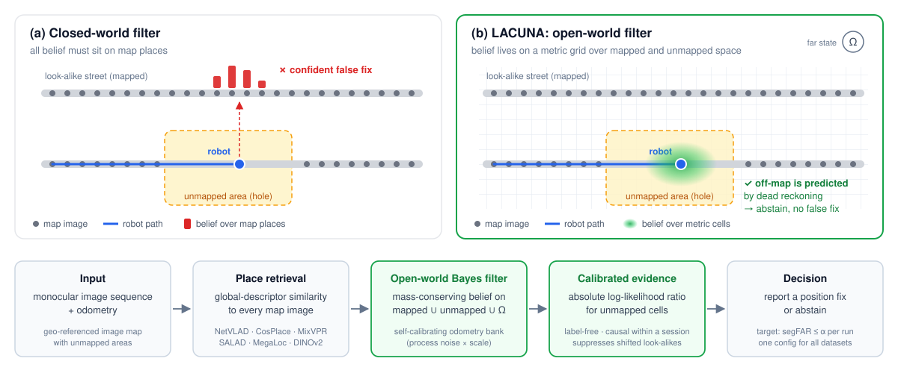

<div align="center">

# LACUNA

**L**ocalization **A**ware of **C**overage and **UN**mapped **A**reas

### Open-World Sequential Visual Localization on Maps with Holes

[](#citation)
[](#citation)



<sub>(a) A closed-world filter is forced onto a look-alike place and reports a false fix. (b) LACUNA tracks the robot into the unmapped
area and abstains.</sub>

</div>

> [!NOTE]
> 📄 **The paper and 💻 code will be released soon.**

## Abstract

Real image maps have holes: streets that were never surveyed, construction sites, seasonal changes. When a robot that localizes by
sequence matching drives into such an area, topological filters that keep all belief on mapped places commit to look-alike locations and
report confident false fixes. **LACUNA** is an open-world Bayes filter whose belief lives on a metric grid covering both mapped and
unmapped space, plus a far state. Leaving the map is therefore *predicted* by dead reckoning against the map's known coverage instead of
being *detected* by a separate test, and odometry scale and noise are self-calibrated online. We further identify
*odometry-unobservable aliasing*: a weak look-alike shifted along a straight road, which filters with per-frame normalized evidence fail
to reject. We counter it with absolute evidence for unmapped cells, calibrated without labels from the filter's own confident fixes. On
432 pre-registered runs over 8 environments and 6 global descriptors, LACUNA reaches **93% recall** and exceeds a 5% false-report budget
on only **0.7%** of runs. On 288 of these runs, its recall is **26–28 points** higher than that of three recent integrity-monitoring
methods, even when their thresholds are tuned on the test labels.

## Results

288 runs (8 environments × 6 descriptors × 6 fresh hole layouts with 30% of the map removed), the same runs for every method. A run is
valid when at most α = 5% of its off-map segments contain a false report.

| Method | Labels | Recall ↑ | Nav. error (m) ↓ | Runs violating α ↓ |
|:---|:---:|:---:|:---:|:---:|
| Xu *et al.* [[RA-L'21](https://arxiv.org/abs/2107.07707)] † | test run | 0.651 | 44.5 | 0 |
| Claxton *et al.* [[RA-L'24](https://arxiv.org/abs/2407.08162)] † | test run | 0.670 | 28.1 | 0 |
| TAO [[arXiv'26](https://arxiv.org/abs/2607.04745v1)] † | test run | 0.651 | 37.1 | 0 |
| Closed-world baseline | none | 0.802 | 15.0 | 0 |
| **LACUNA** | **none** | **0.927** | **13.3** | **0** |

<sub>† Re-implemented from the paper, with the threshold set on the labels of each test run (an upper bound for that method). At their
published operating points, these methods violate α on 57–89% of runs.</sub>

On settings never used for tuning (10% and 50% holes, natural off-map from 4Seasons cross-scene, NCLT), recall is 0.77–0.95, with
4 of 258 runs above α.

**Limitations.** Holes are simulated on most benchmarks. Where odometry is simulated (CMU, Oxford, St Lucia), it keeps the true heading;
with a heading drift of 0.13°/√m, recall drops by 4.8 points.

## Datasets and Descriptors

| Dataset | Reference | Links |
|:---|:---|:---|
| Oxford RobotCar | Maddern *et al.*, IJRR 2017 | [project](https://robotcar-dataset.robots.ox.ac.uk/) · [paper](https://doi.org/10.1177/0278364916679498) |
| Nordland | NRK, 2013 | [data](https://nrkbeta.no/2013/01/15/nordlandsbanen-minute-by-minute-season-by-season/) |
| Extended CMU Seasons | Sattler *et al.*, CVPR 2018 | [project](https://www.visuallocalization.net/datasets/) · [paper](https://arxiv.org/abs/1707.09092) |
| St Lucia | Glover *et al.*, ICRA 2010 | [paper](https://doi.org/10.1109/ROBOT.2010.5509547) |
| Boreas | Burnett *et al.*, IJRR 2023 | [project](https://www.boreas.utias.utoronto.ca/) · [paper](https://arxiv.org/abs/2203.10168) |
| 4Seasons (office loop, old town, countryside) | Wenzel *et al.*, GCPR 2020 | [project](https://www.4seasons-dataset.com/) · [paper](https://arxiv.org/abs/2009.06364) |
| NCLT | Carlevaris-Bianco *et al.*, IJRR 2016 | [project](http://robots.engin.umich.edu/nclt/) · [paper](https://doi.org/10.1177/0278364915614638) |

**Global descriptors:** [NetVLAD](https://arxiv.org/abs/1511.07247) · [CosPlace](https://arxiv.org/abs/2204.02287) ·
[MixVPR](https://arxiv.org/abs/2303.02190) · [SALAD](https://arxiv.org/abs/2311.15937) · [MegaLoc](https://arxiv.org/abs/2502.17237) ·
[DINOv2](https://arxiv.org/abs/2304.07193)

## Related Work

- **Sequence-based place recognition:** [SeqSLAM](https://doi.org/10.1109/ICRA.2012.6224623) (Milford & Wyeth, ICRA 2012) ·
  [HMM sequence matching](https://doi.org/10.1109/IROS.2014.6943207) (Hansen & Browning, IROS 2014) ·
  [Scalable place recognition with HMMs](https://arxiv.org/abs/1908.00178) (Doan *et al.*, ICCV 2019) ·
  [VPR survey](https://doi.org/10.1109/TRO.2015.2496823) (Lowry *et al.*, T-RO 2016)
- **Off-map detection and integrity monitoring:**
  [new-place-aware topometric localization](https://arxiv.org/abs/2107.07707) (Xu *et al.*, RA-L 2021) ·
  [VPR integrity monitor](https://arxiv.org/abs/2407.08162) (Claxton *et al.*, RA-L 2024) ·
  [Trajectory-Anchor Optimization](https://arxiv.org/abs/2607.04745v1) (Lu & Tanaka, arXiv 2026)
- **Long-term localization benchmark:** [Sattler *et al.*](https://arxiv.org/abs/1707.09092), CVPR 2018

## Citation

```bibtex
@misc{lacuna2026,
  title  = {{LACUNA}: Open-World Sequential Visual Localization on Maps with Holes},
  author = {TBA},
  year   = {2026},
  note   = {Paper and code coming soon}
}
```
