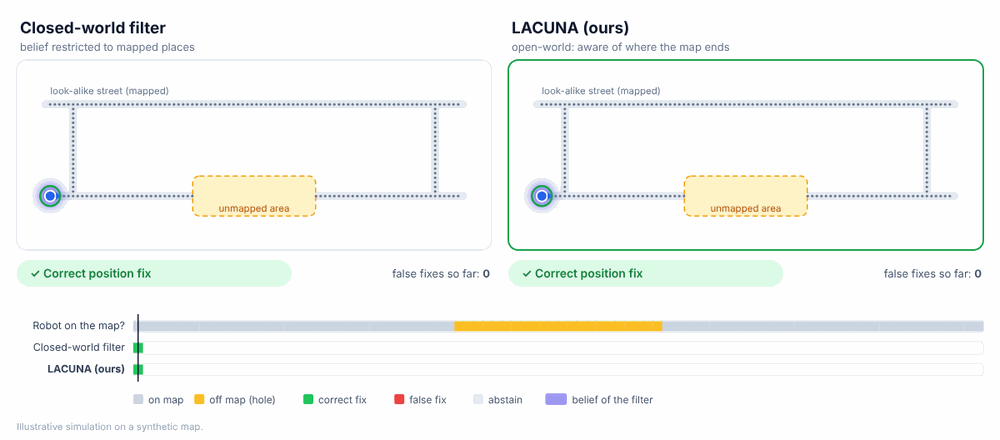
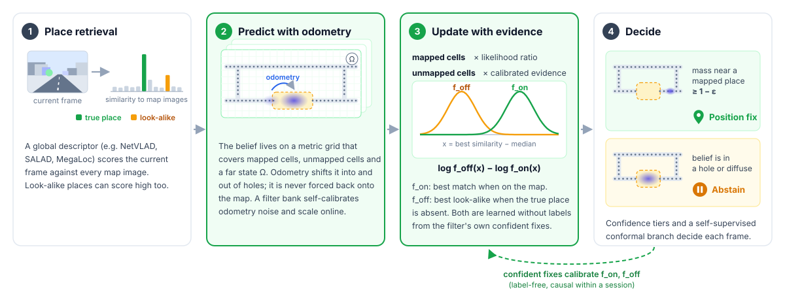
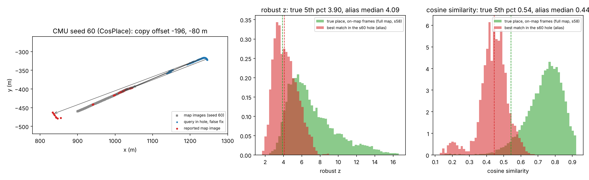
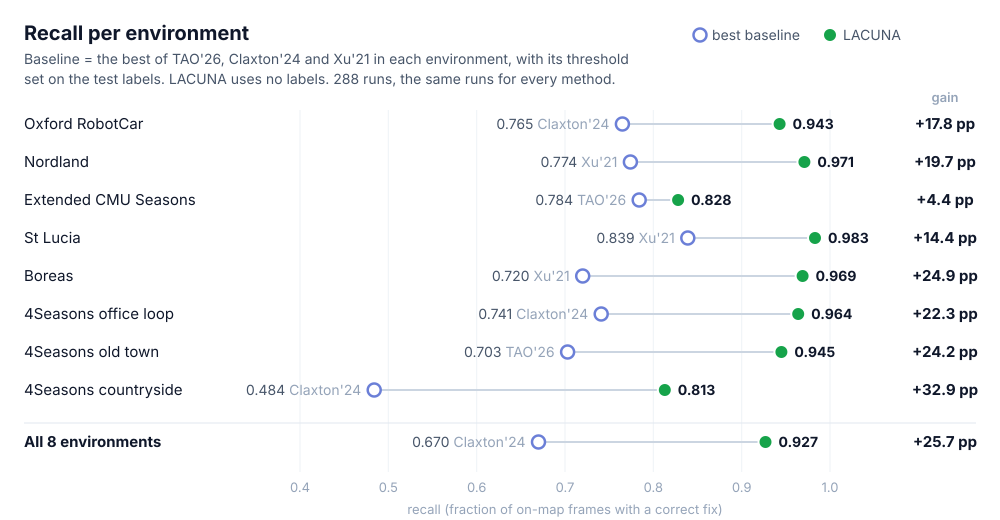

<div align="center">

# LACUNA

**L**ocalization **A**ware of **C**overage and **UN**mapped **A**reas

### Open-World Sequential Visual Localization on Maps with Holes

[](#citation)
[](#citation)

</div>

> [!NOTE]
> 📄 **The paper and 💻 code will be released soon.**

<p align="center"></p>
<p align="center"><sub>Illustrative simulation: the same filter with and without unmapped cells. In the hole, the closed-world filter locks
onto a look-alike street and reports false fixes. LACUNA follows the robot into the hole by dead reckoning, abstains, and resumes when the
robot is back on the map.</sub></p>

## 🧭 Problem

Robots often localize by matching camera frames against a geo-referenced image map, with a sequence filter (HMM) that fuses visual place
recognition and odometry. Real maps have **holes**: streets that were never surveyed, construction sites, seasonal changes. Closed-world
filters keep all of their belief on mapped places, so when the robot enters a hole they lock onto a look-alike place and send **confident
false fixes** to navigation.

**Goal:** report a correct fix whenever the robot is on the map, and abstain while it is off the map, without any labels at deployment.

## 🔁 Input and Output

<p align="center"></p>

For every frame, LACUNA takes the camera image, the odometry increment and the image map. It returns either a position fix or an explicit
abstention.

## 💡 Method

<p align="center"></p>

- **Holes are part of the state.** The belief lives on a metric grid over mapped cells, unmapped cells and a far state Ω. Odometry carries
  it into and out of holes, so leaving the map is *predicted* by dead reckoning instead of *detected* by a separate test.
- **Calibrated evidence for unmapped cells.** A weak look-alike that moves consistently with the odometry can accumulate per-frame evidence
  without bound. LACUNA scores unmapped cells with $`\log f_{\text{off}}(x) - \log f_{\text{on}}(x)`$, where both densities are learned
  without labels from the filter's own confident fixes.

<details>
<summary><b>A real case of this aliasing</b> (Extended CMU Seasons)</summary>
<br>
<p align="center"></p>

Inside a hole, a filter with per-frame normalized evidence matched the query frames (blue) to a copy of the route about 200 m away (red).
The look-alike's robust z-scores overlap those of true matches (middle), but its raw similarity does not (right). The calibrated evidence
is built on this signal.
</details>

## ✨ Advantages

- **Off-map by prediction:** leaving the map follows from the map's known coverage and the odometry, not from a hand-tuned detector.
- **Label-free:** one configuration for every dataset and descriptor, with no threshold tuning on ground truth.
- **Robust to look-alikes:** suppresses aliases shifted along the route, which filters with per-frame normalized evidence fail to reject.
- **Fast:** about 6 ms per frame for the full system on one NVIDIA L4 GPU.

## 📊 Results

Across **432 pre-registered runs** (8 environments × 6 descriptors × 9 fresh hole layouts with 30% of the map removed), LACUNA reaches
**93% recall** and exceeds the 5% false-positive target (per run, over off-map segments) on only **0.7%** of runs.

On 288 of these runs, the same runs for every method:

| Method | Labels | Recall ↑ | Nav. error (m) ↓ | Runs violating α ↓ |
|:---|:---:|:---:|:---:|:---:|
| Xu *et al.* [[RA-L'21](https://arxiv.org/abs/2107.07707)] † | test run | 0.651 | 44.5 | 0 |
| Claxton *et al.* [[RA-L'24](https://arxiv.org/abs/2407.08162)] † | test run | 0.670 | 28.1 | 0 |
| TAO [[arXiv'26](https://arxiv.org/abs/2607.04745v1)] † | test run | 0.651 | 37.1 | 0 |
| Closed-world baseline | none | 0.802 | 15.0 | 0 |
| **LACUNA** | **none** | **0.927** | **13.3** | **0** |

<sub>† Re-implemented from the paper, with the threshold set on the labels of each test run (an upper bound for that method). At their
published operating points, these methods violate α on 57–89% of runs.</sub>

<p align="center"></p>

On settings never used for tuning (10% and 50% holes, natural off-map from 4Seasons cross-scene, NCLT), recall is 0.77–0.95, with
4 of 258 runs above α.

**Limitations.** Holes are simulated on most benchmarks. Where odometry is simulated (CMU, Oxford, St Lucia), it keeps the true heading;
with a heading drift of 0.13°/√m, recall drops by 4.8 points.

## 📚 Datasets and Related Work

| Dataset | Reference | Links |
|:---|:---|:---|
| Oxford RobotCar | Maddern *et al.*, IJRR 2017 | [project](https://robotcar-dataset.robots.ox.ac.uk/) · [paper](https://doi.org/10.1177/0278364916679498) |
| Nordland | NRK, 2013 | [data](https://nrkbeta.no/2013/01/15/nordlandsbanen-minute-by-minute-season-by-season/) |
| Extended CMU Seasons | Sattler *et al.*, CVPR 2018 | [project](https://www.visuallocalization.net/datasets/) · [paper](https://arxiv.org/abs/1707.09092) |
| St Lucia | Glover *et al.*, ICRA 2010 | [paper](https://doi.org/10.1109/ROBOT.2010.5509547) |
| Boreas | Burnett *et al.*, IJRR 2023 | [project](https://www.boreas.utias.utoronto.ca/) · [paper](https://arxiv.org/abs/2203.10168) |
| 4Seasons | Wenzel *et al.*, GCPR 2020 | [project](https://www.4seasons-dataset.com/) · [paper](https://arxiv.org/abs/2009.06364) |
| NCLT | Carlevaris-Bianco *et al.*, IJRR 2016 | [project](http://robots.engin.umich.edu/nclt/) · [paper](https://doi.org/10.1177/0278364915614638) |

- **Global descriptors:** [NetVLAD](https://arxiv.org/abs/1511.07247) · [CosPlace](https://arxiv.org/abs/2204.02287) ·
  [MixVPR](https://arxiv.org/abs/2303.02190) · [SALAD](https://arxiv.org/abs/2311.15937) · [MegaLoc](https://arxiv.org/abs/2502.17237) ·
  [DINOv2](https://arxiv.org/abs/2304.07193)
- **Sequence-based place recognition:** [SeqSLAM](https://doi.org/10.1109/ICRA.2012.6224623) (ICRA 2012) ·
  [HMM sequence matching](https://doi.org/10.1109/IROS.2014.6943207) (IROS 2014) ·
  [Doan *et al.*](https://arxiv.org/abs/1908.00178) (ICCV 2019) · [VPR survey](https://doi.org/10.1109/TRO.2015.2496823) (T-RO 2016)
- **Off-map detection and integrity monitoring:** [Xu *et al.*](https://arxiv.org/abs/2107.07707) (RA-L 2021) ·
  [Claxton *et al.*](https://arxiv.org/abs/2407.08162) (RA-L 2024) · [Lu & Tanaka](https://arxiv.org/abs/2607.04745v1) (arXiv 2026)

## Citation

```bibtex
@misc{lacuna2026,
  title  = {{LACUNA}: Open-World Sequential Visual Localization on Maps with Holes},
  author = {TBA},
  year   = {2026},
  note   = {Paper and code coming soon}
}
```
