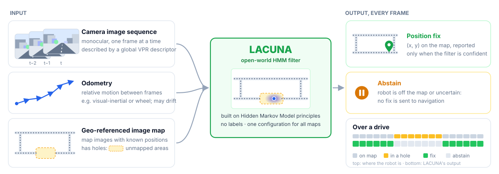
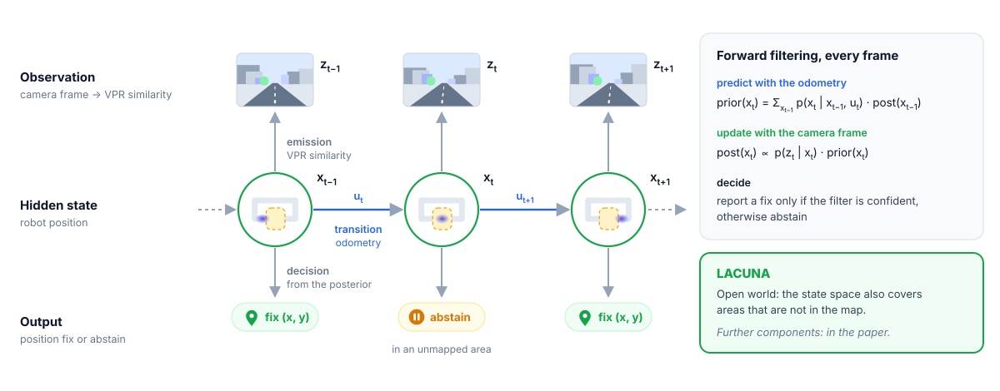

<div align="center">

# LACUNA

**L**ocalization **A**ware of **C**overage and **UN**mapped **A**reas

### Open-World Sequential Visual Localization on Maps with Holes

[**Nhat Long Nguyen**](https://github.com/nhatlong113)

[](#citation)
[](#citation)

</div>

> [!NOTE]
> 📄 **The paper and 💻 code will be released soon.**

<p align="center"></p>
<p align="center"><sub>Illustrative simulation on a synthetic map. When the robot enters an unmapped area, a closed-world filter locks onto a
look-alike street and reports false fixes. LACUNA abstains while the robot is off the map and resumes shortly after it returns to the map.</sub></p>

## 🧭 Problem

A common approach to visual localization for mobile robots matches camera images against a geo-referenced image map and uses a Hidden
Markov Model (HMM) to accumulate visual place recognition (VPR) evidence over time, often together with odometry. Real maps are incomplete:
some streets were never mapped, and construction or seasonal occlusion leaves further gaps. Closed-world HMMs, whose states cover only
mapped places, cannot represent a robot that has left the map. When the robot enters an unmapped area, they assign the belief to the
remaining mapped places, often a visually similar one, and can report confident false position fixes.

**Goal:** report correct position fixes whenever the robot is on the map and abstain while it is off the map, without labels at
deployment.

## 🔁 Input and Output

<p align="center"></p>

For every frame, LACUNA takes the camera image, the odometry increment and the image map. It returns either a position fix or an
abstention.

## 💡 Method: an Open-World HMM

<p align="center"></p>

LACUNA is built on HMM principles:

- **Hidden state:** the robot's position. Unlike in closed-world HMMs, the state space also covers areas that are not in the map.
- **Transition model:** the odometry predicts how the position changes between consecutive frames.
- **Emission model:** the VPR similarities between the current frame and the map images score how well each state explains the
  observation.
- **Forward filtering:** the posterior over states is updated recursively at every frame, so evidence accumulates over the image sequence
  instead of resting on a single retrieval. A position fix is reported only when the filter is confident; otherwise LACUNA abstains.

The components that make this filter reliable without labels will be described in the paper.

## ✨ Advantages

- **Aware of where the map ends:** reliably abstains in unmapped areas, without a separate off-map detector tuned on labels.
- **Label-free:** needs no labels at deployment and uses one configuration for all datasets and descriptors.
- **Robust to look-alike places:** suppresses false fixes caused by visually similar places.
- **Fast:** about 6 ms per frame on a single NVIDIA L4 GPU.

## 📊 Results

We evaluate on 8 environments from 6 public datasets with 6 global descriptors. In each run, 30% of the map is removed in contiguous blocks
with a randomly sampled hole layout, and all decisions were pre-registered before each test. Across **432 runs** on 9 hole layouts never
used during development, LACUNA reaches **93% recall** and exceeds the false-positive target α on only **0.7%** of runs.

On 288 of these runs, with the same runs for every method:

| Method | Labels | Recall ↑ | Nav. error (m) ↓ | Runs violating α ↓ |
|:---|:---:|:---:|:---:|:---:|
| Xu *et al.* [[RA-L'21](https://arxiv.org/abs/2107.07707)] † | test run | 0.651 | 44.5 | 0 |
| Claxton *et al.* [[RA-L'24](https://arxiv.org/abs/2407.08162)] † | test run | 0.670 | 28.1 | 0 |
| TAO [[arXiv'26](https://arxiv.org/abs/2607.04745v1)] † | test run | 0.651 | 37.1 | 0 |
| Closed-world baseline | none | 0.802 | 15.0 | 0 |
| **LACUNA** | **none** | **0.927** | **13.3** | **0** |

<sub>**Recall:** fraction of on-map frames with a correct fix. **α:** at most 5% of a run's 10-frame off-map segments may contain a
reported fix. **Nav. error:** mean error of a Kalman filter fed with the reported fixes. † Re-implemented from the paper, with the threshold
set on the labels of each test run (an upper bound for any threshold on that method's score). At their published operating points, these methods violate α on
57–89% of runs.</sub>

<p align="center"></p>

On settings never used for tuning (10% and 50% holes, natural off-map areas from 4Seasons cross-scene pairs, NCLT), recall ranges from
0.77 to 0.94, with 4 of 258 runs above α.

**Limitations.** Holes are simulated on most benchmarks. Where odometry is simulated (CMU, Oxford, St Lucia), it keeps the true heading;
with a heading drift of 0.13°/√m, recall on these datasets drops by 4.8 points on the development set.

## 📚 Datasets and Related Work

| Dataset | Reference | Links |
|:---|:---|:---|
| Oxford RobotCar | Maddern *et al.*, IJRR 2017 | [project](https://robotcar-dataset.robots.ox.ac.uk/) · [paper](https://doi.org/10.1177/0278364916679498) |
| Nordland | NRK, 2013 | [data](https://nrkbeta.no/2013/01/15/nordlandsbanen-minute-by-minute-season-by-season/) |
| Extended CMU Seasons | Sattler *et al.*, CVPR 2018 | [project](https://www.visuallocalization.net/datasets/) · [paper](https://arxiv.org/abs/1707.09092) |
| St Lucia | Glover *et al.*, ICRA 2010 | [paper](https://doi.org/10.1109/ROBOT.2010.5509547) |
| Boreas | Burnett *et al.*, IJRR 2023 | [project](https://www.boreas.utias.utoronto.ca/) · [paper](https://arxiv.org/abs/2203.10168) |
| 4Seasons | Wenzel *et al.*, GCPR 2020 | [project](https://www.4seasons-dataset.com/) · [paper](https://arxiv.org/abs/2009.06364) |
| NCLT | Carlevaris-Bianco *et al.*, IJRR 2016 | [project](http://robots.engin.umich.edu/nclt/) · [paper](https://doi.org/10.1177/0278364915614638) |

- **Global descriptors:** [NetVLAD](https://arxiv.org/abs/1511.07247) · [CosPlace](https://arxiv.org/abs/2204.02287) ·
  [MixVPR](https://arxiv.org/abs/2303.02190) · [SALAD](https://arxiv.org/abs/2311.15937) · [MegaLoc](https://arxiv.org/abs/2502.17237) ·
  [DINOv2](https://arxiv.org/abs/2304.07193)
- **Sequence-based place recognition:** [SeqSLAM](https://doi.org/10.1109/ICRA.2012.6224623) (ICRA 2012) ·
  [HMM sequence matching](https://doi.org/10.1109/IROS.2014.6943207) (IROS 2014) ·
  [Doan *et al.*](https://arxiv.org/abs/1908.00178) (ICCV 2019) · [VPR survey](https://doi.org/10.1109/TRO.2015.2496823) (T-RO 2016)
- **Off-map detection and integrity monitoring:** [Xu *et al.*](https://arxiv.org/abs/2107.07707) (RA-L 2021) ·
  [Claxton *et al.*](https://arxiv.org/abs/2407.08162) (RA-L 2024) · [Lu & Tanaka](https://arxiv.org/abs/2607.04745v1) (arXiv 2026)

## Citation

```bibtex
@misc{nguyen2026lacuna,
  title  = {{LACUNA}: Open-World Sequential Visual Localization on Maps with Holes},
  author = {Nguyen, Nhat Long},
  year   = {2026},
  note   = {Paper and code coming soon}
}
```
