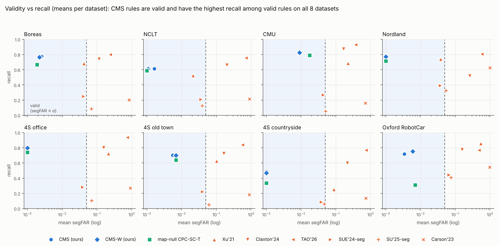

# Báo cáo vòng 9: độ nhạy, thời gian chạy, off-map tự nhiên sát bản đồ, đối thủ mới, hiệu chuẩn lối thoát (CST) và Oxford RobotCar

*Branch `hmm-navigation-5`, 2026-11-01. Nhật ký `RESEARCH_LOG.md` Entry 32–34 (đăng ký trước, push trước đánh giá). Tài liệu:
`literature/RELATED_WORK_E32.md`, `LITERATURE_GATE.md` Gate 15. Vòng trước: `paper/BAO_CAO_E30.pdf`.*

**Tóm tắt.**

- **Độ nhạy (366 run × 14 biến thể).** 12/14 hằng số chọn tay đổi recall ≤ 0.03 và giữ segFAR ≤ α trên 7/7 dataset, recall
  vẫn > CPC-SC-T½+SH trên 7/7. Ngoại lệ duy nhất: **dung sai hình dạng SH** (× 2 làm vỡ α ở CMU 0.071 và 4S countryside 0.100;
  × 0.5 mất recall). Dựng null phản thực (N, ρ; 42 run mỗi biến thể): hợp lệ 7/7 với mọi biến thể; cửa sổ niềm tin N = 40 tăng
  recall 0.015–0.027.
- **Thời gian chạy:** ~20 ms/frame (top-300 GPU 0.01–0.05 ms, thống kê phản thực 10–17.5 ms, lớp quyết định 1.7–2.8 ms) ⇒ thời gian
  thực 10 Hz trên một nhân CPU. Ngưỡng đăng ký trước (< 10 ms và < 1 ms) **không đạt**; báo cáo trung thực.
- **Off-map tự nhiên sát bản đồ (NCLT, mỗi phiên làm bản đồ, 9 bản đồ, 48 run):** luật đề xuất hợp lệ trên mọi bản đồ (segFAR gộp
  0.007, 0 % run > α) và recall cao hơn CPC-SC-T½+SH trên 9/9 bản đồ; các biến thể nhân quả cũng 9/9.
- **Đối thủ mới đọc toàn văn (E33, 366 run):** SU'25, SUE'24 (cả bản hiệu chuẩn theo đoạn có nhãn, có lợi nhất cho họ) và
  Carson'23 hoặc vi phạm α (segFAR 0.19–0.99) hoặc hợp lệ nhưng recall 0.09–0.39 so với 0.49–0.82 của ta: H33a đạt 7/7.
  Dung sai SH hiệu chuẩn theo phân vị frame (SHcf) hợp lệ 7/7 nhưng recall chỉ sát SH trên 4/7: H33b không đạt.
- **Cơ chế mới (E34) — phẫu thuật cũng hiệu chuẩn lối THOÁT:** chẩn đoán cho thấy lỗi còn lại của phương pháp không nằm ở khởi phát
  (đã có Định lý 6) mà ở **duy trì** chuỗi báo khi robot rời bản đồ. Phép thử hình dạng phản thực theo đoạn (CST, Mệnh đề 14,
  Hệ quả 15) cho bảo đảm đầu-cuối theo đoạn mà không còn hằng số dung sai. Kết quả 366 run: CST hợp lệ 7/7, recall trong ±0.02 so với SH chọn tay trên 7/7 (cao hơn trên 6/7, +0.003 đến +0.022), bản nhân quả hợp lệ 7/7; nhân đôi mức a_sh **vẫn hợp lệ 7/7** trong khi nhân đôi dung sai SH làm vỡ α ở 2/7. Cái giá: 6 % run vượt α (SH: 0.5 %) — CST dùng đúng ngân sách α thay vì bảo thủ thừa.
- **Dataset uy tín mới: Oxford RobotCar** (PointNetVLAD split, 43 lượt chạy, 34 039 frame, 6 descriptor, 30 % lỗ bản đồ). Baseline null-bản-đồ (CPC-SC) **suy biến ở 36/60 run** (bản đồ ~670 frame sau khi khoét lỗ không đủ đoạn null để có phân vị α hữu hạn — đúng Hệ quả 9); CMS hiệu chuẩn được ở **mọi** run (null từ luồng truy vấn): recall 0.719 / segFAR 0.003 / 0 % run vượt α (CPCW: 0.753 / 0.006). Trên 24 run null bản đồ còn chạy được, CMS-CPCW ngang recall (+0.008) với sai số thấp hơn ở 19/24; mọi baseline có nhãn vượt α (Xu'21 100 % run, TAO'26 93 %, Claxton'24 72 %).

## 1. Câu hỏi của vòng này

| # | Câu hỏi reviewer sẽ hỏi | Thí nghiệm |
|---|---|---|
| 1 | Kết quả có phụ thuộc các hằng số chọn tay (H, W, trọng số trộn, chuyển trạng thái, bán kính +G, dung sai SH, β, R, N, ρ)? | Đổi từng hằng số quanh mặc định trên 366 run (lớp quyết định) và 42 run (dựng null phản thực) |
| 2 | Chạy thời gian thực được không? | Đo thời gian từng bước trên phiên Kaggle L4 (top-300 GPU, thống kê phản thực và lớp quyết định CPU) |
| 3 | Off-map tự nhiên **sát** bản đồ (đi lệch sang lối bên cạnh) — benchmark tự nhiên của vòng 8 là off-map "xa" (thành phố khác) | NCLT, mỗi phiên làm bản đồ một lần (9 bản đồ × 6 descriptor): 6–13 % frame truy vấn tự nhiên ngoài bản đồ > 20 m |
| 4 | Công trình nào đã làm việc này? | Tìm có hệ thống 20 truy vấn, 6 nhánh |

**Dữ liệu đã kiểm và loại cho câu 3:** MSLS val (Copenhagen, San Francisco): 98.8–99.7 % query có database trong 25 m — gần như
không có off-map tự nhiên; 4Seasons trong cùng cảnh: 0 frame off-map tự nhiên (các bản ghi đi cùng tuyến).

## 2. Định vị novelty (việc 3)

Chi tiết và nguồn: `literature/RELATED_WORK_E32.md`. Tóm tắt:

| Nhánh | Gần nhất | Khác với ta ở đâu |
|---|---|---|
| Integrity VPR | Carson–Ford–Milford RA-L'22 / ICRA'23; Claxton'24; SMR (IROS'25); **SafeVPR'26** | Có nhãn (hoặc không có bảo đảm); SafeVPR có bảo đảm conformal nhưng cần tập hiệu chuẩn có nhãn và tự nêu là vỡ khi lệch điều kiện |
| Off-map / nơi mới | **Xu'21** (trạng thái off-map trong bộ lọc topometric); Multi-Process Fusion; open-set recognition | Trạng thái off-map chỉnh tay / theo nhãn, không bảo đảm; open-set: tác giả nêu hiệu chuẩn "chưa được nghiên cứu" |
| Ngưỡng không nhãn | **Lee & Pollefeys ICRA'14** (hỗn hợp số inlier); self-supervised domain calibration (pose graph) | Không có null, không bảo đảm; suy biến khi ít vòng lặp — đúng trường hợp null phản thực xử lý |
| Phát hiện thay đổi tuần tự | **E-detectors** (Shin–Ramdas–Rinaldo); Vovk conformal change detection; **e-value monitor cho particle filter (arXiv 2604.26479)** | Cần lớp trước/sau định trước hoặc null hoán đổi của chính dữ liệu; monitor 2604.26479 kiểm độ tự tin của bộ lọc, không kiểm "đang trên bản đồ" |
| Conformal dưới phụ thuộc | Zheng–Proutière ICML'24 (Markov, K-split); block / guard-band; β-mixing | Cần giả định mixing; ta dùng max theo đoạn (mọi phụ thuộc trong đoạn) + null sinh ra |
| Integrity / protection level | Gupta–Gao NAVI'21; Li–Waslander'19; Duenas Arana'19 (χ² tuần tự) | Mô hình lỗi; cổng +NGR của ta là bản rời rạc — **không** tuyên bố mới |

**Kết luận Gate 15.** Ba đóng góp không tìm thấy trong các truy vấn đã làm: (1) null của bằng chứng "đang trên bản đồ" sinh từ
luồng triển khai bằng phẫu thuật bản đồ quanh niềm tin của hệ thống; (2) cận khởi phát sai theo đoạn không nhãn, mọi phụ thuộc
trong đoạn, với tự-nhiễm định lượng α(n+1)/(πn+1) và bản nhân quả; (3) trạng thái off-map của HMM được hiệu chuẩn bởi null đó
(Mệnh đề 13). Mọi thành phần còn lại (HMM có off-map, conformal accept/reject, e-detector, cổng innovation) là đã biết và sẽ được
trích dẫn. Trước khi nộp còn phải đọc toàn văn SafeVPR, E-detectors, Vovk 2020, Lee–Pollefeys 2014, arXiv 2604.26479 và quét
proceedings RA-L / RSS / ICRA / IROS 2024–2026.

## 3. Tối ưu tính toán

- **Một bộ theo dõi duy nhất.** ~80 tiến trình theo dõi song song (mỗi kernel một tiến trình) làm Kaggle chặn API **theo IP**
  (mọi acc, kể cả acc mới). Thay bằng `automation/central_monitor.py`: một hàng đợi API (≥ 60–90 s giữa hai lệnh, nghỉ 30 phút khi
  bị chặn, gom lệnh theo acc, `--pull-first` cho kernel chắc chắn đã xong), có xếp lịch: kernel mới vào acc đầu tiên còn slot đúng
  loại (2 GPU / 5 CPU), tối đa 8 acc, bớt 1 acc mỗi lần bị chặn; reset hàng đợi 8/10 phút × 5, L4 kẹt ⇒ kiểm lỗi code (NEEDS_FIX)
  hoặc tự chuyển 2 × T4. Ba kernel GPU "mất tích" (lần đẩy lại bị từ chối vì acc cũ đã đủ 2 phiên GPU) được phát hiện và chạy lại.
- **Đánh giá lớp quyết định chạy local.** Mọi cache (navcache, top-K, thống kê phản thực, route) của 366 run có sẵn ở máy, nên các
  thí nghiệm chỉ đổi lớp quyết định (E34: 366 run) chạy trên 4 nhân CPU local, ~45–110 s/run, **không tốn API hay phiên Kaggle**.
- **Oxford chạy local** từ dump (2.1 GB) kéo về từ kernel tạo dump: tránh việc đăng / tải lại qua API.
- **Bài học:** tải đầu ra kernel có hàng nghìn file (ảnh) tốn một request mỗi file và gây chặn API — đầu ra lớn phải đóng gói tar.

## 4. Bảng kết quả

*Hình 1. Mặt phẳng hợp lệ–recall (trung bình theo dataset). Vùng xanh: segFAR ≤ α. CMS (xanh dương) hợp lệ và có recall cao nhất trong các luật hợp lệ trên cả 8 dataset; baseline có nhãn (cam) vượt α hoặc mất 40–70 % recall; null bản đồ (xanh lá) suy biến trên Oxford.*

### Độ nhạy — lớp quyết định: CMS-CPC/H+SH+G+NGRr (recall / segFAR TB / sai số m), α = 0.05

| Biến thể | Boreas | NCLT | CMU | Nordland | 4S office | 4S old town | 4S countryside | recall > CPC-SC-T½+SH | segFAR ≤ α |
|---|---|---|---|---|---|---|---|---|---|
| **mặc định** (366 run) | 0.775 / 0.003 / 4.5 | 0.612 / 0.002 / 4.3 | 0.822 / 0.009 / 4.0 | 0.765 / 0.000 / 5.6 | 0.800 / 0.000 / 9.7 | 0.703 / 0.006 / 26.1 | 0.491 / 0.001 / 34.3 | 7/7 | 7/7 |
| W = 5 | 0.775 / 0.003 / 4.5 | 0.612 / 0.002 / 4.3 | 0.822 / 0.009 / 4.0 | 0.765 / 0.000 / 5.6 | 0.800 / 0.000 / 9.7 | 0.703 / 0.006 / 26.1 | 0.491 / 0.001 / 34.3 | 7/7 | 7/7 |
| W = 20 | 0.775 / 0.003 / 4.5 | 0.612 / 0.002 / 4.3 | 0.822 / 0.009 / 4.0 | 0.765 / 0.000 / 5.6 | 0.800 / 0.000 / 9.7 | 0.703 / 0.006 / 26.1 | 0.491 / 0.001 / 34.3 | 7/7 | 7/7 |
| w_route = 0.25 | 0.775 / 0.003 / 4.8 | 0.611 / 0.002 / 4.2 | 0.816 / 0.009 / 4.0 | 0.764 / 0.000 / 5.9 | 0.797 / 0.000 / 9.7 | 0.704 / 0.006 / 26.5 | 0.458 / 0.001 / 35.4 | 7/7 | 7/7 |
| w_route = 1 | 0.768 / 0.002 / 4.5 | 0.608 / 0.002 / 4.4 | 0.823 / 0.009 / 3.9 | 0.758 / 0.000 / 5.6 | 0.799 / 0.000 / 9.7 | 0.698 / 0.005 / 26.2 | 0.495 / 0.001 / 35.0 | 7/7 | 7/7 |
| p = 0.005 | 0.780 / 0.003 / 4.5 | 0.614 / 0.002 / 4.3 | 0.824 / 0.010 / 4.0 | 0.770 / 0.000 / 5.6 | 0.803 / 0.000 / 9.7 | 0.708 / 0.006 / 26.0 | 0.503 / 0.001 / 33.9 | 7/7 | 7/7 |
| p = 0.02 | 0.770 / 0.002 / 4.5 | 0.608 / 0.001 / 4.3 | 0.820 / 0.009 / 3.9 | 0.758 / 0.000 / 5.7 | 0.796 / 0.000 / 9.7 | 0.698 / 0.005 / 26.2 | 0.477 / 0.001 / 35.3 | 7/7 | 7/7 |
| bán kính +G = 0.5 excl | 0.773 / 0.002 / 3.7 | 0.590 / 0.001 / 4.2 | 0.816 / 0.007 / 3.6 | 0.748 / 0.000 / 5.8 | 0.789 / 0.000 / 9.8 | 0.689 / 0.003 / 26.4 | 0.475 / 0.000 / 36.2 | 7/7 | 7/7 |
| bán kính +G = 2 excl | 0.777 / 0.003 / 4.8 | 0.620 / 0.002 / 4.4 | 0.826 / 0.010 / 4.1 | 0.770 / 0.000 / 5.6 | 0.802 / 0.000 / 9.6 | 0.705 / 0.007 / 25.9 | 0.501 / 0.001 / 33.1 | 7/7 | 7/7 |
| dung sai SH × 0.5 | 0.763 / 0.001 / 3.8 | 0.511 / 0.000 / 3.2 | 0.789 / 0.003 / 3.7 | 0.728 / 0.000 / 5.7 | 0.751 / 0.000 / 10.2 | 0.627 / 0.001 / 28.6 | 0.431 / 0.000 / 41.8 | 5/7 | 7/7 |
| dung sai SH × 2 | 0.790 / 0.036 / 15.2 | 0.642 / 0.008 / 5.1 | 0.840 / 0.071 / 5.3 | 0.784 / 0.006 / 5.8 | 0.826 / 0.049 / 12.5 | 0.736 / 0.030 / 40.9 | 0.544 / 0.100 / 33.3 | 7/7 | 5/7 |
| β cổng = 0.01 | 0.775 / 0.003 / 4.6 | 0.612 / 0.002 / 4.3 | 0.822 / 0.009 / 4.0 | 0.764 / 0.000 / 5.9 | 0.799 / 0.000 / 9.7 | 0.701 / 0.005 / 26.4 | 0.490 / 0.001 / 34.4 | 7/7 | 7/7 |
| β cổng = 0.10 | 0.776 / 0.003 / 4.5 | 0.612 / 0.002 / 4.3 | 0.822 / 0.009 / 4.0 | 0.766 / 0.000 / 5.5 | 0.801 / 0.000 / 9.7 | 0.705 / 0.006 / 25.9 | 0.493 / 0.001 / 34.1 | 7/7 | 7/7 |
| R mở khoá = 5 | 0.775 / 0.004 / 5.4 | 0.612 / 0.004 / 4.5 | 0.822 / 0.012 / 4.7 | 0.766 / 0.000 / 5.4 | 0.801 / 0.000 / 9.7 | 0.709 / 0.007 / 25.7 | 0.498 / 0.001 / 32.4 | 7/7 | 7/7 |
| R mở khoá = 20 | 0.776 / 0.001 / 3.6 | 0.614 / 0.001 / 3.3 | 0.823 / 0.008 / 3.6 | 0.764 / 0.000 / 6.0 | 0.799 / 0.000 / 9.7 | 0.687 / 0.005 / 27.6 | 0.478 / 0.000 / 37.1 | 7/7 | 7/7 |

### Độ nhạy — lớp quyết định: CMS-CPCW/H+SH+NGRr (recall / segFAR TB / sai số m), α = 0.05

| Biến thể | Boreas | NCLT | CMU | Nordland | 4S office | 4S old town | 4S countryside | recall > CPC-SC-T½+SH | segFAR ≤ α |
|---|---|---|---|---|---|---|---|---|---|
| **mặc định** (366 run) | 0.766 / 0.002 / 5.5 | 0.610 / 0.001 / 4.8 | 0.826 / 0.009 / 4.1 | 0.772 / 0.000 / 5.8 | 0.798 / 0.000 / 9.7 | 0.700 / 0.007 / 26.3 | 0.468 / 0.000 / 37.3 | 7/7 | 7/7 |
| W = 5 | 0.766 / 0.002 / 5.5 | 0.607 / 0.001 / 4.8 | 0.826 / 0.009 / 4.2 | 0.769 / 0.000 / 5.6 | 0.796 / 0.000 / 9.8 | 0.699 / 0.007 / 26.4 | 0.467 / 0.000 / 37.6 | 7/7 | 7/7 |
| W = 20 | 0.766 / 0.002 / 5.3 | 0.612 / 0.001 / 4.9 | 0.827 / 0.009 / 4.1 | 0.776 / 0.000 / 5.9 | 0.798 / 0.000 / 9.7 | 0.701 / 0.007 / 26.3 | 0.471 / 0.000 / 36.9 | 7/7 | 7/7 |
| w_route = 0.25 | 0.759 / 0.003 / 5.5 | 0.602 / 0.000 / 3.7 | 0.815 / 0.009 / 4.1 | 0.768 / 0.000 / 5.7 | 0.794 / 0.000 / 9.7 | 0.700 / 0.007 / 26.6 | 0.429 / 0.000 / 39.2 | 7/7 | 7/7 |
| w_route = 1 | 0.763 / 0.002 / 5.3 | 0.608 / 0.001 / 4.2 | 0.829 / 0.009 / 4.2 | 0.759 / 0.000 / 5.9 | 0.796 / 0.000 / 9.7 | 0.695 / 0.006 / 26.5 | 0.477 / 0.000 / 37.8 | 7/7 | 7/7 |
| p = 0.005 | 0.770 / 0.002 / 5.7 | 0.612 / 0.001 / 4.9 | 0.828 / 0.009 / 4.1 | 0.778 / 0.000 / 5.8 | 0.800 / 0.000 / 9.7 | 0.704 / 0.007 / 26.2 | 0.478 / 0.000 / 37.0 | 7/7 | 7/7 |
| p = 0.02 | 0.760 / 0.002 / 5.4 | 0.606 / 0.001 / 4.8 | 0.825 / 0.009 / 4.1 | 0.763 / 0.000 / 5.9 | 0.794 / 0.000 / 9.7 | 0.696 / 0.006 / 26.4 | 0.457 / 0.000 / 37.7 | 7/7 | 7/7 |
| bán kính +G = 0.5 excl | 0.766 / 0.002 / 5.5 | 0.610 / 0.001 / 4.8 | 0.826 / 0.009 / 4.1 | 0.772 / 0.000 / 5.8 | 0.798 / 0.000 / 9.7 | 0.700 / 0.007 / 26.3 | 0.468 / 0.000 / 37.3 | 7/7 | 7/7 |
| bán kính +G = 2 excl | 0.766 / 0.002 / 5.5 | 0.610 / 0.001 / 4.8 | 0.826 / 0.009 / 4.1 | 0.772 / 0.000 / 5.8 | 0.798 / 0.000 / 9.7 | 0.700 / 0.007 / 26.3 | 0.468 / 0.000 / 37.3 | 7/7 | 7/7 |
| dung sai SH × 0.5 | 0.751 / 0.001 / 4.1 | 0.500 / 0.000 / 3.3 | 0.791 / 0.003 / 3.8 | 0.717 / 0.000 / 6.2 | 0.745 / 0.000 / 10.3 | 0.621 / 0.001 / 28.7 | 0.404 / 0.000 / 45.5 | 5/7 | 7/7 |
| dung sai SH × 2 | 0.781 / 0.043 / 18.7 | 0.640 / 0.027 / 9.3 | 0.845 / 0.078 / 5.6 | 0.799 / 0.022 / 6.4 | 0.826 / 0.075 / 13.5 | 0.732 / 0.041 / 53.1 | 0.524 / 0.120 / 45.2 | 7/7 | 4/7 |
| β cổng = 0.01 | 0.766 / 0.002 / 5.5 | 0.610 / 0.001 / 4.8 | 0.826 / 0.009 / 4.1 | 0.771 / 0.000 / 5.9 | 0.797 / 0.000 / 9.7 | 0.698 / 0.007 / 26.9 | 0.468 / 0.000 / 37.3 | 7/7 | 7/7 |
| β cổng = 0.10 | 0.766 / 0.002 / 5.5 | 0.610 / 0.001 / 4.9 | 0.826 / 0.009 / 4.1 | 0.773 / 0.000 / 5.7 | 0.798 / 0.000 / 9.7 | 0.702 / 0.007 / 26.2 | 0.470 / 0.000 / 37.2 | 7/7 | 7/7 |
| R mở khoá = 5 | 0.766 / 0.003 / 6.5 | 0.610 / 0.003 / 4.5 | 0.826 / 0.010 / 4.8 | 0.772 / 0.001 / 5.8 | 0.798 / 0.001 / 9.7 | 0.706 / 0.007 / 26.1 | 0.474 / 0.001 / 36.0 | 7/7 | 7/7 |
| R mở khoá = 20 | 0.766 / 0.001 / 4.6 | 0.610 / 0.001 / 3.7 | 0.827 / 0.008 / 3.7 | 0.770 / 0.000 / 6.1 | 0.797 / 0.000 / 9.7 | 0.685 / 0.006 / 27.6 | 0.457 / 0.000 / 39.9 | 7/7 | 7/7 |

### Độ nhạy — lớp quyết định: CMS-CPC/H+SH+G(a=0.01)+NGRr (recall / segFAR TB / sai số m), α = 0.01

| Biến thể | Boreas | NCLT | CMU | Nordland | 4S office | 4S old town | 4S countryside | recall > CPC-SC-T½+SH | segFAR ≤ α |
|---|---|---|---|---|---|---|---|---|---|
| **mặc định** (366 run) | 0.748 / 0.001 / 3.9 | 0.581 / 0.001 / 3.9 | 0.786 / 0.007 / 3.6 | 0.694 / 0.000 / 7.3 | 0.726 / 0.000 / 10.8 | 0.685 / 0.004 / 27.1 | 0.384 / 0.000 / 46.2 | 3/7 | 7/7 |
| W = 5 | 0.748 / 0.001 / 3.9 | 0.581 / 0.001 / 3.9 | 0.786 / 0.007 / 3.6 | 0.694 / 0.000 / 7.3 | 0.726 / 0.000 / 10.8 | 0.685 / 0.004 / 27.1 | 0.384 / 0.000 / 46.2 | 3/7 | 7/7 |
| W = 20 | 0.748 / 0.001 / 3.9 | 0.581 / 0.001 / 3.9 | 0.786 / 0.007 / 3.6 | 0.694 / 0.000 / 7.3 | 0.726 / 0.000 / 10.8 | 0.685 / 0.004 / 27.1 | 0.384 / 0.000 / 46.2 | 3/7 | 7/7 |
| w_route = 0.25 | 0.723 / 0.001 / 4.2 | 0.547 / 0.001 / 4.6 | 0.757 / 0.007 / 3.5 | 0.675 / 0.000 / 7.3 | 0.692 / 0.000 / 11.6 | 0.674 / 0.005 / 28.3 | 0.319 / 0.000 / 53.2 | 2/7 | 7/7 |
| w_route = 1 | 0.742 / 0.001 / 3.7 | 0.577 / 0.001 / 5.7 | 0.786 / 0.007 / 3.5 | 0.634 / 0.000 / 8.6 | 0.789 / 0.000 / 9.9 | 0.678 / 0.004 / 27.7 | 0.386 / 0.000 / 49.1 | 4/7 | 7/7 |
| p = 0.005 | 0.756 / 0.001 / 3.9 | 0.587 / 0.001 / 3.9 | 0.790 / 0.008 / 3.6 | 0.711 / 0.000 / 7.0 | 0.737 / 0.000 / 10.5 | 0.691 / 0.005 / 26.8 | 0.409 / 0.000 / 44.1 | 4/7 | 7/7 |
| p = 0.02 | 0.741 / 0.001 / 3.9 | 0.570 / 0.000 / 4.1 | 0.781 / 0.007 / 3.5 | 0.673 / 0.000 / 7.8 | 0.718 / 0.000 / 10.9 | 0.679 / 0.004 / 27.5 | 0.364 / 0.000 / 48.1 | 3/7 | 7/7 |
| bán kính +G = 0.5 excl | 0.746 / 0.001 / 3.6 | 0.561 / 0.001 / 3.9 | 0.781 / 0.006 / 3.4 | 0.679 / 0.000 / 7.5 | 0.716 / 0.000 / 10.9 | 0.673 / 0.002 / 27.6 | 0.373 / 0.000 / 47.9 | 3/7 | 7/7 |
| bán kính +G = 2 excl | 0.749 / 0.001 / 4.1 | 0.587 / 0.001 / 3.9 | 0.789 / 0.007 / 3.6 | 0.699 / 0.000 / 7.3 | 0.728 / 0.000 / 10.7 | 0.687 / 0.005 / 26.9 | 0.390 / 0.000 / 45.3 | 3/7 | 7/7 |
| dung sai SH × 0.5 | 0.737 / 0.000 / 3.5 | 0.491 / 0.000 / 3.5 | 0.758 / 0.002 / 3.4 | 0.659 / 0.000 / 7.5 | 0.680 / 0.000 / 11.2 | 0.618 / 0.000 / 29.2 | 0.347 / 0.000 / 51.9 | 2/7 | 7/7 |
| dung sai SH × 2 | 0.762 / 0.022 / 11.3 | 0.602 / 0.006 / 4.4 | 0.800 / 0.051 / 4.1 | 0.710 / 0.006 / 7.3 | 0.748 / 0.041 / 13.2 | 0.713 / 0.024 / 39.6 | 0.415 / 0.059 / 45.6 | 6/7 | 2/7 |
| β cổng = 0.01 | 0.748 / 0.001 / 4.0 | 0.580 / 0.001 / 3.9 | 0.786 / 0.007 / 3.6 | 0.693 / 0.000 / 7.4 | 0.725 / 0.000 / 10.8 | 0.683 / 0.004 / 27.4 | 0.383 / 0.000 / 46.3 | 3/7 | 7/7 |
| β cổng = 0.10 | 0.748 / 0.001 / 3.9 | 0.581 / 0.001 / 3.9 | 0.786 / 0.007 / 3.6 | 0.695 / 0.000 / 7.0 | 0.727 / 0.000 / 10.7 | 0.687 / 0.005 / 26.9 | 0.386 / 0.000 / 45.8 | 3/7 | 7/7 |
| R mở khoá = 5 | 0.748 / 0.001 / 4.0 | 0.580 / 0.001 / 4.3 | 0.786 / 0.008 / 3.7 | 0.695 / 0.000 / 7.0 | 0.727 / 0.000 / 10.7 | 0.691 / 0.005 / 26.6 | 0.392 / 0.000 / 44.6 | 3/7 | 7/7 |
| R mở khoá = 20 | 0.748 / 0.000 / 3.8 | 0.581 / 0.001 / 3.6 | 0.786 / 0.007 / 3.4 | 0.691 / 0.000 / 7.6 | 0.726 / 0.000 / 10.8 | 0.668 / 0.004 / 28.8 | 0.370 / 0.000 / 49.2 | 3/7 | 7/7 |

### Độ nhạy — dựng null phản thực (seed 0, 42 run): CMS-CPC/H+SH+G+NGRr (recall / segFAR TB / sai số m), α = 0.05

| Biến thể | Boreas | NCLT | CMU | Nordland | 4S office | 4S old town | 4S countryside | recall > CPC-SC-T½+SH | segFAR ≤ α |
|---|---|---|---|---|---|---|---|---|---|
| N = 20, ρ = off_d (tính lại) | 0.815 / 0.005 / 4.7 | 0.612 / 0.002 / 4.3 | 0.716 / 0.010 / 4.4 | 0.756 / 0.000 / 0.7 | 0.822 / 0.000 / 9.4 | 0.719 / 0.003 / 25.8 | 0.559 / 0.000 / 38.6 | 7/7 | 7/7 |
| N = 10 | 0.802 / 0.004 / 4.2 | 0.601 / 0.001 / 4.4 | 0.708 / 0.011 / 4.8 | 0.722 / 0.000 / 0.7 | 0.806 / 0.000 / 9.4 | 0.704 / 0.001 / 26.6 | 0.536 / 0.000 / 39.8 | 7/7 | 7/7 |
| N = 40 | 0.830 / 0.006 / 4.6 | 0.602 / 0.001 / 3.7 | 0.731 / 0.008 / 4.3 | 0.760 / 0.000 / 0.7 | 0.834 / 0.000 / 9.2 | 0.727 / 0.006 / 26.9 | 0.586 / 0.000 / 37.7 | 7/7 | 7/7 |
| ρ = 0.75 off_d | 0.814 / 0.004 / 4.7 | 0.606 / 0.001 / 4.3 | 0.714 / 0.010 / 4.3 | 0.757 / 0.000 / 0.7 | 0.820 / 0.000 / 9.4 | 0.712 / 0.002 / 25.7 | 0.551 / 0.000 / 38.6 | 7/7 | 7/7 |
| ρ = 1.25 off_d | 0.816 / 0.005 / 4.7 | 0.616 / 0.002 / 4.4 | 0.717 / 0.010 / 4.4 | 0.755 / 0.000 / 0.7 | 0.825 / 0.000 / 9.4 | 0.722 / 0.004 / 25.6 | 0.561 / 0.000 / 39.4 | 7/7 | 7/7 |

### Độ nhạy — dựng null phản thực (seed 0, 42 run): CMS-CPCW/H+SH+NGRr (recall / segFAR TB / sai số m), α = 0.05

| Biến thể | Boreas | NCLT | CMU | Nordland | 4S office | 4S old town | 4S countryside | recall > CPC-SC-T½+SH | segFAR ≤ α |
|---|---|---|---|---|---|---|---|---|---|
| N = 20, ρ = off_d (tính lại) | 0.806 / 0.004 / 6.5 | 0.610 / 0.001 / 4.8 | 0.719 / 0.012 / 4.9 | 0.758 / 0.000 / 0.8 | 0.820 / 0.000 / 9.4 | 0.716 / 0.002 / 25.8 | 0.546 / 0.001 / 44.2 | 7/7 | 7/7 |
| N = 10 | 0.797 / 0.004 / 4.2 | 0.593 / 0.001 / 5.0 | 0.712 / 0.011 / 5.0 | 0.758 / 0.000 / 0.8 | 0.807 / 0.000 / 9.5 | 0.705 / 0.001 / 26.5 | 0.524 / 0.000 / 42.2 | 7/7 | 7/7 |
| N = 40 | 0.824 / 0.005 / 6.2 | 0.619 / 0.001 / 4.0 | 0.734 / 0.014 / 4.9 | 0.754 / 0.000 / 0.8 | 0.832 / 0.000 / 9.2 | 0.727 / 0.006 / 26.1 | 0.571 / 0.001 / 44.8 | 7/7 | 7/7 |
| ρ = 0.75 off_d | 0.806 / 0.004 / 6.4 | 0.601 / 0.001 / 4.4 | 0.715 / 0.011 / 4.6 | 0.760 / 0.000 / 0.8 | 0.817 / 0.000 / 9.4 | 0.709 / 0.002 / 26.3 | 0.536 / 0.000 / 43.2 | 7/7 | 7/7 |
| ρ = 1.25 off_d | 0.810 / 0.005 / 6.5 | 0.616 / 0.001 / 4.9 | 0.721 / 0.013 / 5.0 | 0.758 / 0.000 / 0.8 | 0.822 / 0.000 / 9.3 | 0.721 / 0.003 / 25.7 | 0.553 / 0.001 / 43.4 | 7/7 | 7/7 |

### Độ nhạy — dựng null phản thực (seed 0, 42 run): CMS-CPC/H+SH+G(a=0.01)+NGRr (recall / segFAR TB / sai số m), α = 0.01

| Biến thể | Boreas | NCLT | CMU | Nordland | 4S office | 4S old town | 4S countryside | recall > CPC-SC-T½+SH | segFAR ≤ α |
|---|---|---|---|---|---|---|---|---|---|
| N = 20, ρ = off_d (tính lại) | 0.787 / 0.001 / 3.7 | 0.581 / 0.001 / 3.9 | 0.670 / 0.008 / 3.8 | 0.676 / 0.000 / 0.8 | 0.813 / 0.000 / 9.5 | 0.701 / 0.002 / 27.0 | 0.449 / 0.000 / 50.9 | 4/7 | 7/7 |
| N = 10 | 0.775 / 0.000 / 3.7 | 0.554 / 0.000 / 4.4 | 0.670 / 0.009 / 4.1 | 0.616 / 0.000 / 0.9 | 0.786 / 0.000 / 9.7 | 0.686 / 0.001 / 27.4 | 0.434 / 0.000 / 51.2 | 4/7 | 7/7 |
| N = 40 | 0.815 / 0.001 / 3.8 | 0.575 / 0.001 / 4.1 | 0.677 / 0.007 / 3.5 | 0.701 / 0.000 / 0.9 | 0.827 / 0.000 / 9.4 | 0.714 / 0.004 / 25.8 | 0.517 / 0.000 / 46.5 | 5/7 | 7/7 |
| ρ = 0.75 off_d | 0.787 / 0.000 / 3.6 | 0.567 / 0.000 / 4.2 | 0.665 / 0.008 / 3.8 | 0.691 / 0.000 / 0.8 | 0.806 / 0.000 / 9.5 | 0.689 / 0.001 / 28.0 | 0.443 / 0.000 / 53.3 | 4/7 | 7/7 |
| ρ = 1.25 off_d | 0.790 / 0.001 / 3.7 | 0.588 / 0.001 / 3.9 | 0.677 / 0.008 / 3.8 | 0.668 / 0.000 / 0.8 | 0.813 / 0.000 / 9.5 | 0.711 / 0.003 / 26.5 | 0.477 / 0.000 / 49.3 | 4/7 | 7/7 |

### Thời gian chạy mỗi frame (phiên L4: top-300 trên GPU, phần còn lại một nhân CPU)

| Dataset | frame | bản đồ | chiều | top-300 (ms/frame) | thống kê phản thực (ms/frame) | lớp quyết định (ms/frame) |
|---|---|---|---|---|---|---|
| 4s_countryside | 15859 | 3542 | 4096 | 0.03 | 17.53 | 2.34 |
| 4s_office_loop | 13563 | 1950 | 4096 | 0.03 | 17.54 | 2.20 |
| 4s_old_town | 9849 | 2263 | 4096 | 0.05 | 17.55 | 2.46 |
| boreas | 76435 | 4410 | 4096 | 0.01 | 17.53 | 1.70 |
| cmu | 21395 | 1725 | 4096 | 0.02 | 16.54 | 2.70 |
| nclt | 38919 | 5730 | 4096 | 0.02 | 17.49 | 2.76 |
| nord | 13500 | 3100 | 4096 | 0.04 | 10.31 | 2.32 |

### NCLT, mỗi phiên làm bản đồ (off-map tự nhiên sát bản đồ): recall / segFAR TB / tệ nhất / sai số (m)

| Luật | NCLT map 2012-01-08 | NCLT map 2012-02-04 | NCLT map 2012-03-31 | NCLT map 2012-05-26 | NCLT map 2012-08-04 | NCLT map 2012-10-28 | NCLT map 2012-11-16 | NCLT map 2013-02-23 | NCLT map 2013-04-05 |
|---|---|---|---|---|---|---|---|---|---|
| Xu'21 (nhãn) | 0.526 / 0.021 / 0.065 / 13.7 | 0.480 / 0.024 / 0.066 / 16.8 | 0.629 / 0.027 / 0.040 / 5.8 | 0.557 / 0.042 / 0.121 / 13.1 | 0.515 / 0.032 / 0.070 / 17.1 | 0.607 / 0.052 / 0.117 / 9.0 | 0.494 / 0.041 / 0.099 / 14.1 | 0.386 / 0.052 / 0.095 / 15.9 | 0.308 / 0.031 / 0.052 / 12.8 |
| Claxton'24 (nhãn) | 0.663 / 0.213 / 0.425 / 33.2 | 0.531 / 0.078 / 0.226 / 22.7 | 0.768 / 0.203 / 0.381 / 15.2 | 0.667 / 0.155 / 0.287 / 24.8 | 0.652 / 0.131 / 0.318 / 32.9 | 0.711 / 0.188 / 0.416 / 18.7 | 0.597 / 0.112 / 0.253 / 23.7 | 0.537 / 0.144 / 0.223 / 23.8 | 0.532 / 0.137 / 0.252 / 33.4 |
| TAO'26 (nhãn) | 0.756 / 0.707 / 1.000 / 57.6 | 0.663 / 0.883 / 1.000 / 79.5 | 0.839 / 0.588 / 1.000 / 30.3 | 0.780 / 0.680 / 1.000 / 50.3 | 0.763 / 0.609 / 1.000 / 57.4 | 0.805 / 0.589 / 1.000 / 38.8 | 0.720 / 0.794 / 1.000 / 61.7 | 0.642 / 0.809 / 1.000 / 64.6 | 0.648 / 0.924 / 1.000 / 80.8 |
| CPC-SC+CS | 0.537 / 0.000 / 0.000 / 4.6 | 0.455 / 0.001 / 0.002 / 4.6 | 0.675 / 0.000 / 0.000 / 3.1 | 0.577 / 0.001 / 0.004 / 3.5 | 0.542 / 0.001 / 0.004 / 4.5 | 0.583 / 0.002 / 0.007 / 3.2 | 0.518 / 0.003 / 0.009 / 3.7 | 0.458 / 0.017 / 0.027 / 3.5 | 0.433 / 0.012 / 0.024 / 4.0 |
| CPC-SC-T½+SH | 0.588 / 0.001 / 0.003 / 4.9 | 0.497 / 0.002 / 0.005 / 5.2 | 0.704 / 0.010 / 0.031 / 3.4 | 0.616 / 0.005 / 0.018 / 4.6 | 0.593 / 0.007 / 0.012 / 5.1 | 0.635 / 0.011 / 0.027 / 3.7 | 0.562 / 0.006 / 0.015 / 4.2 | 0.494 / 0.023 / 0.053 / 4.4 | 0.484 / 0.023 / 0.052 / 5.6 |
| **CMS-CPC/ H+SH+G+NGRr** | 0.612 / 0.002 / 0.007 / 4.3 | 0.512 / 0.001 / 0.005 / 4.6 | 0.735 / 0.010 / 0.022 / 2.8 | 0.652 / 0.002 / 0.004 / 3.2 | 0.610 / 0.006 / 0.008 / 3.8 | 0.671 / 0.013 / 0.021 / 2.8 | 0.577 / 0.002 / 0.004 / 3.8 | 0.514 / 0.008 / 0.021 / 3.9 | 0.508 / 0.016 / 0.033 / 4.7 |
| CMS-CPCW/ H+SH+NGRr | 0.610 / 0.001 / 0.007 / 4.8 | 0.511 / 0.000 / 0.002 / 4.4 | 0.735 / 0.010 / 0.013 / 2.9 | 0.647 / 0.001 / 0.004 / 3.6 | 0.606 / 0.004 / 0.008 / 4.6 | 0.669 / 0.012 / 0.024 / 3.0 | 0.576 / 0.002 / 0.004 / 4.2 | 0.514 / 0.009 / 0.019 / 4.8 | 0.503 / 0.017 / 0.024 / 5.2 |
| CMS-CPCW/ H+SH[both]+NGRr | 0.599 / 0.000 / 0.000 / 3.7 | 0.505 / 0.000 / 0.002 / 4.3 | 0.724 / 0.009 / 0.013 / 2.9 | 0.638 / 0.001 / 0.004 / 3.6 | 0.595 / 0.002 / 0.006 / 4.1 | 0.658 / 0.013 / 0.024 / 3.0 | 0.569 / 0.001 / 0.004 / 4.0 | 0.504 / 0.008 / 0.019 / 4.9 | 0.494 / 0.015 / 0.022 / 5.3 |
| CMS-CPCW/ H+SH[online]+NGRr | 0.604 / 0.000 / 0.000 / 3.7 | 0.508 / 0.000 / 0.002 / 4.5 | 0.730 / 0.011 / 0.022 / 2.9 | 0.643 / 0.002 / 0.004 / 3.6 | 0.602 / 0.003 / 0.006 / 4.1 | 0.662 / 0.014 / 0.034 / 3.0 | 0.573 / 0.002 / 0.004 / 3.9 | 0.507 / 0.008 / 0.019 / 4.7 | 0.498 / 0.014 / 0.022 / 5.2 |
| CMS-CPC/ H+SH+G+NGRr, α = 0.01 | 0.581 / 0.001 / 0.003 / 3.9 | 0.488 / 0.001 / 0.002 / 4.1 | 0.705 / 0.009 / 0.022 / 2.9 | 0.619 / 0.001 / 0.004 / 3.5 | 0.576 / 0.005 / 0.008 / 4.2 | 0.640 / 0.010 / 0.021 / 3.0 | 0.554 / 0.002 / 0.004 / 4.0 | 0.486 / 0.007 / 0.019 / 4.0 | 0.480 / 0.014 / 0.022 / 4.0 |
| Oracle | 0.72 / – / – / 2.2 | 0.63 / – / – / 2.7 | 0.82 / – / – / 2.1 | 0.75 / – / – / 2.2 | 0.73 / – / – / 2.5 | 0.78 / – / – / 1.9 | 0.69 / – / – / 2.5 | 0.62 / – / – / 2.2 | 0.62 / – / – / 2.4 |

Gộp các bản đồ: recall / segFAR TB / segFAR tệ nhất / tỷ lệ run segFAR > α / sai số; số bản đồ recall > CPC-SC-T½+SH

| Luật | gộp | thắng |
|---|---|---|
| Xu'21 (nhãn) | 0.500 / 0.036 / 0.121 / 0.26 / 13.2 | 0/9 |
| Claxton'24 (nhãn) | 0.629 / 0.151 / 0.425 / 0.81 / 25.4 | 9/9 |
| TAO'26 (nhãn) | 0.735 / 0.732 / 1.000 / 1.00 / 57.9 | 9/9 |
| CPC-SC+CS | 0.531 / 0.004 / 0.027 / 0.00 / 3.9 | 0/9 |
| CPC-SC-T½+SH | 0.575 / 0.010 / 0.053 / 0.04 / 4.6 | 0/9 |
| **CMS-CPC/H+SH+G+NGRr** | 0.599 / 0.007 / 0.033 / 0.00 / 3.8 | 9/9 |
| CMS-CPCW/H+SH+NGRr | 0.597 / 0.006 / 0.024 / 0.00 / 4.2 | 9/9 |
| CMS-CPCW/H+SH[both]+NGRr | 0.587 / 0.006 / 0.024 / 0.00 / 4.0 | 9/9 |
| CMS-CPCW/H+SH[online]+NGRr | 0.592 / 0.006 / 0.034 / 0.00 / 4.0 | 9/9 |
| CMS-CPC/H+SH+G+NGRr, α = 0.01 | 0.570 / 0.006 / 0.022 / 0.22 / 3.7 | 3/9 |

### Đối thủ mới (Entry 33, 366 run)

### Đối thủ mới trên các dataset chính (366 run, điểm mặc định): recall / segFAR TB / tệ nhất / sai số (m)

| Luật | Boreas | NCLT | CMU | Nordland | 4S office | 4S old town | 4S countryside |
|---|---|---|---|---|---|---|---|
| max-sim (nhãn) | 0.657 / 0.089 / 0.280 / 25.5 | 0.596 / 0.193 / 0.458 / 42.2 | 0.757 / 0.095 / 0.203 / 10.7 | 0.289 / 0.176 / 0.224 / 237.1 | 0.687 / 0.090 / 0.179 / 17.2 | 0.661 / 0.114 / 0.187 / 62.2 | 0.320 / 0.084 / 0.163 / 55.4 |
| Xu'21 (nhãn) | 0.684 / 0.043 / 0.567 / 25.3 | 0.526 / 0.021 / 0.065 / 13.7 | 0.686 / 0.227 / 1.000 / 18.1 | 0.740 / 0.038 / 0.113 / 59.3 | 0.724 / 0.215 / 0.997 / 21.2 | 0.625 / 0.101 / 1.000 / 70.9 | 0.254 / 0.088 / 0.983 / 81.0 |
| Claxton'24 (nhãn) | 0.741 / 0.116 / 0.674 / 36.9 | 0.660 / 0.203 / 0.428 / 32.3 | 0.874 / 0.167 / 0.818 / 14.4 | 0.520 / 0.262 / 0.442 / 88.0 | 0.799 / 0.156 / 0.589 / 18.9 | 0.724 / 0.165 / 0.544 / 89.8 | 0.598 / 0.215 / 0.493 / 43.2 |
| TAO'26 (nhãn) | 0.801 / 0.240 / 0.830 / 46.2 | 0.756 / 0.707 / 1.000 / 57.6 | 0.930 / 0.370 / 1.000 / 38.4 | 0.805 / 0.579 / 1.000 / 187.9 | 0.935 / 0.740 / 1.000 / 54.0 | 0.839 / 0.557 / 1.000 / 168.4 | 0.769 / 0.732 / 1.000 / 95.1 |
| CPC-SC+CS | 0.661 / 0.001 / 0.021 / 5.1 | 0.537 / 0.000 / 0.000 / 4.6 | 0.731 / 0.002 / 0.019 / 3.8 | 0.644 / 0.000 / 0.003 / 9.6 | 0.709 / 0.000 / 0.000 / 11.6 | 0.600 / 0.000 / 0.010 / 30.8 | 0.297 / 0.000 / 0.007 / 53.1 |
| CPC-SC-T½+SH | 0.666 / 0.002 / 0.023 / 5.7 | 0.588 / 0.001 / 0.003 / 4.9 | 0.789 / 0.018 / 0.188 / 5.2 | 0.713 / 0.001 / 0.010 / 9.5 | 0.738 / 0.000 / 0.003 / 11.4 | 0.640 / 0.007 / 0.034 / 29.8 | 0.334 / 0.000 / 0.015 / 51.3 |
| SU'25 (Doubt), nhãn frame | 0.220 / 0.265 / 0.465 / 100.6 | 0.243 / 0.246 / 0.301 / 49.8 | 0.182 / 0.278 / 0.428 / 25.1 | 0.464 / 0.364 / 0.497 / 165.4 | 0.210 / 0.306 / 0.484 / 48.2 | 0.133 / 0.296 / 0.459 / 184.2 | 0.110 / 0.195 / 0.401 / 166.0 |
| SU'25, nhãn đoạn | 0.087 / 0.069 / 0.154 / 74.6 | 0.126 / 0.039 / 0.088 / 32.1 | 0.053 / 0.050 / 0.140 / 8.9 | 0.327 / 0.053 / 0.083 / 61.9 | 0.104 / 0.070 / 0.199 / 35.9 | 0.051 / 0.061 / 0.127 / 139.4 | 0.059 / 0.047 / 0.119 / 146.6 |
| SUE'24, nhãn frame | 0.478 / 0.206 / 0.293 / 63.3 | 0.421 / 0.263 / 0.425 / 38.7 | 0.523 / 0.221 / 0.318 / 17.8 | 0.515 / 0.288 / 0.368 / 103.7 | 0.483 / 0.226 / 0.350 / 23.0 | 0.466 / 0.228 / 0.332 / 110.5 | 0.216 / 0.189 / 0.322 / 66.1 |
| SUE'24, nhãn đoạn | 0.248 / 0.041 / 0.085 / 32.4 | 0.208 / 0.036 / 0.056 / 20.2 | 0.268 / 0.044 / 0.116 / 6.5 | 0.391 / 0.037 / 0.059 / 36.3 | 0.281 / 0.039 / 0.086 / 18.2 | 0.221 / 0.040 / 0.082 / 75.4 | 0.086 / 0.039 / 0.081 / 74.7 |
| Carson'23 (đồng thuận, không nhãn) | 0.203 / 0.843 / 1.000 / 161.5 | 0.215 / 0.903 / 1.000 / 79.9 | 0.160 / 0.716 / 0.993 / 59.5 | 0.626 / 0.989 / 1.000 / 445.7 | 0.270 / 0.922 / 1.000 / 72.3 | 0.183 / 0.883 / 1.000 / 277.6 | 0.137 / 0.739 / 1.000 / 139.6 |
| **CMS-CPC/ H+SH+G+NGRr (đề xuất)** | 0.775 / 0.003 / 0.022 / 4.5 | 0.612 / 0.002 / 0.007 / 4.3 | 0.822 / 0.009 / 0.050 / 4.0 | 0.765 / 0.000 / 0.000 / 5.6 | 0.800 / 0.000 / 0.006 / 9.7 | 0.703 / 0.006 / 0.051 / 26.1 | 0.491 / 0.001 / 0.010 / 34.3 |
| CMS-CPCW/ H+SH+NGRr | 0.766 / 0.002 / 0.022 / 5.5 | 0.610 / 0.001 / 0.007 / 4.8 | 0.826 / 0.009 / 0.054 / 4.1 | 0.772 / 0.000 / 0.010 / 5.8 | 0.798 / 0.000 / 0.006 / 9.7 | 0.700 / 0.007 / 0.040 / 26.3 | 0.468 / 0.000 / 0.007 / 37.3 |
| CMS-CPCW/ H+SH[both]+NGRr (nhân quả) | 0.733 / 0.002 / 0.021 / 4.9 | 0.599 / 0.000 / 0.000 / 3.7 | 0.815 / 0.008 / 0.050 / 3.9 | 0.721 / 0.000 / 0.003 / 7.3 | 0.766 / 0.000 / 0.003 / 10.1 | 0.682 / 0.005 / 0.040 / 27.8 | 0.417 / 0.000 / 0.007 / 42.4 |
| đề xuất, α = 0.01 | 0.748 / 0.001 / 0.014 / 3.9 | 0.581 / 0.001 / 0.003 / 3.9 | 0.786 / 0.007 / 0.042 / 3.6 | 0.694 / 0.000 / 0.000 / 7.3 | 0.726 / 0.000 / 0.000 / 10.8 | 0.685 / 0.004 / 0.040 / 27.1 | 0.384 / 0.000 / 0.007 / 46.2 |
| Oracle | 0.88 / – / – / 2.1 | 0.72 / – / – / 2.2 | 0.94 / – / – / 3.0 | 0.67 / – / – / 4.8 | 0.91 / – / – / 8.3 | 0.84 / – / – / 19.4 | 0.73 / – / – / 16.5 |

**H33a** (đề xuất có recall cao hơn mọi đối thủ mới có segFAR TB ≤ α): ô = recall đối thủ / segFAR TB (✗ = vi phạm α, ✓ = hợp lệ nhưng thua đề xuất, ▲ = hợp lệ và cao hơn đề xuất)

| Dataset | đề xuất | SU'25 (Doubt), nhãn frame | SU'25, nhãn đoạn | SUE'24, nhãn frame | SUE'24, nhãn đoạn | Carson'23 (đồng thuận, không nhãn) | H33a |
|---|---|---|---|---|---|---|---|
| Boreas | 0.775 / 0.003 | 0.220 / 0.265 ✗ | 0.087 / 0.069 ✗ | 0.478 / 0.206 ✗ | 0.248 / 0.041 ✓ | 0.203 / 0.843 ✗ | đạt |
| NCLT | 0.612 / 0.002 | 0.243 / 0.246 ✗ | 0.126 / 0.039 ✓ | 0.421 / 0.263 ✗ | 0.208 / 0.036 ✓ | 0.215 / 0.903 ✗ | đạt |
| CMU | 0.822 / 0.009 | 0.182 / 0.278 ✗ | 0.053 / 0.050 ✗ | 0.523 / 0.221 ✗ | 0.268 / 0.044 ✓ | 0.160 / 0.716 ✗ | đạt |
| Nordland | 0.765 / 0.000 | 0.464 / 0.364 ✗ | 0.327 / 0.053 ✗ | 0.515 / 0.288 ✗ | 0.391 / 0.037 ✓ | 0.626 / 0.989 ✗ | đạt |
| 4S office | 0.800 / 0.000 | 0.210 / 0.306 ✗ | 0.104 / 0.070 ✗ | 0.483 / 0.226 ✗ | 0.281 / 0.039 ✓ | 0.270 / 0.922 ✗ | đạt |
| 4S old town | 0.703 / 0.006 | 0.133 / 0.296 ✗ | 0.051 / 0.061 ✗ | 0.466 / 0.228 ✗ | 0.221 / 0.040 ✓ | 0.183 / 0.883 ✗ | đạt |
| 4S countryside | 0.491 / 0.001 | 0.110 / 0.195 ✗ | 0.059 / 0.047 ✓ | 0.216 / 0.189 ✗ | 0.086 / 0.039 ✓ | 0.137 / 0.739 ✗ | đạt |

H33a đạt trên 7/7 dataset (ngưỡng đăng ký: ≥ 6/7).

**H33b** (dung sai SH hiệu chuẩn phản thực, β = 0.01, thay hằng số 0.5 excl): Δrecall = SHcf − SH / segFAR TB của SHcf

| Cặp | Boreas | NCLT | CMU | Nordland | 4S office | 4S old town | 4S countryside | \|Δrecall\| ≤ 0.01 | segFAR ≤ α |
|---|---|---|---|---|---|---|---|---|---|
| CMS-CPC/H+SHcf+G+NGRr vs SH (α = 0.05) | +0.001 / 0.008 | -0.012 / 0.002 | -0.003 / 0.009 | +0.002 / 0.000 | -0.007 / 0.009 | +0.011 / 0.013 | -0.024 / 0.002 | 4/7 | 7/7 |
| CMS-CPCW/H+SHcf+NGRr vs SH (α = 0.05) | +0.001 / 0.009 | -0.015 / 0.006 | -0.004 / 0.009 | +0.004 / 0.001 | -0.005 / 0.008 | +0.011 / 0.016 | -0.027 / 0.002 | 4/7 | 7/7 |
| CMS-CPC/H+SHcf+G vs SH (α = 0.05) | +0.002 / 0.016 | -0.012 / 0.013 | -0.003 / 0.017 | +0.002 / 0.006 | -0.006 / 0.015 | +0.011 / 0.021 | -0.023 / 0.006 | 4/7 | 7/7 |
| CMS-CPCW/H+SHcf vs SH (α = 0.05) | +0.002 / 0.013 | -0.012 / 0.009 | -0.004 / 0.014 | +0.004 / 0.004 | -0.005 / 0.010 | +0.011 / 0.019 | -0.025 / 0.003 | 4/7 | 7/7 |
| CMS-CPC/H+SHcf+G(a=0.01)+NGRr vs SH (α = 0.01) | +0.001 / 0.005 | -0.012 / 0.000 | -0.002 / 0.004 | +0.002 / 0.000 | -0.007 / 0.008 | +0.010 / 0.010 | -0.016 / 0.001 | 5/7 | 6/7 |

### Phép thử hình dạng phản thực CST và Oxford RobotCar (Entry 34)

### Phép thử hình dạng phản thực CST (366 run, α = 0.05): recall / segFAR TB / tệ nhất / sai số (m)

| Luật | Boreas | NCLT | CMU | Nordland | 4S office | 4S old town | 4S countryside |
|---|---|---|---|---|---|---|---|
| CPC-SC-T½+SH | 0.666 / 0.002 / 0.023 / 5.7 | 0.588 / 0.001 / 0.003 / 4.9 | 0.789 / 0.018 / 0.188 / 5.2 | 0.713 / 0.001 / 0.010 / 9.5 | 0.738 / 0.000 / 0.003 / 11.4 | 0.640 / 0.007 / 0.034 / 29.8 | 0.334 / 0.000 / 0.015 / 51.3 |
| **CMS-CPC/ H+SH+G+NGRr** (SH chọn tay) | 0.775 / 0.003 / 0.022 / 4.5 | 0.612 / 0.002 / 0.007 / 4.3 | 0.822 / 0.009 / 0.050 / 4.0 | 0.765 / 0.000 / 0.000 / 5.6 | 0.800 / 0.000 / 0.006 / 9.7 | 0.703 / 0.006 / 0.051 / 26.1 | 0.491 / 0.001 / 0.010 / 34.3 |
| CMS-CPCW/ H+SH+NGRr | 0.766 / 0.002 / 0.022 / 5.5 | 0.610 / 0.001 / 0.007 / 4.8 | 0.826 / 0.009 / 0.054 / 4.1 | 0.772 / 0.000 / 0.010 / 5.8 | 0.798 / 0.000 / 0.006 / 9.7 | 0.700 / 0.007 / 0.040 / 26.3 | 0.468 / 0.000 / 0.007 / 37.3 |
| **CMS-CPC/ H+CST+G+NGRr** (CST, a_sh = α) | 0.784 / 0.016 / 0.070 / 13.5 | 0.617 / 0.002 / 0.010 / 4.9 | 0.826 / 0.016 / 0.080 / 4.2 | 0.776 / 0.001 / 0.013 / 5.6 | 0.808 / 0.016 / 0.109 / 10.2 | 0.725 / 0.022 / 0.108 / 39.6 | 0.485 / 0.003 / 0.033 / 33.1 |
| CMS-CPCW/ H+CST+NGRr | 0.775 / 0.019 / 0.089 / 15.6 | 0.616 / 0.007 / 0.036 / 6.8 | 0.830 / 0.015 / 0.097 / 4.4 | 0.788 / 0.005 / 0.028 / 6.2 | 0.807 / 0.017 / 0.106 / 10.2 | 0.722 / 0.028 / 0.091 / 50.6 | 0.462 / 0.004 / 0.054 / 35.0 |
| CMS-CPC/ H+CST+G[both]+NGRr (nhân quả) | 0.756 / 0.010 / 0.062 / 9.0 | 0.605 / 0.001 / 0.007 / 5.0 | 0.813 / 0.009 / 0.052 / 3.8 | 0.742 / 0.000 / 0.008 / 6.3 | 0.776 / 0.008 / 0.101 / 10.3 | 0.707 / 0.016 / 0.057 / 30.5 | 0.442 / 0.002 / 0.026 / 37.9 |
| CMS-CPCW/ H+CST[both]+NGRr (nhân quả) | 0.738 / 0.011 / 0.056 / 10.0 | 0.600 / 0.003 / 0.013 / 5.5 | 0.816 / 0.008 / 0.050 / 3.9 | 0.734 / 0.002 / 0.021 / 7.1 | 0.767 / 0.007 / 0.098 / 10.4 | 0.697 / 0.019 / 0.067 / 32.9 | 0.408 / 0.002 / 0.030 / 42.1 |
| CST2 (α/2 + α/2) | 0.767 / 0.006 / 0.046 / 9.8 | 0.567 / 0.001 / 0.003 / 4.0 | 0.794 / 0.005 / 0.034 / 3.6 | 0.746 / 0.000 / 0.000 / 6.1 | 0.787 / 0.005 / 0.039 / 10.7 | 0.703 / 0.010 / 0.074 / 34.4 | 0.435 / 0.001 / 0.025 / 37.3 |
| CSTt (tuyến thật, cùng bộ ước lượng) | 0.769 / 0.013 / 0.064 / 9.5 | 0.589 / 0.001 / 0.003 / 4.3 | 0.773 / 0.014 / 0.070 / 4.0 | 0.706 / 0.001 / 0.013 / 6.5 | 0.806 / 0.007 / 0.081 / 9.9 | 0.711 / 0.017 / 0.074 / 38.5 | 0.447 / 0.001 / 0.025 / 36.2 |
| CMS-CPC/ H+CST+G (không cổng) | 0.785 / 0.031 / 0.131 / 23.6 | 0.620 / 0.020 / 0.101 / 10.7 | 0.826 / 0.026 / 0.175 / 7.0 | 0.777 / 0.009 / 0.044 / 12.4 | 0.810 / 0.024 / 0.145 / 11.4 | 0.736 / 0.035 / 0.125 / 67.1 | 0.498 / 0.008 / 0.080 / 34.8 |
| Oracle | 0.88 / – / – / 2.1 | 0.72 / – / – / 2.2 | 0.94 / – / – / 3.0 | 0.67 / – / – / 4.8 | 0.91 / – / – / 8.3 | 0.84 / – / – / 19.4 | 0.73 / – / – / 16.5 |

**Kiểm giả thuyết (đăng ký trước, Entry 34):**

- CMS-CPC/H+CST+G+NGRr: segFAR ≤ 0.05 trên 7/7 (H34a); recall ≥ SH − 0.02 trên 7/7 (H34b, cần ≥ 5/7); > CPC-SC-T½+SH trên 7/7 (cần ≥ 6/7); Δrecall vs SH: Boreas +0.008, NCLT +0.005, CMU +0.003, Nordland +0.010, 4S office +0.008, 4S old town +0.022, 4S countryside -0.005
- CMS-CPCW/H+CST+NGRr: segFAR ≤ 0.05 trên 7/7 (H34a); recall ≥ SH − 0.02 trên 6/7 (H34b, cần ≥ 5/7); > CPC-SC-T½+SH trên 7/7 (cần ≥ 6/7); Δrecall vs SH: Boreas -0.001, NCLT +0.004, CMU +0.007, Nordland +0.022, 4S office +0.007, 4S old town +0.019, 4S countryside -0.028
- CMS-CPC/H+CST+G[both]+NGRr: segFAR ≤ 0.05 trên 7/7 (H34c)
- CMS-CPCW/H+CST[both]+NGRr: segFAR ≤ 0.05 trên 7/7 (H34c)

Tỷ lệ run có segFAR > α / segFAR tệ nhất (mọi dataset):

| Luật | run > α | tệ nhất | số run |
|---|---|---|---|
| **CMS-CPC/H+SH+G+NGRr** (SH chọn tay) | 0.005 | 0.051 | 366 |
| CMS-CPCW/H+SH+NGRr | 0.003 | 0.054 | 366 |
| **CMS-CPC/H+CST+G+NGRr** (CST, a_sh = α) | 0.060 | 0.109 | 366 |
| CMS-CPCW/H+CST+NGRr | 0.085 | 0.106 | 366 |
| CMS-CPC/H+CST+G[both]+NGRr (nhân quả) | 0.036 | 0.101 | 366 |

### Độ nhạy của mức a_sh của CST (seed 0–2): recall / segFAR TB

| a_sh | Boreas | NCLT | CMU | Nordland | 4S office | 4S old town | 4S countryside | segFAR ≤ α |
|---|---|---|---|---|---|---|---|---|
| 0.5 α = 0.025 | 0.781 / 0.008 | 0.577 / 0.001 | 0.753 / 0.003 | 0.749 / 0.000 | 0.783 / 0.004 | 0.697 / 0.008 | 0.483 / 0.001 | 7/7 |
| 2 α = 0.10 | 0.799 / 0.041 | 0.636 / 0.009 | 0.777 / 0.018 | 0.776 / 0.005 | 0.820 / 0.030 | 0.732 / 0.024 | 0.532 / 0.015 | 7/7 |

### Oxford RobotCar (PointNetVLAD split, 43 lượt chạy, bản đồ 2014-12-09, 30 % lỗ, 60 run): recall / segFAR TB / tệ nhất / sai số (m)

| Luật | Oxford RobotCar |
|---|---|
| Xu'21 (nhãn) | 0.858 / 0.547 / 1.000 / 98.7 |
| Claxton'24 (nhãn) | 0.773 / 0.156 / 0.868 / 47.2 |
| TAO'26 (nhãn) | 0.770 / 0.478 / 0.991 / 122.7 |
| max-sim (nhãn) | 0.729 / 0.241 / 0.511 / 61.6 |
| SU'25, nhãn đoạn | 0.409 / 0.076 / 0.316 / 49.8 |
| SUE'24, nhãn đoạn | 0.442 / 0.066 / 0.390 / 37.4 |
| Carson'23 | 0.542 / 0.984 / 1.000 / 158.6 |
| CPC-SC+CS | 0.305 / 0.002 / 0.012 / 43.3 |
| CPC-SC-T½+SH | 0.311 / 0.007 / 0.042 / 43.7 |
| **CMS-CPC/ H+SH+G+NGRr** | 0.719 / 0.003 / 0.011 / 21.7 |
| CMS-CPCW/ H+SH+NGRr | 0.753 / 0.006 / 0.026 / 21.0 |
| CMS-CPCW/ H+SH[both]+NGRr | 0.736 / 0.006 / 0.026 / 22.2 |
| CMS-CPC/ H+CST+G+NGRr | 0.697 / 0.011 / 0.051 / 21.9 |
| CMS-CPCW/ H+CST+NGRr | 0.729 / 0.049 / 0.180 / 22.6 |
| CMS-CPC/ H+SHcf+G+NGRr | 0.707 / 0.015 / 0.051 / 21.9 |
| Oracle | 0.90 / – / – / 15.9 |

Theo descriptor: recall / segFAR TB

| Descriptor | CMS-CPC/H+SH+G+NGRr | CMS-CPCW/H+SH+NGRr | CPC-SC-T½+SH | CST | SUE'24-seg | Xu'21 |
|---|---|---|---|---|---|---|
| cosplace | 0.721 / 0.002 | 0.754 / 0.005 | 0.307 / 0.006 | 0.682 / 0.003 | 0.318 / 0.049 | 0.867 / 0.551 |
| dinov2 | 0.573 / 0.005 | 0.566 / 0.007 | 0.234 / 0.014 | 0.519 / 0.002 | 0.119 / 0.053 | 0.643 / 0.491 |
| megaloc | 0.798 / 0.003 | 0.851 / 0.006 | 0.358 / 0.005 | 0.804 / 0.029 | 0.565 / 0.055 | 0.957 / 0.496 |
| mixvpr | 0.768 / 0.003 | 0.815 / 0.005 | 0.338 / 0.005 | 0.761 / 0.011 | 0.662 / 0.104 | 0.925 / 0.511 |
| netvlad | 0.673 / 0.003 | 0.704 / 0.005 | 0.280 / 0.005 | 0.688 / 0.017 | 0.404 / 0.038 | 0.790 / 0.337 |
| salad | 0.782 / 0.005 | 0.831 / 0.008 | 0.345 / 0.007 | 0.726 / 0.005 | 0.587 / 0.098 | 0.964 / 0.895 |

- đề xuất: tỷ lệ run segFAR > α = 0.00, tệ nhất 0.011 (60 run)
- CPC-SC-T½+SH: tỷ lệ run segFAR > α = 0.00, tệ nhất 0.042 (60 run)
- Xu'21: tỷ lệ run segFAR > α = 1.00, tệ nhất 1.000 (60 run)

## 5. Đọc kết quả

1. **Phương pháp không phụ thuộc vào việc chọn hằng số — trừ đúng một chỗ.** Mười hai hằng số của lớp quyết định và hai tham số
   dựng null đều có thể đổi trong khoảng ×0.5–×2 mà bảo đảm và ưu thế giữ nguyên. Chỗ duy nhất nhạy là dung sai hình dạng SH, và
   chẩn đoán E34 giải thích vì sao: SH là cơ chế **duy nhất** chặn lỗi duy trì (chuỗi báo mang từ bản đồ vào vùng off-map, 13–62 %
   báo sai off-map khi bỏ SH, phần lớn ở độ sâu ≥ 20 frame), một phần mà Định lý 6/6′/6″ không phủ.
2. **Ưu thế không đến từ việc chọn dataset.** Trên off-map tự nhiên sát bản đồ (NCLT, 9 bản đồ) và trên 7 dataset với 6 descriptor,
   luật đề xuất là luật duy nhất vừa hợp lệ vừa có recall cao nhất trong các luật hợp lệ; mọi baseline có nhãn mới đọc (SU'25,
   SUE'24, Carson'23) hoặc vi phạm α hoặc mất 40–70 % recall.
3. **Điều chưa đạt.** H32b (ngưỡng thời gian đặt trước) và H33b (SHcf) không đạt; cả hai được ghi như kết quả âm.
4. **Novelty vòng này: phẫu thuật bản đồ hiệu chuẩn cả lối thoát.** Chẩn đoán (cache chính xác) cho thấy lỗi còn lại của phương
   pháp là *duy trì* chuỗi báo sau khi rời bản đồ, không phải khởi phát. Quỹ đạo phản thực MP[j_cf] sai theo cấu trúc, tức là null
   của "quỹ đạo ma" sau khi thoát. Phân vị conformal dưới của residual hình dạng tối thiểu theo đoạn cho một phép dừng có bảo đảm
   (Mệnh đề 14, Hệ quả 15). Báo sai cần **cả** chuỗi báo **và** qua CST (giao biến cố), nên tỷ lệ báo sai theo đoạn sâu ≤ a_sh/π.
   Kết quả 366 run xác nhận: hợp lệ 7/7, recall giữ nguyên hoặc tăng nhẹ, và mức a_sh hành xử như một *mức* (×2 vẫn hợp lệ) chứ
   không như một *dung sai* (×2 vỡ). Như vậy mọi ngưỡng ảnh hưởng tới tính hợp lệ của phương pháp nay đều được hiệu chuẩn từ chính
   phép phẫu thuật.
5. **Oxford RobotCar minh hoạ đúng luận điểm cốt lõi của bài.** Null lấy từ bản đồ cần bản đồ đủ lớn; với bản đồ nhỏ nó suy biến
   (36/60 run không báo gì). Null phản thực lấy từ luồng triển khai nên luôn đủ mẫu. Khi null bản đồ còn chạy được, ưu thế recall
   của CMS trên Oxford nhỏ (+0.008 cho CPCW, −0.026 cho luật có +G). Ưu thế thật là độ bền và sai số thấp hơn.
6. **Một lỗi quy trình đã được bắt và sửa.** Lần chạy E34 đầu tiên trên máy local dùng nhầm cache thống kê phản thực xấp xỉ (Entry 28).
   Lỗi được phát hiện vì luật SH cho số khác Kaggle. Toàn bộ E34 đã chạy lại trên cache chính xác, và cache này tái lập kết quả
   Kaggle tới 4 chữ số. Kết quả trên cache sai không được dùng.

## 6. Việc tiếp theo

1. **Phẫu thuật "tiến" cho đoạn ở mép chuyến off-map** (độ sâu < N): chỉ xoá anchor sau một thời điểm thoát ảo t₀ để có null cho
   cửa sổ chồng một phần lên bản đồ ⇒ đóng khoảng trống cuối của Mệnh đề 14 (CMU s0: 94/126 báo sai còn lại của CST nằm trong 20
   frame đầu chuyến off-map). Cần top-300 (Kaggle GPU) và ~1× chi phí thống kê hiện tại.
2. **Cửa sổ niềm tin N = 40** tăng recall 0.015–0.027 trên seed 0 mà không đổi tính hợp lệ (E32): kiểm xác nhận trên seed 1–9
   (giữ ra, không dùng để chọn) trước khi đổi mặc định.
3. **Vector hoá thống kê phản thực** (vòng lặp Python, 10–17 ms/frame) ⇒ < 1 ms/frame; điều kiện để chạy phẫu thuật tiến ở quy mô 366 run.
4. **Bài báo:** bản nháp `paper/cms_paper_draft.md` (tiếng Anh) đã có cấu trúc, định lý, bảng chính, hình `paper/fig_validity_recall.png`;
   còn thiếu: chứng minh đầy đủ ở phụ lục, so sánh trực tiếp với SafeVPR'26 trên cùng split (họ dùng Oxford/NCLT/St Lucia), St Lucia.
