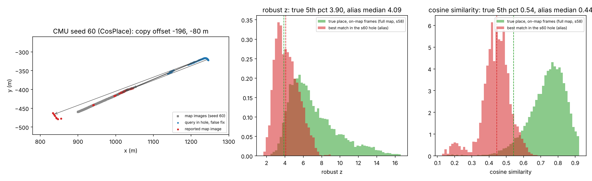

# Báo cáo phiên 2026-11-06 — Entry 19–23: không dịch chuyển tức thời, phủ quyết thế giới mở, bí danh mà odometry không thấy được, bằng chứng tuyệt đối hiệu chỉnh hồi cứu

*Branch `hmm-2nd-idea`. Nhật ký đầy đủ: `RESEARCH_LOG.md` Entry 19–22. Lý thuyết: `paper/owf_theory.md` §8 (Mệnh đề 5), §9 (Mệnh đề 6). Số liệu
thô: `analysis/results/owf/s1106/`. Báo cáo không tuyên bố novelty hay vượt SOTA ngoài những gì các bảng dưới chứng minh trên đúng giao thức này.*

## 1. Tóm tắt

0. **LUẬT KHUYẾN NGHỊ MỚI: OWF-HWA-S5-NT-HQ (Entry 23, đăng ký trước, seed 64–66).** Thay OWF-HWA-S5 theo đúng quy tắc (V1–V3 đạt):
   - TB segFAR 0.0074 → 0.0057; recall −0.0037 [−0.0071, −0.0008]; điều hướng 14.67 → 14.51 m.
   - CMU: recall +0.009, segFAR −30 %, điều hướng 8.5 → 7.1 m. Nordland: segFAR −44 %, điều hướng 7.5 → 4.1 m.
   - Biến thể có phủ quyết (C10, chỉ báo cáo): 0/144 run > α, TB segFAR 0.0024, recall −0.012.
   - Cơ chế: bằng chứng tuyệt đối cho ô trống, hiệu chỉnh hồi cứu không nhãn, nhân quả theo phiên (Mệnh đề 7).
1. **Luật cũ OWF-HWA-S5** đã được kiểm trên ba nhóm seed mới, đều đăng ký trước, mỗi nhóm 144 run (8 dataset × 6 descriptor):

   | Nhóm | Recall | TB segFAR | Run > α | Sai số điều hướng (m) |
   |---|---|---|---|---|
   | 55–57 (Entry 17) | 0.937 | 0.0045 | 1 | 12.5 |
   | 58–60 (Entry 19) | 0.934 | 0.0101 | 6 | 16.3 |
   | 61–63 (Entry 21) | 0.927 | 0.0043 | 2 | 12.9 |

   Tổng 9/432 run vượt α (2.1 %). 7 trong 9 là CMU, đến từ đúng hai bố cục lỗ.
2. **Entry 19 (đăng ký trước, seed 58–60): không dịch chuyển tức thời (NT, Mệnh đề 5).** Recall bằng (−0.001); TB segFAR 0.0101 → 0.0091;
   Nordland điều hướng 19.1 → 13.5 m. Không qua quy tắc, vì tiêu chí tuyệt đối "≤ 2/144 run > α" trượt với CẢ R* lẫn ứng viên (6 run mỗi bên).
3. **Entry 21 (đăng ký trước, seed 61–63): OWF phủ quyết nhánh HSI khi khối lượng gần bản đồ mN < ½.**
   - Hợp lệ tốt hơn: TB segFAR 0.0043 → 0.0033; Oxford 0.0068 → 0.0010.
   - Recall −0.005.
   - Điều hướng +0.9 m (countryside 26 → 35 m): trượt V3, R* giữ nguyên.
   - NT trên cùng nhóm: trượt N3 0.07 m.
4. **Phát hiện chính: bí danh mà odometry không thấy được.** Truy ngược các run vượt α: cả hai bố cục lỗ CMU đều phủ một đoạn đường mà ở chỗ
   khác trên bản đồ có một "bản sao dịch chuyển".
   - Độ lệch không đổi: (−188, −78) m ở seed 60 và (−652, +166) m ở seed 61, qua 10–17 lượt đi.
   - Hai descriptor độc lập chọn cùng chỗ.
   - Khớp yếu theo giá trị tuyệt đối (cos 0.34–0.45 so với 0.69–0.77 ở đúng chỗ), nhưng nhất quán với chuyển động.

   Mệnh đề 6: với emission chuẩn hoá theo hồ sơ của frame, ảnh được tăng khối lượng khi z > ≈ 0.5 SD. Vì vậy bản sao tích luỹ bằng chứng không
   giới hạn.
5. **Entry 22 (âm ở phát triển): điểm giao Gaussian-shift μ₁/2 cho ô trống.** Cơ chế được xác nhận: báo sai CMU của OWF đơn lẻ ÷ 4.6; run
   thiết kế CMU s60 từ 17 → 0 đoạn sai, sai số 6.8 → 2.7 m. Nhưng một điểm giao chung cho cả run làm recall hệ đầy đủ giảm 3 pp và Nordland tệ
   hơn. Loại ở phát triển; seed 64–66 để dành, rồi dùng cho Entry 23.
6. **Entry 20 (âm ở phát triển): độ dài bằng chứng ℓ = chiều dài tương quan thị giác của bản đồ.** Recall −0.029, 13 run > α.

## 2. Entry 19 — không dịch chuyển tức thời (Mệnh đề 5)

Bộ lọc cũ đưa khối lượng của trạng thái xa Ω quay lại lưới theo prior khởi đầu: mỗi frame, mọi ảnh bản đồ nhận một hạt giống nhỏ. Một đợt
aliasing liên tiếp (độ phóng đại K tới 10¹⁰, Mệnh đề 2′) biến hạt giống thành chắc chắn. NT làm Ω hấp thụ (`owf.py --pin 0`), tương đương
re-entry qua rìa band. Trên run thiết kế Nordland, số báo sai ở 1 − 1e-8 giảm 22 → 0.

| Seed 58–60, 144 run | R* | NT |
|---|---|---|
| recall gộp | 0.934 | 0.933 |
| TB segFAR | 0.0101 | 0.0091 |
| run > α | 6 | 6 |
| điều hướng (m) | 16.3 | 15.6 |

Cả R* cũng có đúng 6 run > α: 4 CMU (seed 60, từ nhánh HSI), 1 countryside, 1 St Lucia. Tiêu chí N1 lẽ ra phải tương đối với một thay đổi chỉ
chạm bộ ước lượng. Quy tắc không được sửa sau khi xem kết quả; Entry 21 viết N1 tương đối trước khi xem nhóm mới.

## 3. Entry 21 — bộ lọc thế giới mở phủ quyết nhánh thế giới đóng

Nhánh HSI không có trạng thái "ngoài bản đồ"; OWF thì có. Luật C2: HSI chỉ được báo nơi OWF cho rằng robot ở gần bản đồ nhiều khả năng hơn là
không (mN ≥ ½, quyết định Bayes dưới mất mát 0–1).

Phát triển, tập A, 399 run, so với R* trên cùng run:
- recall −0.0044;
- TB segFAR 0.0045 → 0.0025;
- run > α 1 → 0.

| Seed 61–63, 144 run | R* | C1 = NT | C2 = NT + phủ quyết |
|---|---|---|---|
| recall | 0.927 | 0.926 | 0.922 |
| TB segFAR | 0.0043 | 0.0043 | **0.0033** |
| run > α | 2 | 2 | 2 |
| điều hướng (m) | 12.9 | 13.0 | 13.8 |
| countryside điều hướng (m) | 26.0 | 25.8 | **34.6** |

Đọc:
- Ở countryside, VIO trôi làm hậu nghiệm OWF loang (mN thấp), nên phủ quyết bỏ cả các fix HSI đúng.
- 2 run CMU > α không đến từ HSI (H(R*) = 0 run > α), nên phủ quyết không chạm được chúng.
- Hai run đó đến từ bậc đồng thuận ba nguồn, ở đầu chuỗi trong lỗ: OWF, chuỗi tô-pô và top-1 cùng chỉ vào một bản sao dịch chuyển.

## 4. Bí danh mà odometry không thấy được (Mệnh đề 6)

*Trái: CMU seed 60 (CosPlace).*
- Xám: ảnh bản đồ của run.
- Xanh: truy vấn trong lỗ bị báo sai.
- Đỏ: ảnh được báo.

*Giữa / phải: z và độ tương đồng thô.*
- Xanh lá: z / cos của đúng chỗ, bản đồ đầy đủ (seed 58).
- Đỏ: z / cos của khớp tốt nhất trong lỗ (bí danh).
- Theo z hai phân bố chồng nhau; theo cos thì tách được.

Lập luận:
- Bản sao là quỹ đạo thật dịch dọc chính con đường. Odometry không phân biệt được hai quỹ đạo, nên tỉ số hậu nghiệm chỉ do emission quyết
  định.
- Emission hiện tại cho ảnh i log-LR β z_i − A_t, với A_t = log mean_j exp(β z_j). Với β = 1, điểm giao so với ô trống là z ≈ 0.5.
- Bí danh có z trung vị ≈ 4.1 mỗi frame, nên tích luỹ khoảng e^3.6 mỗi frame. Không ngưỡng quyết định nào cứu được, vì khối lượng của bản sao hội tụ về 1.
- Mô hình dịch Gaussian (khớp đúng ~ N(μ₁, 1)), làm mềm về cùng độ dốc, cho điểm giao μ₁/2.

| CMU, 399 run phát triển | R* | NT | NT + LU (μ₁/2) |
|---|---|---|---|
| OWF đơn lẻ, ε = 1e-3: TB segFAR | — | 0.036 | **0.008** |
| OWF đơn lẻ: recall | — | 0.767 | 0.691 |
| hệ đầy đủ: run > α | 1 | 2 | 0 |
| hệ đầy đủ: điều hướng (m) | 4.4 | 4.4 | 3.9 |

Cái giá, đã dự báo trong §9 trước đợt phát triển:
- Các frame trên bản đồ có z thật < μ₁/2 (mùa đông, quay đầu, che khuất) đẩy khối lượng ra ngoài bản đồ.
- Recall office / old town / Boreas giảm 11–12 pp (OWF đơn lẻ).
- Nordland báo sai TĂNG (0.018 → 0.046): hậu nghiệm mất vết, rồi bắt lại ở chỗ giống.
- Hệ đầy đủ: recall −0.030, điều hướng +3.4 m.

Mô hình có phương sai (σ₁ ≈ 2–3) hạ điểm giao về ≈ 2, thấp hơn z của bí danh. Vậy trong không gian z, khớp đúng yếu và bí danh chồng nhau.
Thông tin tách được nằm ở độ tương đồng tuyệt đối (cos ở đúng chỗ, phân vị 5 % = 0.54, so với trung vị bí danh 0.44), và chuẩn hoá z theo frame đã bỏ nó đi.

Phủ quyết bằng bộ lọc LU (quyết định vững trên hai mô hình emission, Entry 22b):
- hợp lệ nhất từng đo trên tập A: TB segFAR 0.0012–0.0018, 0 run > α;
- nhưng recall giảm 2.6–4.5 pp.

## 4b. Entry 23 — bằng chứng tuyệt đối cho ô trống, hiệu chỉnh hồi cứu theo phiên (Mệnh đề 7)

Entry 22 cho thấy thông tin tách khớp đúng khỏi bí danh nằm ở độ tương đồng tuyệt đối, không ở z. Mô hình quan sát đúng là trên **max của
frame** x_t = max s − median s:
- trên bản đồ, x_t = max(đúng chỗ, bí danh tốt nhất), mật độ f_on;
- ngoài bản đồ, x_t = bí danh tốt nhất khi đúng chỗ vắng mặt, mật độ f_off.

Ô trống nhận log-LR log f_off(x_t) − log f_on(x_t).

Hai mật độ ước lượng **không nhãn** từ các fix tự tin của lượt 1 (bộ lọc cũ):
- f_on: max của frame;
- f_off: max trên ảnh xa hơn 1.6 excl khỏi fix.

Đây là "bí danh khi đúng chỗ bị loại", cùng điều kiện, cùng descriptor, cùng bản đồ. Trên CMU s60, trung vị bí danh hồi cứu 0.469 khớp bí danh
thật trong lỗ 0.445.

**Nhân quả:** lượt 1 không phụ thuộc lượt 2. Frame t dùng mẫu của chính phiên ở frame < t khi đã đủ 100 mẫu, trước đó dùng các phiên khác.

Tính chất (Mệnh đề 7):
- ngoài bản đồ, giả thuyết "trên bản đồ" mất bằng chứng với tốc độ KL(f_off ‖ f_on);
- ở điều kiện mà đúng chỗ không nổi bật (đêm, đoạn lặp dài), f_on ≈ f_off nên LR ≈ 1 và bộ lọc tự lùi về bộ lọc cũ.

Bài học từ các biến thể thất bại trên run thiết kế: hiệu chỉnh từ phiên khác (leave-one-session-out) làm sập phiên đêm old town (0.72 →
0.11–0.32), vì cos đúng chỗ ban đêm (0.20 trên nền) thấp hơn bí danh ban ngày (0.30). Chỉ hiệu chỉnh trong chính phiên mới đúng điều kiện.

**Phát triển (tập A, 399 run, cùng run với R*):**

| | R* | C9 = NT + HQ | C10 = C9 + phủ quyết |
|---|---|---|---|
| recall gộp | 0.933 | 0.929 | 0.923 |
| TB segFAR | 0.0045 | **0.0034** | **0.0013** |
| run > α | 1 | **0** | **0** |
| điều hướng (m) | 12.7 | 13.0 | 12.8 |
| CMU recall / segFAR | 0.852 / 0.0095 | **0.863 / 0.0066** | 0.854 / 0.0037 |
| Nordland recall / segFAR | 0.968 / 0.0069 | **0.970 / 0.0026** | 0.969 / 0.0026 |

Cái giá nằm ở đầu các phiên có điều kiện khác hẳn (đêm 4Seasons), trước khi phiên đủ mẫu riêng: old town −1.4 pp, countryside −1.9 pp.

## 4c. Entry 23 — kiểm tra trên seed 64–66 (đăng ký trước)

| Seed 64–66, 144 run | R* = OWF-HWA-S5 | **C9 = OWF-HWA-S5-NT-HQ** | C10 = C9 + phủ quyết |
|---|---|---|---|
| recall gộp | 0.936 | 0.932 | 0.924 |
| TB segFAR | 0.0074 | **0.0057** | **0.0024** |
| run > α | 4 | 4 | **0** |
| điều hướng (m) | 14.67 | **14.51** | 14.90 |
| CMU recall / segFAR / điều hướng | 0.856 / 0.0364 / 8.5 | **0.865 / 0.0254 / 7.1** | 0.856 / 0.0129 / 5.3 |
| Nordland segFAR / điều hướng | 0.0064 / 7.5 | **0.0036 / 4.1** | 0.0036 / 4.1 |

**Quyết định theo quy tắc: C9 thay R*.**
- V1: 4 = 4 run > α; segFAR thấp hơn.
- V2: −0.0037, CI dưới −0.0071 ≥ −0.010.
- V3: điều hướng tốt hơn.

Script đánh giá in nhầm luật (sao từ Entry 21). Quyết định được tính lại đúng luật đã commit từ cùng các số
(`analysis/results/owf/s1106/e23_decision.txt`).

**Tổng quát của C9 (mô tả, không quyết định; đợt `genhq`, các tập chưa từng dùng để chỉnh; R* = OWF-HWA-S5 trên CÙNG run).** Ô = recall
/ TB segFAR / run > α:

| Tập | R* | C9 | chênh recall (CI 95 %) |
|---|---|---|---|
| lỗ 10 % (108) | 0.933 / 0.0022 / 1 | 0.932 / 0.0019 / **0** | −0.001 [−0.004, +0.002] |
| lỗ 50 % (108) | 0.894 / 0.0091 / 4 | 0.873 / 0.0071 / 4 | −0.021 [−0.031, −0.013] |
| off-map tự nhiên (36) | 0.952 / 0.0104 / 2 | 0.943 / **0.0025 / 0** | −0.009 [−0.014, −0.005] |
| NCLT (6) | 0.781 / 0.0049 / 0 | 0.768 / 0.0011 / 0 | −0.013 [−0.028, +0.004] |

- Hợp lệ tốt hơn ở MỌI tập: tổng run > α 7 → 4; 4 run còn lại đều là CMU ở lỗ 50 %.
- Lỗ 10 %, CMU: 0.796 / 0.0077 / 1 → 0.814 / 0.0034 / 0.
- Điều hướng: lỗ 50 % Nordland 21.7 → 13.2 m; NCLT 5.8 → 4.7 m.
- Recall giảm rõ nhất ở lỗ 50 % (−0.021): ít frame trên bản đồ, nên phiên đủ 100 mẫu riêng muộn hơn.

Còn lại:
- 4 run CMU > α (cả hai luật), 3 trong đó từ nhánh HSI. C10 xoá cả 4, đổi lại −0.012 recall.
- Recall giảm ở đầu các phiên khác điều kiện (old town −0.018, Boreas −0.013).

## 5. Vận hành

- Kho seed mới `namhunhh/hmm-navcache-r61` (seed 61–66, 288 cache, 20 kernel CPU).
- Ba đợt kiểm tra / phát triển trên GPU (6 phiên 4×L4 mỗi đợt, 20–35 phút):
  - `test61`: R*, NT;
  - `devlu`: NT + LU;
  - `genlu`: tổng quát, mô tả.
- `hieuho669` dùng được L4 từ 06:23 UTC.
- Container khởi động lại một lần; monitor trung tâm chạy lại từ state file, không mất kernel.

## 6. Hạn chế và việc tiếp theo

- Bí danh odometry không thấy được (CMU) là nguồn đuôi hợp lệ. Entry 23 giảm nó ở bộ ước lượng (CMU segFAR −30 %). Phủ quyết bằng mN của
  C9 xoá hết trên seed 64–66, với giá −0.012 recall.
- Đầu phiên có điều kiện chưa từng thấy (đêm): trước 100 mẫu riêng, phiên dùng phân bố của phiên khác. Cần dự phòng có điều kiện tốt hơn
  (thử theo trung vị hồ sơ: không đủ).
- **Ưu tiên 1:** sinh kho seed mới (r61 đã dùng hết) rồi kiểm C10 (C9 + phủ quyết ½) như một điểm vận hành "an toàn" riêng. Trên seed
  64–66 nó đạt 0/144 run > α.
- **Ưu tiên 2:** dự phòng đầu phiên cho điều kiện chưa từng thấy. Ví dụ trộn Bayes giữa "trung tính" và "phân bố phiên khác", trọng số theo
  khả năng dự đoán x_t của chính phiên.
- **Ưu tiên 3:** tổng quát của C9 trên lỗ 10/50 %, off-map tự nhiên, NCLT. Đợt `genhq` đã chạy; xem RESEARCH_LOG nếu kịp đọc.
- VPR-Space: lớp quyết định quá bảo thủ trên triển khai ngắn (Entry 18). Vẫn mở.
