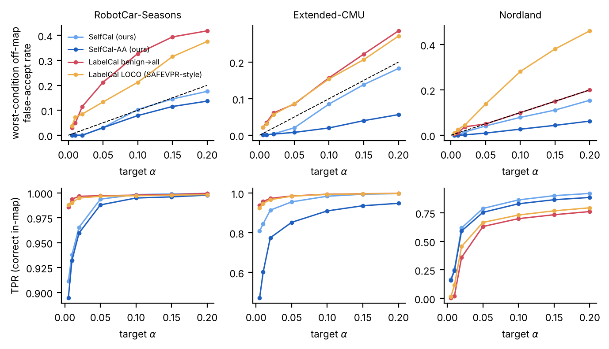
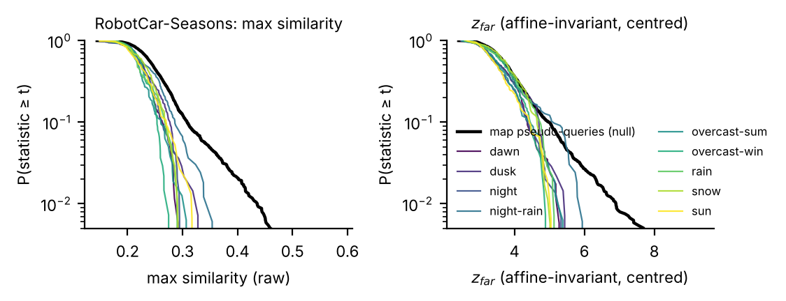
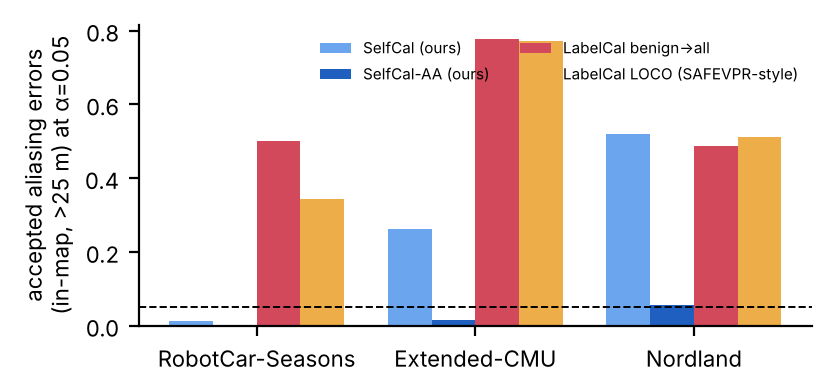

# Your Map Is Its Own Calibration Set: Label-Free, Shift-Robust Rejection of False Matches in Visual Place Recognition

## Abstract

Visual place recognition (VPR) returns a best match for every query, yet a robot must decide whether to *trust* it:
accepting a match for a place that is not in the map — or one that merely looks like it — corrupts pose graphs and
relocalisation. Existing acceptance rules (similarity thresholds, learned integrity monitors, conformal calibration) all
need labelled query–map pairs, and we show that their false-accept guarantees break as soon as the appearance
condition (night, rain, snow, season) differs between calibration and deployment. We observe that VPR offers labelled
negatives for free: **the map itself**. Holding out each spatial block of the map turns every map image into a query
that is off-map *by construction*. Calibrating an acceptance statistic against these map pseudo-queries yields
split-conformal p-values without any human or deployment labels. To make this calibration transfer across appearance
conditions we use statistics that are invariant to per-query affine changes of the similarity scores, computed against
spatially distant map regions on hubness-reduced (map-centred) descriptors, combine them with a self-calibrated
minimum-p rule, and add an aliasing guard based on the gap to the best distant region. We prove validity under
exchangeability, conservativeness whenever appearance change only makes unrelated queries less map-like, and FDR
control with Benjamini–Hochberg. On RobotCar-Seasons (official reference map and thresholds), Extended-CMU-Seasons
(eleven official slices merged into one 2,418-image city map, 21k queries, 11 dates) and Nordland, with six descriptors
from NetVLAD to MegaLoc, the method keeps the off-map false-accept rate at or below the target in every deployment
condition and rejects nearly all perceptual-aliasing errors, while label-calibrated baselines — including
leave-one-condition-out conformal calibration and quantile transfer — exceed the target in up to five of nine conditions
and accept 33–80% of aliasing errors. Its power approaches an oracle that has labels for every condition.

# 1. Introduction

Modern VPR descriptors are remarkably robust: on RobotCar-Seasons a frozen SALAD descriptor retrieves a reference image
within 5 m and 10° for about 90% of queries even at night. Recall, however, is not what breaks a deployed system. A
VPR module always returns a top-1 match, and the downstream consumer — loop closure in SLAM, relocalisation, map
merging — needs to know *whether to accept it*. Two failure modes dominate. First, the query may come from a place
that is **not in the map** (an unmapped street, a detour, a changed environment). Second, the query may be in the map
but be matched to a **perceptual alias**, a different place that looks the same. A single accepted false match can
corrupt a pose graph irreversibly; a rejected true match merely delays localisation. The decision therefore calls for
an explicit, controllable false-accept rate.

The standard recipe is to calibrate a threshold — on raw similarity, on a hand-crafted score such as the top-1/top-2
ratio, or on the output of a learned integrity monitor — using queries whose correctness is known, possibly with a
conformal procedure that turns the calibration set into a finite-sample guarantee [SAFEVPR, Quantile Transfer]. These
guarantees rest on exchangeability between calibration and deployment queries. VPR is the textbook case in which this
assumption fails: the whole point of the task is that deployment happens under different illumination, weather and
season than any data one could label in advance. We confirm this empirically (§6): thresholds calibrated with labels on
benign conditions exceed a 5% false-accept target by up to 4× at night, and even calibrating on all *other* labelled
conditions (the protocol of SAFEVPR) leaves violations in a third of the deployment conditions on Extended-CMU.

We make three observations that, together, remove the need for labels.

1. **The map provides labelled negatives for free.** A VPR map is a set of images with known positions. Removing a
   spatial block from the map and querying it with one of its own images produces a query that is off-map *by
   construction*. Repeating this for all blocks yields thousands of null examples in the map's own environment —
   exactly the distribution a deployment-time off-map query is drawn from, up to the appearance condition.
2. **Appearance change acts mostly as an affine distortion of similarity scores**, and appearance change can only make
   an unrelated query *less* similar to the map than the map is to itself. Statistics that are invariant to per-query
   affine changes therefore transfer from the map's condition to any deployment condition, and the residual shift is in
   the safe (conservative) direction.
3. **Map geometry separates the two failure modes.** Scoring the top-1 against the best matches of *spatially distant*
   map regions (rather than its own neighbours, which are visually redundant) gives a statistic for off-map detection;
   the gap to the single best distant region exposes aliasing, where the true place is a strong distant competitor.

We call the result **self-calibrating maps (SelfCal)**. It is training-free, label-free, descriptor-agnostic, costs one
offline pass of self-retrieval over the map and a sort per query, and provides a p-value per query that can be used
with a fixed level, with Benjamini–Hochberg for batches, or turned into a calibrated confidence via the two-groups
model — all without labels.

**Contributions.** (i) We show on three benchmarks that label-calibrated acceptance (threshold, learned and conformal)
loses its false-accept guarantee under appearance shift, and that the classical parametric nulls (Gaussian z-norm, EVT
spacing tests) are invalid or degraded by hubness. (ii) We propose SelfCal: map pseudo-queries via spatial hold-out as
a conformal null sample, affine-invariant far-region statistics on map-centred descriptors, a self-calibrated
combination, and an aliasing guard. (iii) We give validity, dominance-based robustness, excess-risk and FDR results.
(iv) We evaluate on RobotCar-Seasons, Extended-CMU-Seasons and Nordland with six descriptors and 23 deployment
conditions, with full ablations; code and descriptor dumps are released.

# 2. Related work

**Uncertainty and introspection for VPR.** Retrieval-based scores — the L2 distance to the nearest reference and the
perceptual-aliasing (PA) ratio of the first two distances [Hausler'21] — remain strong baselines [Zaffar'24]. Zaffar
et al. [CVPR'24] compare them with learned aleatoric uncertainty (BTL [Warburg'21], STUN [Cai'22]) and geometric
verification, and propose SUE, the spatial spread of the top-K reference poses. Miller et al. [RA-L'26] introduce
training-free score-distribution metrics (ratio spread, similarity distribution). KappaPlace [2026] learns a von
Mises–Fisher concentration and reports calibration error. Integrity monitors learn to predict whether a match is within
tolerance from statistics of the distance vector, with SVMs [Carson'22] or MLPs [Claxton'24]; Hussaini et al. predict
when sequence matching helps [2025]. All of these produce *scores*; turning a score into an accept/reject decision with
a known error rate requires labelled calibration data from the deployment conditions. SelfCal is complementary: it can
calibrate any score, and it shows which scores transfer across conditions.

**Thresholds and operating points.** Schubert et al. [ICRA'21] model the similarity distribution as a robust normal and
threshold a high quantile; Vysotska et al. [ICRA'25] adapt thresholds for sequences; Trinh & Lyons [2025] derive
per-place thresholds from negative statistics of the database; Quantile Transfer [IROS'26] transfers a threshold
calibrated on a labelled traversal through quantiles of the deployment similarity distribution. None provides a
guarantee under appearance shift; parametric nulls are invalid in our experiments and raw-score database negatives are
conservative but lose power under shift (§6.4).

**Conformal prediction for robotics and VPR.** Split conformal prediction and its risk-control extensions provide
finite-sample guarantees under exchangeability [Vovk'05, Angelopoulos'21, Bates'23]; Barber et al. [2023] bound the
coverage gap under distribution shift. SAFEVPR [Sier'26] combines a DINOv2 patch-matching verifier with Mondrian
Learn-then-Test and reports empirical FDR validity across conditions when calibrating on labelled data of the other
conditions; Route-MHT [2026] learns a map-out guardrail for thermal VPR. Our null sample comes from the map rather than
from labelled queries, and our robustness argument is a stochastic-dominance property of the map's own condition.

**Using the map at test time.** The reference map with its poses is available before deployment in most VPR
applications; it has been used to fine-tune descriptors (RSF [Zaffar'25]), to choose map density from two reference
traversals [Hussaini'26], and to estimate spatial uncertainty (SUE). We use it as a *calibration set*.

**Hubness.** High-dimensional nearest-neighbour retrieval produces hubs, points that are close to many queries
[Radovanović'10]; centring [Suzuki'13] and local scaling (CSLS [Conneau'18]) reduce it. We find that hubness is what
breaks extreme-value nulls in VPR and that map centring improves the power of the invariant statistic.

# 3. Problem

A map $\mathcal{M}=\{(f_j,x_j)\}_{j=1}^N$ holds L2-normalised global descriptors $f_j$ and positions $x_j$ (metres;
frame index on Nordland). A query $q$ with descriptor $f_q$ yields similarities $s_j=\langle f_q,f_j\rangle$ and the
retrieval $j^*=\arg\max_j s_j$. An *acceptance test* maps the similarity vector (and map positions) to accept/reject.
We distinguish:

* **Off-map false accept:** $q$ has no map position within $\delta$ (40 m) and is accepted. The false-accept rate in
  deployment condition $c$ is $\mathrm{FAR}_c(\alpha)=P(\text{accept}\mid q\text{ off-map}, c)$.
* **Aliasing accept:** $q$ is in the map, but $x_{j^*}$ is farther than $\rho$ (25 m) from its true position.
* **True accept (power):** $q$ is in the map and the top-1 satisfies the localisation tolerance (5 m and 10° on
  RobotCar/CMU; 2 frames on Nordland).

The goal is $\mathrm{FAR}_c(\alpha)\le\alpha$ for every condition $c$, few aliasing accepts and high power, **without
labelled queries**.

# 4. Method: self-calibrating maps

**Map pseudo-queries.** Partition map positions into square blocks of side $L$ (300 m; 200 frames on Nordland). For a
map item $i$ in block $b$ whose distance to $\mathcal{M}\setminus B_b$ exceeds $\delta$, compute the acceptance
statistic of $f_i$ against the reduced map, $T^0_i=T(f_i;\mathcal{M}\setminus B_b)$. Item $i$ is an off-map query
by construction. Using every second map image gives 757 (CMU) to 2,391 (RobotCar) null statistics.

**Far-region statistic.** Hash map positions into cells of side 10 m, take the region maxima $Z_c=\max_{j\in c}s_j$,
and keep the cells farther than $\rho$ from $x_{j^*}$. With mean $\mu_{far}$ and standard deviation $\sigma_{far}$ of
these far-region maxima,
$$z_{far}(q)=\frac{s_{j^*}-\mu_{far}}{\sigma_{far}},\qquad z_{gap}(q)=\frac{s_{j^*}-\max_{c\,\text{far}}Z_c}{\sigma_{far}}.$$
Both are invariant to $s\mapsto as+b$ ($a>0$). Excluding the neighbourhood of $j^*$ prevents the visually redundant
neighbours of a true match from being counted as competitors; using region maxima makes the competitors comparable.

**Hubness reduction.** Descriptors are centred on the map mean and re-normalised (map only, no labels).

**Conformal p-value.** $p_T(q)=\big(1+\#\{i: T^0_i\ge T(q)\}\big)/(1+n)$.

**Self-calibrated combination.** No single statistic is best everywhere (raw max-similarity is strongest on CMU, the
invariant $z_{far}$ on Nordland). We take $m(q)=\min\{p_{\max s}(q),p_{z_{far}}(q)\}$ and re-calibrate it against
the leave-one-out values $m(i)$ of the null items: $p_{comb}(q)=(1+\#\{i:m(i)\le m(q)\})/(1+n)$.

**Aliasing guard (SelfCal-AA).** Accept iff $\max\{p_{comb}(q),\,p_{z_{gap}}(q)\}\le\alpha$. In an aliasing failure
the true place is a strong far competitor, so $z_{gap}$ is small.

**Batches.** With p-values of a deployment batch, Benjamini–Hochberg controls the false-discovery rate, and the
two-groups model (Storey's $\hat\pi_0$, Grenander density estimate) turns $p$ into a calibrated probability of a true
match, $1-\widehat{\mathrm{lfdr}}(p)$ — again without labels.

**Cost.** Offline: one self-retrieval pass over the map ($O(N^2d)$; seconds for $N\approx7{,}000$). Online: the
similarity vector (needed for retrieval anyway), cell maxima and a binary search.

# 5. Guarantees

**T1 (validity).** If, for an off-map query, $T(q)$ and the null statistics $\{T^0_i\}$ are exchangeable, then
$P(p_T(q)\le\alpha)\le\alpha$. *Standard split-conformal argument.*

**T2 (dominance ⇒ conservative).** If in condition $c$ the off-map statistic is stochastically dominated by the map
null, $P(T^c\ge t)\le P(T^0\ge t)\ \forall t$, then $\mathrm{FAR}_c(\alpha)\le\alpha$. Map pseudo-queries are images of
the map's own traversal: appearance change can only make an unrelated query *less* map-like, so calibrating on the clean
map errs on the safe side. Fig. 1 verifies dominance for all nine RobotCar conditions.

**T3 (excess risk).** In general $\mathrm{FAR}_c(\alpha)-\alpha\le\Delta_c^+:=\sup_t[P(T^c\ge t)-P(T^0\ge t)]_+$,
the one-sided Kolmogorov distance. Affine invariance removes the dominant per-query distortion, keeping $\Delta_c^+$
near zero while keeping the null tight (power).

**T4 (combination).** If the vector of statistics is exchangeable with the null vectors, the re-calibrated minimum is a
valid conformal p-value (the leave-one-out ranks are computed exactly as for the query).

**T5 (FDR).** Conformal p-values that share one calibration set are PRDS [Bates'23]; hence Benjamini–Hochberg at level
$q$ controls the off-map FDR at $\pi_0 q$. Aliasing control is empirical: an in-map aliasing failure differs from its
off-map counterpart by an extra strong far competitor, which can only decrease $z_{far}$ and $z_{gap}$.

# 6. Experiments

## 6.1 Setup

**Datasets.** *RobotCar-Seasons v2* [Sattler'18]: the map is the official `overcast-reference` rear-camera traversal
(6,954 images, ~1.3 × 1.1 km) with poses from the official reconstruction (`all.nvm`); queries are the 1,906 rear
images of the public training split in nine conditions (dawn, dusk, night, night-rain, overcast-summer/winter, rain,
snow, sun), whose 6-DoF poses are released (test poses are withheld by the benchmark). A query is correct if the top-1
reference is within the coarsest official threshold (5 m, 10°); we also report the finer official thresholds.
*Extended-CMU-Seasons* [Toft'20]: the eleven slices with released query poses (6–8, 10–13, 21–24) share one world frame
and are consecutive segments, so we merge their official databases into one 2,418-image city map; queries are the
21,407 camera-0 images of 11 dates (Sep 2010 – Jul 2011), correct at (5 m, 10°). *Nordland* [Sünderhauf'13]: 4,500
frame-aligned places per season (uniform subsample of the 35,768-frame route); summer is the map (winter in §6.6),
spring/fall/winter are queries, correct within 2 places.

**Off-map protocol.** We cannot rely on a few hand-picked unmapped streets, so we hold out the map in turn: the map is
partitioned into 300 m blocks (200 places on Nordland); for each block, the block is removed and its queries farther
than 40 m (10 places) from the remaining map are evaluated as *off-map*. This gives 1,386 (RobotCar), 14,117 (CMU) and
12,180 (Nordland) off-map query instances spread over all conditions. In-map queries (within 5 m of a map image) are
evaluated against the full map; in-map queries whose top-1 is farther than 25 m (5 places) are *aliasing* errors.
The method's own null construction (map blocks, pseudo-queries) uses only the map and never sees queries.

**Descriptors.** Frozen, off-the-shelf: NetVLAD (VGG16, Pitts30k, 4,096-d) [Arandjelović'16], CosPlace (ResNet-50,
2,048-d) [Berton'22], MixVPR (ResNet-50, 4,096-d) [Ali-bey'23], DINOv2 ViT-B/14 CLS+mean (1,536-d) [Oquab'24], SALAD
(8,448-d) [Izquierdo'24] and MegaLoc (8,448-d) [Berton'25]. All descriptors are extracted once at 322 × 322.

**Baselines.** (a) *Threshold, benign→all*: split-conformal threshold on the max-similarity of off-map queries of the
two most benign conditions (RobotCar: overcast-summer/winter; CMU: the two dates with the highest recall; Nordland:
fall), applied to all conditions; (b) the same with aliasing errors added to the negatives; (c) *conformal LOCO*,
the SAFEVPR protocol: calibrate on the labelled off-map queries of all *other* conditions and test on the held-out
one; (d) *Quantile Transfer* [Rajani'26]: the benign threshold mapped through the quantile function of each deployment
batch; (e) a learned logistic calibrator on margin, max-similarity and entropy (CRSG) trained on benign conditions;
(f) the PA ratio [Hausler'21]; (g) parametric nulls: Gaussian z-norm with Bonferroni and the closed-form EVT spacing
test; (h) an *oracle* that calibrates max-similarity with the labels of every deployment condition.

**Metrics.** FAR on off-map queries per condition (target α), the number of conditions whose FAR is significantly above
α (one-sided binomial test, Bonferroni over conditions), TPR on correct in-map queries, and the acceptance rate of
aliasing errors.

## 6.2 Main result

Table 1 reports α = 0.05 for SALAD. Every label-calibrated method exceeds the target in at least one realistic dataset —
the benign→all threshold in 5/9 RobotCar conditions (worst FAR 0.21 at night-rain) and 4/11 CMU dates; calibrating on
all other labelled conditions (SAFEVPR protocol) still fails in 1/9, 4/11 and 2/3 conditions — and all of them accept a
third to four fifths of the aliasing errors. Parametric nulls are either invalid (Gaussian z-norm: FAR 0.13–0.35) or
anti-conservative under hubness (EVT spacing: night-rain 0.109). SelfCal-AA, which uses no labels, has **no
significant violation in any of the 23 conditions**, accepts 0.0%, 1.5% and 5.7% of aliasing errors, and its TPR
(0.988 / 0.853 / 0.754) is close to the oracle that holds labels for every condition (0.995 / 0.992 / 0.780).
Without the aliasing guard, SelfCal reaches oracle power on RobotCar and CMU (0.994 / 0.956) while still controlling
the off-map FAR. Fig. 2 shows the same picture for α ∈ [0.005, 0.2].

**Table 1 (α = 0.05). SALAD. Cell: off-map FAR / #conditions significantly above α (binomial, Bonferroni) / TPR / aliasing-accept rate**

| method | labels | RobotCar-Seasons (9 cond.) | Extended-CMU (11 dates) | Nordland (3 seasons) |
|---|---|---|---|---|
| **SelfCal-AA (ours)** | none | 0.004 / 0/9 / 0.988 / 0.00 | 0.002 / 0/11 / 0.853 / 0.01 | 0.008 / 0/3 / 0.754 / 0.06 |
| SelfCal (ours, no alias guard) | none | 0.004 / 0/9 / 0.994 / 0.01 | 0.009 / 0/11 / 0.956 / 0.26 | 0.031 / 0/3 / 0.788 / 0.52 |
| Threshold, benign→all | benign | 0.109 / 5/9 / 0.997 / 0.50 | 0.052 / 4/11 / 0.985 / 0.78 | 0.037 / 0/3 / 0.630 / 0.49 |
| Threshold, benign, neg. incl. aliasing | benign | 0.075 / 2/9 / 0.997 / 0.43 | 0.047 / 4/11 / 0.984 / 0.75 | 0.010 / 0/3 / 0.043 / 0.10 |
| Conformal LOCO (SAFEVPR protocol) | other cond. | 0.052 / 1/9 / 0.997 / 0.34 | 0.051 / 4/11 / 0.984 / 0.77 | 0.070 / 2/3 / 0.666 / 0.51 |
| Quantile Transfer | benign | 0.097 / 4/9 / 0.998 / 0.47 | 0.054 / 2/11 / 0.993 / 0.80 | 0.109 / 2/3 / 0.901 / 0.72 |
| Learned calibrator (CRSG), benign→all | benign | 0.099 / 4/9 / 0.996 / 0.33 | 0.054 / 4/11 / 0.982 / 0.68 | 0.041 / 0/3 / 0.814 / 0.45 |
| PA ratio, benign→all | benign | 0.078 / 2/9 / 0.596 / 0.09 | 0.046 / 2/11 / 0.449 / 0.19 | 0.040 / 0/3 / 0.846 / 0.18 |
| Gaussian z-norm null | none | 0.350 / 9/9 / 0.999 / 0.72 | 0.250 / 11/11 / 0.994 / 0.73 | 0.125 / 3/3 / 0.752 / 0.79 |
| EVT spacing test (F(2,2k)) | none | 0.058 / 1/9 / 0.888 / 0.17 | 0.050 / 1/11 / 0.700 / 0.01 | 0.036 / 0/3 / 0.743 / 0.07 |
| SelfCal on raw max-sim (ablation) | none | 0.001 / 0/9 / 0.979 / 0.00 | 0.010 / 0/11 / 0.949 / 0.46 | 0.022 / 0/3 / 0.411 / 0.39 |
| Oracle (labels of every condition) | all | 0.040 / 0/9 / 0.995 / — | 0.049 / 0/11 / 0.992 / — | 0.050 / 0/3 / 0.780 / — |

*Figure 2. Worst-condition off-map false-accept rate (top) and TPR (bottom) versus the target level, SALAD.*

## 6.3 Why it works

Fig. 1 plots the survival function of the off-map statistic for every RobotCar condition against the map null.
All conditions lie below the null for both max-similarity and z_far: appearance change makes unrelated queries
*less* map-like than the map's own held-out blocks (T2). Table 3 quantifies the excess-risk bound Δ⁺ of T3: with the
map null it is at most 0.052 (max-similarity) and 0.047 (z_far, centred) over all 23 conditions, whereas with a
labelled benign null it reaches 0.255 (max-similarity, night-rain) — exactly the violations of Table 1. The
invariant statistic matters for power: calibrating raw max-similarity on the map is valid but loses most of its
power on Nordland (0.41 vs 0.84), where seasonal change lowers all similarities.

*Figure 1. Survival functions of the off-map statistic per RobotCar condition (coloured) vs. the map pseudo-query null (black).*

**Table 3. Excess-FAR bound Δ⁺_c (one-sided KS) — labelled benign null vs map null**

- RobotCar-Seasons (9 cond.): max over conditions — max-sim | benign null 0.255, max-sim | map null 0.017, z_far | benign null 0.146, z_far+centring | map null 0.047
- Extended-CMU (11 dates): max over conditions — max-sim | benign null 0.101, max-sim | map null 0.052, z_far | benign null 0.067, z_far+centring | map null 0.028
- Nordland (3 seasons): max over conditions — max-sim | benign null 0.018, max-sim | map null 0.006, z_far | benign null 0.093, z_far+centring | map null 0.024

## 6.4 Descriptors

Table 2 repeats the comparison for six descriptors spanning a decade of VPR.

**Table 2 (α = 0.05). Descriptors. Cell: FAR / #viol / TPR / aliasing for SelfCal-AA | #viol for benign threshold, LOCO, CRSG | oracle TPR**

| descriptor | dataset | R@1 (5 m,10° / 2 fr) | SelfCal-AA | benign thr. #viol (alias) | LOCO #viol | CRSG #viol | oracle TPR |
|---|---|---|---|---|---|---|---|
| SALAD | RobotCar-Seasons | 0.911 | 0.004 / 0/9 / 0.988 / 0.00 | 5/9 (0.50) | 1/9 | 4/9 | 0.995 |
| SALAD | Extended-CMU | 0.936 | 0.002 / 0/11 / 0.853 / 0.01 | 4/11 (0.78) | 4/11 | 4/11 | 0.992 |
| SALAD | Nordland | 0.791 | 0.008 / 0/3 / 0.754 / 0.06 | 0/3 (0.49) | 2/3 | 0/3 | 0.780 |

## 6.5 Batches: FDR and label-free confidence

With an off-map share of 10–50%, Benjamini–Hochberg on SelfCal p-values (q = 0.1) keeps the false-discovery rate of
gross errors at 0.004–0.009 on RobotCar and 0.008–0.011 on CMU (max over conditions 0.046 / 0.023) with power 0.96–0.998,
and the two-groups confidence has ECE 0.013–0.050 without labels (π̂₀ within 0.03–0.08 of the true off-map share).
On Nordland, where 18.5% of in-map queries are gross aliasing errors that the union rule does not target, BH on the
union p-values exceeds q (gross FDR 0.15); with the aliasing-aware p-values, max(p_comb, p_gap), BH keeps the gross FDR
at 0.017–0.021 (max 0.030) with power 0.53–0.75. The label-free confidence is, however, poorly calibrated on Nordland
(ECE ≈ 0.14): many correct matches on its repetitive scenery have non-significant gaps, which inflates π̂₀
(0.47–0.91 vs. 0.27–0.57). We therefore recommend the p-values, not the two-groups confidence, on aliasing-prone maps.

**Table 5. Deployment batches: BH on SelfCal p-values (SALAD), label-free confidence**

- RobotCar-Seasons (9 cond.), off-map share 0.1: π̂0 0.15 (true 0.14); ECE label-free 0.044; BH q=0.1: gross FDR mean 0.004 (max 0.014), power 0.998
- RobotCar-Seasons (9 cond.), off-map share 0.3: π̂0 0.41 (true 0.33); ECE label-free 0.018; BH q=0.1: gross FDR mean 0.009 (max 0.046), power 0.998
- RobotCar-Seasons (9 cond.), off-map share 0.5: π̂0 0.56 (true 0.44); ECE label-free 0.013; BH q=0.1: gross FDR mean 0.004 (max 0.024), power 0.993
- Extended-CMU (11 dates), off-map share 0.1: π̂0 0.11 (true 0.11); ECE label-free 0.050; BH q=0.1: gross FDR mean 0.008 (max 0.018), power 0.972
- Extended-CMU (11 dates), off-map share 0.3: π̂0 0.34 (true 0.31); ECE label-free 0.036; BH q=0.1: gross FDR mean 0.011 (max 0.023), power 0.964
- Extended-CMU (11 dates), off-map share 0.5: π̂0 0.45 (true 0.40); ECE label-free 0.034; BH q=0.1: gross FDR mean 0.011 (max 0.023), power 0.958
- Nordland (3 seasons), off-map share 0.1: π̂0 0.22 (true 0.27); ECE label-free 0.166; BH q=0.1: gross FDR mean 0.144 (max 0.166), power 0.807
- Nordland (3 seasons), off-map share 0.3: π̂0 0.46 (true 0.43); ECE label-free 0.138; BH q=0.1: gross FDR mean 0.146 (max 0.169), power 0.780
- Nordland (3 seasons), off-map share 0.5: π̂0 0.67 (true 0.57); ECE label-free 0.104; BH q=0.1: gross FDR mean 0.147 (max 0.176), power 0.733

## 6.6 Robustness and ablations

*Map in a hard condition.* Using Nordland **winter** as the map (queries summer/spring/fall) — so that map
pseudo-queries are the degraded ones — SelfCal-AA keeps 0/3 violations (FAR 0.010, aliasing 0.022, TPR 0.593).
*Map size.* Keeping 25% of the RobotCar map (635 × 592 m, 1,739 images, 650 pseudo-queries) gives FAR 0.000 and
TPR 0.994; 50% gives 0.037 and 0.916. *Hyper-parameters.* Cell size (×0.5–2), exclusion radius (×0.4–2), block size
(×0.5–2), δ (×0.6–2) and calibration-set size (497–4,747 pseudo-queries) change TPR by at most 0.05 and keep the worst-condition FAR at or below 0.073 at α = 0.05 (Table 4). *Centring* is essential on Nordland (TPR 0.754 → 0.329 without it) and neutral elsewhere.

**Table 4. Ablations of SelfCal-AA (SALAD, α = 0.05): FAR / worst / TPR / aliasing**

**RobotCar-Seasons (9 cond.)**

| variant | FAR | worst | TPR | aliasing | null n |
|---|---|---|---|---|---|
| default | 0.004 | 0.030 | 0.988 | 0.000 | 2391 |
| cell x0.5 | 0.004 | 0.030 | 0.987 | 0.000 | 2391 |
| cell x2.0 | 0.005 | 0.036 | 0.988 | 0.000 | 2391 |
| excl x0.4 | 0.003 | 0.012 | 0.941 | 0.000 | 2391 |
| excl x2.0 | 0.004 | 0.030 | 0.990 | 0.000 | 2391 |
| block_m x0.5 | 0.001 | 0.006 | 0.970 | 0.000 | 1384 |
| block_m x2.0 | 0.004 | 0.030 | 0.991 | 0.000 | 2951 |
| off_d_m x0.6 | 0.001 | 0.006 | 0.964 | 0.000 | 2851 |
| off_d_m x2.0 | 0.012 | 0.073 | 0.993 | 0.026 | 1572 |
| stride 1 | 0.004 | 0.030 | 0.987 | 0.000 | 4747 |
| stride 4 | 0.004 | 0.030 | 0.988 | 0.000 | 1194 |
| stride 8 | 0.003 | 0.024 | 0.986 | 0.000 | 597 |
| no centering | 0.002 | 0.007 | 0.980 | 0.000 | 2391 |

**Nordland (3 seasons)**

| variant | FAR | worst | TPR | aliasing | null n |
|---|---|---|---|---|---|
| default | 0.008 | 0.010 | 0.754 | 0.057 | 2030 |
| cell x0.5 | 0.005 | 0.006 | 0.719 | 0.049 | 2030 |
| cell x2.0 | 0.010 | 0.011 | 0.761 | 0.057 | 2030 |
| excl x0.4 | 0.008 | 0.009 | 0.748 | 0.047 | 2030 |
| excl x2.0 | 0.008 | 0.009 | 0.759 | 0.076 | 2030 |
| block_m x0.5 | 0.001 | 0.001 | 0.566 | 0.044 | 1810 |
| block_m x2.0 | 0.011 | 0.012 | 0.774 | 0.060 | 2140 |
| off_d_m x0.6 | 0.008 | 0.009 | 0.752 | 0.057 | 2118 |
| off_d_m x2.0 | 0.008 | 0.010 | 0.758 | 0.057 | 1810 |
| stride 1 | 0.008 | 0.009 | 0.753 | 0.058 | 4060 |
| stride 4 | 0.007 | 0.008 | 0.750 | 0.055 | 1015 |
| stride 8 | 0.006 | 0.007 | 0.747 | 0.053 | 497 |
| no centering | 0.005 | 0.006 | 0.329 | 0.086 | 2030 |

*Figure 3. Acceptance rate of in-map aliasing errors (>25 m) at α = 0.05.*

# 7. Limitations

The aliasing guard is supported empirically, not by a theorem. The guarantees concern the *off-map* null and assume
deployment off-map queries are no more map-like than the map's own held-out blocks; a deployment area that is a
near-duplicate of a mapped area (e.g. two identical stations) is aliasing in disguise. The map must be large enough to
hold out blocks (we merged the CMU slices into one city map). RobotCar ground truth exists only for the public training
queries (test poses are withheld by the benchmark), so we apply the official thresholds to the top-1 reference pose of
the 1,906 training queries. Strict levels (α ≤ 0.01) cost power on Extended-CMU.

# 8. Conclusion

A VPR map is more than a retrieval database: with its poses, it is a free, unlimited source of labelled off-map
queries in its own environment. Calibrating affine-invariant, geometry-aware statistics against these pseudo-queries
gives acceptance decisions whose false-accept rate is controlled without labels and survives the appearance changes
that break label-based calibration, together with an aliasing guard, FDR control and calibrated confidence. Natural
next steps are sequential evidence (accumulating p-values along a trajectory), maps that change over time, and
combining SelfCal with geometric verification scores, which it can calibrate without modification.

# References

- [Ali-bey'23] A. Ali-bey, B. Chaib-draa, P. Giguère. MixVPR: Feature mixing for visual place recognition. WACV 2023.
- [Angelopoulos'21] A. N. Angelopoulos, S. Bates. A gentle introduction to conformal prediction and distribution-free uncertainty quantification. arXiv:2107.07511.
- [Arandjelović'16] R. Arandjelović, P. Gronat, A. Torii, T. Pajdla, J. Sivic. NetVLAD: CNN architecture for weakly supervised place recognition. CVPR 2016.
- [Barber'23] R. F. Barber, E. J. Candès, A. Ramdas, R. J. Tibshirani. Conformal prediction beyond exchangeability. Annals of Statistics 2023.
- [Bates'23] S. Bates, E. Candès, L. Lei, Y. Romano, M. Sesia. Testing for outliers with conformal p-values. Annals of Statistics 2023.
- [Benjamini'95] Y. Benjamini, Y. Hochberg. Controlling the false discovery rate. JRSS-B 1995.
- [Berton'22] G. Berton, C. Masone, B. Caputo. Rethinking visual geo-localization for large-scale applications (CosPlace). CVPR 2022.
- [Berton'25] G. Berton, C. Masone. MegaLoc: One retrieval to place them all. CVPR Workshops 2025.
- [Cai'22] K. Cai, C. X. Lu, X. Huang. STUN: Self-teaching uncertainty estimation for place recognition. IROS 2022.
- [Carson'22] H. Carson, J. J. Ford, M. Milford. Predicting to improve: Integrity measures for assessing visual localization performance. RA-L 2022.
- [Claxton'24] O. Claxton, C. Malone, H. Carson, J. J. Ford, G. Bolton, I. Shames, M. Milford. Improving visual place recognition based robot navigation by verifying localization estimates. RA-L 2024.
- [Conneau'18] A. Conneau, G. Lample, M. Ranzato, L. Denoyer, H. Jégou. Word translation without parallel data (CSLS). ICLR 2018.
- [Efron'01] B. Efron, R. Tibshirani, J. D. Storey, V. Tusher. Empirical Bayes analysis of a microarray experiment (local fdr). JASA 2001.
- [Hausler'21] S. Hausler, T. Fischer, M. Milford. Unsupervised complementary-aware multi-process fusion for visual place recognition. arXiv:2112.04701.
- [Hussaini'25] S. Hussaini, T. Fischer, M. Milford. Improving visual place recognition with sequence-matching receptiveness prediction. arXiv:2503.06840.
- [Hussaini'26] S. Hussaini, T. Fischer, M. Milford. Automatic map density selection for locally-performant visual place recognition. arXiv:2602.21473.
- [Izquierdo'24] S. Izquierdo, J. Civera. Optimal transport aggregation for visual place recognition (SALAD). CVPR 2024.
- [KappaPlace'26] M. Yanko, Y. Shavit. KappaPlace: Learning hyperspherical uncertainty for visual place recognition via prototype-anchored supervision. arXiv:2605.19435.
- [Lowe'04] D. G. Lowe. Distinctive image features from scale-invariant keypoints. IJCV 2004.
- [Miller'26] E. Miller, M. Milford, M. B. Hafez, S. D. Ramchurn, S. Ehsan. Through the lens of doubt: Robust and efficient uncertainty estimation for visual place recognition. RA-L 2026 (arXiv:2510.13464).
- [Oquab'24] M. Oquab et al. DINOv2: Learning robust visual features without supervision. TMLR 2024.
- [Radovanović'10] M. Radovanović, A. Nanopoulos, M. Ivanović. Hubs in space: Popular nearest neighbors in high-dimensional data. JMLR 2010.
- [Rajani'26] D. M. Rajani, M. Milford, T. Fischer. Quantile transfer for reliable operating point selection in visual place recognition. IROS 2026 (arXiv:2602.04401).
- [RouteMHT'26] Z. Lu, K. Tanaka. Route-MHT: Multimodal transformer guardrails for thermal visual place recognition. arXiv:2607.04745.
- [Sattler'18] T. Sattler et al. Benchmarking 6DOF outdoor visual localization in changing conditions. CVPR 2018.
- [Scheirer'11] W. J. Scheirer, A. Rocha, R. J. Micheals, T. E. Boult. Meta-recognition: The theory and practice of recognition score analysis. TPAMI 2011.
- [Schubert'21] S. Schubert, P. Neubert, P. Protzel. Beyond ANN: Exploiting structural knowledge for efficient place recognition. ICRA 2021.
- [Sier'26] H. Sier, J. Zhang, Z. Zou, X. Yu, T. Westerlund. SAFEVPR: Patch-based conformal verification for safe cross-condition sequence visual place recognition. arXiv:2605.28048.
- [Storey'02] J. D. Storey. A direct approach to false discovery rates. JRSS-B 2002.
- [Sünderhauf'13] N. Sünderhauf, P. Neubert, P. Protzel. Are we there yet? Challenging SeqSLAM on a 3000 km journey across all four seasons. ICRA Workshops 2013.
- [Suzuki'13] I. Suzuki, K. Hara, M. Shimbo, M. Saerens, K. Fukumizu. Centering similarity measures to reduce hubs. EMNLP 2013.
- [Toft'20] C. Toft et al. Long-term visual localization revisited. TPAMI 2020.
- [Trinh'25] N. Trinh, D. Lyons. Adaptive thresholding for visual place recognition using negative Gaussian mixture statistics. arXiv:2512.09071.
- [Vovk'05] V. Vovk, A. Gammerman, G. Shafer. Algorithmic Learning in a Random World. Springer 2005.
- [Vysotska'25] O. Vysotska, I. Bogoslavskyi, M. Hutter, C. Stachniss. Adaptive thresholding for sequence-based place recognition. ICRA 2025.
- [Warburg'21] F. Warburg, M. Jørgensen, J. Civera, S. Hauberg. Bayesian triplet loss: Uncertainty quantification in image retrieval. ICCV 2021.
- [Zaffar'24] M. Zaffar, L. Nan, J. F. P. Kooij. On the estimation of image-matching uncertainty in visual place recognition. CVPR 2024.
- [Zaffar'25] M. Zaffar, L. Nan, S. Scherer, J. F. P. Kooij. The overlooked value of test-time reference sets in visual place recognition. arXiv:2510.03751.
