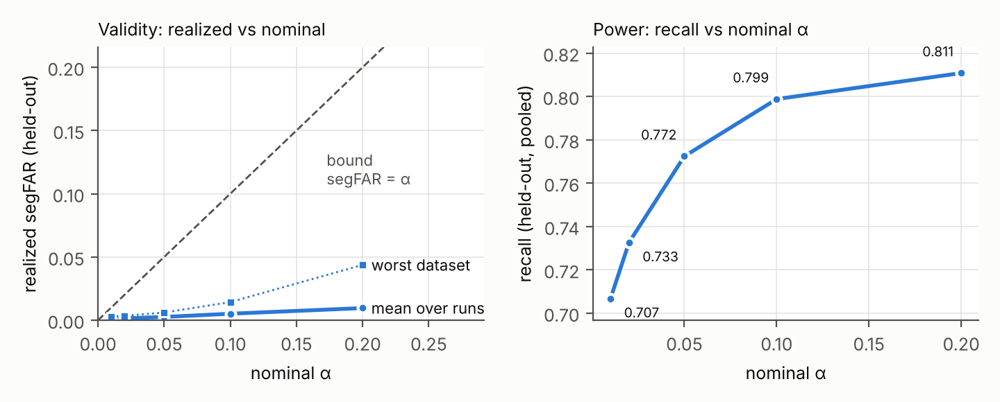

# BÁO CÁO — Ý tưởng 2: HSI, tự giám sát hồi cứu bằng hình học cho định vị chuỗi trên bản đồ có lỗ

*Branch `hmm-2nd-idea`, 2026-11-03/04 (cập nhật 2026-11-04 04:45 UTC). Nhật ký: `RESEARCH_LOG.md` Entry 1–9 + hai tập mới; lý thuyết: `paper/hsi_theory.md`; novelty: `LITERATURE_GATE.md`
Gate 17; code: `analysis/hsi.py`, `analysis/hsi_eval.py`, `analysis/hsi_summary.py`; kết quả thô: `analysis/results/hsi/`.*

## 1. Tóm tắt

**Vấn đề.** Ý tưởng 1 hiệu chuẩn quyết định "báo / không báo fix" bằng null phản thực (phẫu thuật bản đồ). Chẩn đoán cho thấy: (i) phần mất
recall nằm ở quyết định báo, không ở bộ lọc vị trí; (ii) thông tin đủ để vượt xa ý tưởng 1 đã có sẵn trong các đặc trưng nhân quả (một bộ phân
loại có giám sát vượt +0.12…+0.31 recall) — cái thiếu là cách học và hiệu chuẩn **không nhãn**.

**Ý tưởng (HSI).** Hai giác quan độc lập kiểm chứng lẫn nhau: chuỗi vị trí (thị giác) đề xuất, odometry xác minh — một chứng chỉ không dùng
giá trị similarity nên không phụ thuộc điều kiện ảnh (P(fix đúng | xác minh) ≥ 0.993). Những gì đã xác minh, và các excursion off-map nằm giữa
chúng (định vị lại bằng dead-reckoning hai phía + vùng phủ đã biết của bản đồ), thành **nhãn hồi cứu tự sinh** để học online khi nào tin thị giác
sớm hơn, và để hiệu chuẩn ngưỡng báo bằng conformal trên các excursion THẬT của chính lần triển khai. Không nhãn, không can thiệp bản đồ, không GPU
(~1 ms/frame trên một lõi CPU, gồm cả học lại).

**Kết quả.** Bảy vòng, mỗi vòng đăng ký trước khi xem kết quả; 413 run giữ ra (9 dataset × 6 descriptor, so với ý tưởng 1 trên CÙNG run) + lỗ
10 %/50 % + off-map tự nhiên + **một tập xác nhận hoàn toàn mới** (bố cục lỗ seed 10–12, sinh SAU khi các quyết định đã chốt, 108 run).
Luật khuyến nghị **HSI-rot-m-sc** (Entry 3): hợp lệ ở **413/413 run giữ ra và 108/108 run mới** (segFAR ≤ 0.05; SH của ý tưởng 1: 411/413),
**kiểm toán theo vị trí (start / edge / deep) ≤ 0.07 trên 9/9 dataset** — điều ý tưởng 1 chưa đạt; recall gộp **+0.041** so với SH, cao hơn trên 7/9
dataset (Boreas +0.115, countryside +0.149, St Lucia +0.144, office +0.069, Oxford +0.045, old town +0.027, Nordland +0.016), descriptor yếu DINOv2
+0.123, NetVLAD +0.068. Các bộ giám sát có nhãn làm tham chiếu (Xu'21, Claxton'24) vượt α ở 31–70 % run. **Hiệu chuẩn:** quét α ∈ [0.01, 0.2] —
segFAR thực luôn ≤ α (bảo thủ 5–25×), recall 0.707 → 0.811. **Phát hiện phương pháp (Entry 5, Mệnh đề 6 — chứng nhận rồi hiệu chuẩn):** dùng
chứng chỉ hình học làm điểm neo nhãn hồi cứu làm sạch null (NCLT +0.068); chứng chỉ một mình 0/773 run vi phạm trên mọi tập. Các biến thể sau
(HSI-V, HSI-VM, HSI-VM-nosc) đều hợp lệ và lặp lại về dấu trên dữ liệu mới (+0.007…+0.008 recall, có CI dương với HSI-V; HSI-VM −1.0 m điều
hướng) nhưng không vượt ngưỡng đăng ký trước ⇒ là các điểm vận hành thay thế, không thay luật. Bỏ cổng nhất quán ngắn hạn tăng recall
(+0.02…+0.03) nhưng tốn 1.7–3 m điều hướng (fix sai xa) — lộ trên giữ ra và tập mới, không lộ trên tập thiết kế. **Phát hiện mới nhất (Entry 8, Mệnh đề 7 — vách khoá hiệu chuẩn):** ở CMU nhánh học TẮT HẲN ở 27/60 run vì ngưỡng conformal (phân vị của max
điểm theo đoạn, điểm bão hoà) nhảy từ −∞ lên ≈ 1 khi > α đoạn null có một frame được phép báo; thủ phạm là frame chưa từng xác minh mà mô hình chưa
từng thấy là âm. **Căn chỉnh Neyman–Pearson** (học điểm với âm = chính null hiệu chuẩn) — HSI-VN: run bị khoá 27 → 1, CMU +0.11 (phát triển); trên
**tập kiểm tra seed 13–15** (108 run chưa từng thấy): 0/108 vi phạm, recall +0.016 (CI 95 % [+0.009, +0.024]), điều hướng −0.58 m so với luật khuyến
nghị, CMU +0.059 — trội Pareto trên cả ba thước đo kết quả, nhưng trượt tiêu chí cơ chế đăng ký trước (số run khoá 7 → 4, cần ≤ 3.5) nên luật khuyến nghị
chính thức vẫn là HSI-rot-m-sc cho tới nhân bản trên seed 16–18 (Entry 9). **Điểm yếu còn lại:** CMU (khoá do chuỗi ngắn hoàn toàn đúng nhưng không
thể chứng nhận — giới hạn thông tin), NCLT (2 run giữ ra), sai số old town.

## 2. Bài toán (giữ nguyên giao thức của ý tưởng 1)

Robot camera đơn + odometry đi trên bản đồ ảnh có lỗ (30 % ô 300 m bị xoá; NCLT off-map tự nhiên). Mỗi frame: báo hay không báo fix vị trí
(nơi MAP của chuỗi vị trí HMM dùng chung) cho bộ lọc điều hướng Kalman. Thước đo: recall (fix đúng trong excl / frame on-map), segFAR (tỷ lệ đoạn
off-map 10 frame có ≥ 1 báo, mục tiêu ≤ α = 0.05), sai số điều hướng TB, kiểm toán theo vị trí (start / edge / deep ≤ 0.07). Không dùng nhãn khi
triển khai. Baseline cần đánh bại: luật SH và CST-JS của ý tưởng 1 (phẫu thuật bản đồ phản thực), trên CÙNG (dataset, descriptor, seed).

## 3. Chẩn đoán dẫn tới ý tưởng (tập thiết kế: seed 0, 7 dataset × 4 descriptor)

| Phát hiện | Số liệu |
|---|---|
| Mất recall nằm ở quyết định báo, không ở bộ lọc vị trí | chuỗi vị trí đúng 54–99.8 % frame on-map; SH báo 14–96 % (CMU CosPlace: 0.981 vs 0.814) |
| Thông tin có sẵn: một GBM có giám sát trên đặc trưng nhân quả vượt SH | +0.12…+0.31 recall ở segFAR ≤ 0.05 (7 run) |
| Thống kê bất biến affine (ý tưởng 1) bỏ thông tin | AUROC on/off: p SelfCal 0.65 vs s1 − mean 0.95 (countryside CosPlace) |
| Tự nhất quán hình học (chuỗi vị trí ↔ odometry, độ trễ 10–80) là chứng chỉ gần tuyệt đối, không phụ thuộc điều kiện ảnh | P(fix đúng \| neo) ≥ 0.993 trên 28/28 run |
| Nhãn hồi cứu từ cầu odometry giữa hai đoạn đã xác minh | nhãn off-map chính xác 1.000 (Boreas, office, countryside, Nordland), 0.88–0.93 (old town, NCLT); nhãn fix đúng ≥ 0.99 |
| Sai số điều hướng do vài fix sai rất xa (> 100 m), kể cả neo trên tuyến sai nhất quán | Boreas DINOv2: bỏ 458/40 727 fix đó, sai số 26.3 → 3.7 m |

## 4. Phương pháp HSI

Ý tưởng cốt lõi: **hai giác quan độc lập kiểm chứng lẫn nhau, và phán quyết hồi cứu của sự kiểm chứng đó dạy robot khi nào tin giác quan nhanh
hơn.** Thị giác (chuỗi vị trí HMM) đề xuất; proprioception (odometry) xác minh — không cần giá trị similarity nào, nên chứng chỉ giữ nguyên ý
nghĩa dưới mọi điều kiện ảnh. Những gì đã được xác minh (và các excursion off-map nằm giữa các đoạn đã xác minh, định vị lại bằng dead
reckoning hai phía) trở thành nhãn tự sinh để học và hiệu chuẩn quyết định nhanh dựa trên ngoại hình.

1. **(a) Điểm neo tin cậy** — chuỗi vị trí khớp odometry ở mọi độ trễ (10/20/40/80 m); tham chiếu = phép biến đổi cứng odometry→bản đồ; neo
   mới chỉ được tin nếu khớp dead-reckoning của tham chiếu trước (loại tuyến dịch cứng — aliasing có cấu trúc) hoặc sau 80 m neo liên tục.
2. **(b) Đồng thuận dead-reckoning** — báo khi fix và vị trí dead-reckoning cùng nằm trong vùng phủ của bản đồ (biên 2σ, σ tăng theo quãng đường,
   tốc độ trôi ước lượng không nhãn từ các lần khớp).
3. **(c) Điểm số học hồi cứu** — GBM dự đoán nhãn hồi cứu "fix đúng" từ ~33 đặc trưng nhân quả; học lại theo thứ tự triển khai, chỉ dùng nhãn
   đã chốt; báo khi chuỗi nhất quán ngắn hạn, không mâu thuẫn xa với tham chiếu, P̂ > 0.5 và vượt ngưỡng conformal.
4. **Hiệu chuẩn biên của cả luật** — phân vị conformal (1 − α) trên các đoạn null hồi cứu giữ ra (có thể off-map ∪ fix chắc chắn sai ∪ chưa từng
   được xác minh) của các excursion THẬT, với điểm đoạn = +∞ nếu (a|b) báo, P̂ nếu (c) được phép, −∞ còn lại (Mệnh đề 4).
5. **Entry 2:** cửa sổ theo mét quãng đường (Oxford / St Lucia có ~10 m/frame) và bù hướng odometry có giới hạn (|góc| ≤ 20°).
6. **Entry 3:** đầu chuỗi được nới (nhất quán ngắn hạn chưa xác định ở đó) và biên null "có thể off-map" ≤ off_d/4.
7. **Entry 4 (ablation):** ngưỡng conformal riêng theo chế độ (đã / chưa có tham chiếu tin cậy) — Mondrian.
8. **Entry 5 — chứng nhận rồi hiệu chuẩn:** frame có chứng chỉ hình học (a|b) cũng là điểm neo của cầu hồi cứu. Chẩn đoán: NCLT chỉ 6–13 % frame
   được xác minh hồi cứu nhưng chứng chỉ phủ 28–42 % (độ chính xác ≥ 0.997) ⇒ cầu dài trôi 30–180 m ⇒ 20 % frame null thật ra là fix đúng, và
   chứng chỉ báo đúng ở một nửa số đó; hiệu chuẩn hợp tính các báo đúng ấy là vi phạm (18 % đoạn null > α ⇒ (c) bị khoá). Tỉ lệ chứng chỉ báo
   trong null ∩ off-map thật = 0.000. Bảo đảm trở thành ε_G + α (Mệnh đề 6), ε_G đo trực tiếp bằng biến thể chỉ-hình-học.

Lý thuyết (Mệnh đề 1–6, `paper/hsi_theory.md`): neo chứng nhận sai số hằng trên cửa sổ; tham chiếu tin cậy loại tuyến dịch cứng; sai số vị trí
hồi cứu theo cầu Brown; hiệu chuẩn biên cho P(báo trong một đoạn null mới) ≤ α dưới hoán đổi; sàn MAP chặn ngưỡng suy biến; chứng nhận rồi
hiệu chuẩn: P(báo trong đoạn off-map) ≤ ε_G + α khi chứng chỉ neo cầu hồi cứu.

## 5. Kết quả trên tập giữ ra

Tập giữ ra = mọi run ngoài tập thiết kế (seed 0 × 7 dataset × 4 descriptor): seed 1–9, SALAD/MixVPR, Oxford, St Lucia — 413 run có SH của ý tưởng
1 trên cùng (dataset, descriptor, seed). Ba vòng, mỗi vòng đăng ký trước khi xem bất kỳ kết quả giữ ra nào (`RESEARCH_LOG.md`):

| Vòng | Luật | H1 hợp lệ | H2 recall ≥ SH | H3 descriptor yếu | H4 điều hướng | H5 vị trí | Kết luận |
|---|---|---|---|---|---|---|---|
| Entry 1 | HSI (cửa sổ theo frame) | đạt (1/413 > α) | **không** (3/9; −0.069) | **không** (−0.032) | đạt (5/9) | đạt (9/9) | bác: Oxford/St Lucia (10 m/frame) sụp |
| Entry 2 | HSI-rot-m (cửa sổ theo mét + bù hướng) | đạt (0/413) | đạt (6/9; +0.039) | đạt (+0.089) | đạt (7/9) | đạt (9/9) | luật khuyến nghị (vòng 2) |
| Entry 3 | HSI-rot-m-sc (+ đầu chuỗi, biên null) | đạt (0/413) | đạt (7/9; +0.041) | đạt (+0.096) | đạt (6/9) | đạt (9/9) | **luật khuyến nghị** (H7: ≥ Entry 2 trên 8/9) |
| Entry 4 | HSI-M (Mondrian theo chế độ) | đạt (0/413) | đạt (7/9; +0.033) | – | đạt (7/9) | đạt (9/9) | ablation (H8 trượt: CMU +0.002); sai số −1.1 m |
| Entry 5 | HSI-V (chứng nhận rồi hiệu chuẩn) | đạt (0/413) | đạt (7/9; +0.054) | đạt (+0.110) | đạt (7/9) | đạt (9/9) | ablation (H9 trượt ở CMU +0.024 < 0.03; H10, H11 đạt) |
| Entry 6 | HSI-V-sc5 (cổng nhất quán chỉ 5 m) | đạt (9/413 > α) | đạt (+0.063) | – | – | – | ablation (H12 trượt: điều hướng +1.7 m) |
| Entry 7 | HSI-VM-nosc (quyết định trên tập mới) | đạt (0/108) | – | – | đạt (−0.7 m) | – | ablation (E2: +0.008 < 0.01) |
| Entry 8 | HSI-VN (căn chỉnh Neyman–Pearson), kiểm tra seed 13–15 | đạt (0/108) | đạt (+0.016) | – | đạt (−0.58 m) | – | trội Pareto; trượt T3 cơ chế (khoá 7 → 4) |
| Entry 9 | nhân bản Entry 8 trên seed 16–18 | đang chạy | | | | | |

**Ablation (giữ ra; recall / segFAR / số run > α / sai số điều hướng TB):** hiệu chuẩn biên chung thay vì có điều kiện +0.09 recall; gộp phiên thay
vì theo phiên +0.044; bỏ nhất quán ngắn hạn → 13 run vi phạm; bỏ null "chưa từng xác minh" → 7 run vi phạm; chỉ neo nhân quả → 40 run vi phạm,
thêm tham chiếu tin cậy (chỉ hình học) → 6; cửa sổ theo mét +0.12 (Oxford, St Lucia); bù hướng +0.01. Bảng đầy đủ ở Bảng A.

**Độ bền (giữ ra, so với SH trên cùng run — tập con không thuộc tập thiết kế).** Lỗ 10 %: HSI-rot-m-sc 0/84 run vượt α, recall ≥ SH trên 5/6
dataset (gộp +0.005; CMU 0.539 vs 0.845); lỗ 50 %: 4/84 (SH 3/84), ≥ SH trên 4/6 (gộp +0.048; Nordland −0.10), sai số old town +20.6 m. Trên MỌI run
(108 mỗi tỷ lệ lỗ, kể cả seed 0) xem §5.2: lỗ 10 % 0/108, lỗ 50 % 4/108 — đều ở CMU (HSI-V 5/108). Off-map tự nhiên (4Seasons, cảnh B hoàn toàn
ngoài bản đồ, ảnh + VIO thật, 36 run): recall cảnh A 0.743, segFAR 0.010 (1/36 run 0.053); HSI-M / HSI-V / HSI-VM 0/36; Xu'21 (nhãn) 0.581 với
10/36 run vượt α. Chi phí: 10–90 s mỗi run (Boreas 74 k frame) trên một lõi CPU ⇒ ~1 ms/frame cho cả đặc trưng, học lại GBM và đánh giá; ý tưởng
1 cần 18–45 ms/frame trên GPU cho mô phỏng tiến.

### 5.1 So sánh các biến thể (413 run giữ ra; recall / segFAR / số run > 0.05 / sai số điều hướng m)

{{CMP_MAIN}}

### 5.2 Độ bền: lỗ 10 %, lỗ 50 %, off-map tự nhiên (mọi run; sai số của 4Seasons chéo cảnh không có nghĩa — gốc toạ độ khác)

Lỗ 10 % (108 run):

{{CMP_d10}}

Lỗ 50 % (108 run):

{{CMP_d50}}

Off-map tự nhiên 4Seasons chéo cảnh (36 run):

{{CMP_nat}}

### 5.3 Hiệu chuẩn: quét α (HSI-rot-m-sc ở α khác nhau; 413 run giữ ra)

{{ALPHA}}

Bảo đảm đúng ở mọi mức và bảo thủ (null hồi cứu là tập cha của off-map). Claxton'24 (MLP giám sát có nhãn) và Xu'21 (HMM có trạng thái off-map,
chỉnh bằng nhãn) không có cơ chế hiệu chuẩn cho off-map nên vượt α ở 49–70 % run.

### 5.4 Tập xác nhận mới (bố cục lỗ seed 10–12, sinh lại sau khi mọi quyết định đã chốt; 108 run, mọi run)

Sinh bằng `analysis/hsi_fresh.py` (nav_demo `--cache-only` trên dump descriptor công khai; mã tái tạo đúng từng bit cache công khai seed 0; hai lần
sinh độc lập cho kết quả giống hệt). Không có SH (cần GPU). Đăng ký trước: C1 (luật được chọn hợp lệ) **đạt** 0/108; C3 (chứng chỉ) **đạt** 0/108;
C2 (HSI-V ≥ +0.01) **không đạt**: +0.0074, bootstrap 95 % [+0.0026, +0.0127]; Entry 7 (HSI-VM-nosc) E1, E3 đạt, E2 không đạt (+0.0080).

{{CONFIRM}}

### 5.5 Entry 8 — vách khoá hiệu chuẩn và căn chỉnh Neyman–Pearson (HSI-VN)

**Phát hiện.** Ở CMU, nhánh học tắt hẳn ở 27/60 run (HSI-rot-m-sc): ngưỡng conformal là phân vị của max điểm theo đoạn, điểm GBM bão hoà, nên
khi tỉ lệ đoạn null có một frame được phép báo vượt α thì ngưỡng nhảy từ −∞ lên ≈ 1 (Mệnh đề 7). Đoạn gây khoá là frame CHƯA TỪNG XÁC MINH (đầu
chuỗi bắt đầu trong lỗ, chuỗi ngắn) — thứ mô hình học trên nhãn có-nhãn chưa từng thấy là âm. **Sửa (một cờ):** học điểm (c) với âm = toàn bộ null
hồi cứu, trên đơn vị huấn luyện ⇒ điểm ước lượng tỉ số hợp lý so với chính phân phối null dùng để hiệu chuẩn; bảo đảm split conformal giữ nguyên.
Các hướng đã thử và loại (đều đo trước khi chạy lớn): đặc trưng hubness theo nơi, chứng chỉ cửa sổ ngắn "học từ chuỗi dài", chứng chỉ tự đồng
dạng của bản đồ, Mondrian theo trạng thái bằng chứng (`RESEARCH_LOG.md` Entry 8).

Phát triển (seed 0–9, tập con có SH):

{{CMP_dev8_ho}}

Tập kiểm tra seed 13–15 (sinh sau đăng ký trước Entry 8; 108 run, không có SH):

{{CMP_test8}}

{{TABLES_E1}}

{{TABLES_E2}}

## 6. Novelty, hạn chế, việc tiếp theo

**Novelty (Gate 17).** Gần nhất: Lajoie & Beltrame RA-L'23 (nhãn tự giám sát từ pose-graph để fine-tune VPR + ước lượng bất định — cần
loop closure, không có trạng thái off-map, không có quyết định online có bảo đảm); TF-VPR, Carson'23, Claxton'24; ACI với phản hồi trễ. Mới: (i)
nhãn của lớp OFF-MAP (lớp không bao giờ có nhãn khi triển khai) từ dead-reckoning + vùng phủ bản đồ; (ii) nhãn sinh và dùng online, nhân quả, trong
cùng một lần triển khai để học và hiệu chuẩn quyết định báo; (iii) hiệu chuẩn biên của luật hợp gồm chứng chỉ hình học không cần hiệu chuẩn và
điểm số học được, trên excursion thật (mép, đầu chuỗi có sẵn); (iv) chứng chỉ hình học bất biến điều kiện ảnh; (v) chứng nhận rồi hiệu chuẩn — chứng chỉ neo nhãn hồi cứu và không tiêu ngân sách α
(Mệnh đề 6). Từng khối riêng có tiền lệ.

**So với ý tưởng 1.** Ý tưởng 1 can thiệp lên bản đồ để sinh null và hiệu chuẩn một thống kê cố định (bất biến affine — bỏ thông tin); hệ số 1/π và
lỗ ảo khác lỗ thật ở mép làm bảo đảm theo vị trí không đạt. HSI quan sát excursion thật qua hình học hồi cứu, học hàm điểm dùng cả similarity tuyệt
đối, và đạt kiểm toán vị trí 9/9 với recall cao hơn — nhưng phải "học dần": phiên đầu tiên của một lần triển khai chỉ có chứng chỉ hình học (khởi
động lạnh), và mỗi phiên chỉ có 5–7 lỗ thật nên hiệu chuẩn phải gộp phiên (hoán đổi giữa điều kiện chỉ xấp xỉ).

**Phát hiện mới của Entry 5 (Mệnh đề 6).** Hiệu chuẩn hợp tính mọi báo của chứng chỉ trong null hồi cứu là vi phạm; khi null bị nhiễm (cầu
dead-reckoning dài trôi xa — NCLT chỉ 6–13 % frame được xác minh hồi cứu), chứng chỉ báo ĐÚNG ở các frame nhiễm và khoá nhánh học. Dùng chứng chỉ
làm điểm neo hồi cứu sửa cả hai: null sạch hơn và nhánh học được ngân sách. Đo được: chứng chỉ báo trong null ∩ off-map thật = 0.000; một mình
chứng chỉ 0/665 run vi phạm. Đây là một nguyên lý chung cho giám sát toàn vẹn tự giám sát: **chứng nhận rồi hiệu chuẩn** (phần có chứng chỉ không
tiêu ngân sách α và không bị phán xét bằng nhãn kém tin cậy hơn chính nó).

**Hạn chế đã đo.** (1) CMU: chuỗi rất ngắn (trung vị 186 frame), 37/130 chuỗi bắt đầu off-map, 48 % frame thuộc chuỗi không có đoạn nào được
xác minh hồi cứu ⇒ ít nhãn, khởi động lạnh; mọi biến thể vẫn dưới SH (0.65–0.70 vs 0.835). (2) NCLT: chỉ 2 run giữ ra (một bản đồ, off-map tự
nhiên). (3) Sai số điều hướng old town (VIO trôi 6 %/100 m) — HSI-VM giảm nhưng chưa bằng SH. (4) Bảo đảm dựa trên hoán đổi giữa đoạn null hồi
cứu và đoạn off-map thật; null là tập cha nên bảo thủ 5–25× (§5.3) — đúng mà tốn recall. (5) Tập giữ ra đã dùng cho 6 vòng quyết định ⇒ nguy cơ
quá khớp thích nghi; tập xác nhận mới (§5.4) cho thấy lợi ích của các cải tiến sau Entry 3 co lại (+0.014 → +0.007). (6) Tham số mặc định (α, H, độ trễ, 0.5) chung cho
mọi dataset; không tinh chỉnh theo dataset.

**Việc tiếp theo.** Thu hẹp null bằng ước lượng tỉ lệ nhiễm (giảm bảo thủ mà vẫn hợp lệ); mô hình ưu tiên mang từ các lần triển khai trước cho
CMU (khởi động lạnh); bộ dữ liệu không gian (VPR-Space, gợi ý của user) cần pose + thứ tự chuỗi để áp giao thức; kiểm chứng robot thật vòng kín.

## 7. Tái lập

- Dữ liệu: cache công khai `nhatlong1103/hmm-navcache-v2` (7 dataset × 6 descriptor × 10 seed), `nhatlong1103/hmm-e37-caches` (Oxford, St Lucia).
- Một run: `python3 analysis/hsi_eval.py <cache_dir> <ds> <desc> <seeds> --variants HSI-rot-m-sc,HSI-V,HSI-VM,geo-rm`.
- Tập xác nhận mới (bố cục lỗ mới, sinh cache từ dump rồi đánh giá): `python3 analysis/hsi_fresh.py <dump_dir> <ds> <desc> 10 3 --variants ...`.
- So sánh biến thể: `analysis/hsi_compare.py`; quét α + hình: `analysis/hsi_alpha.py --png`.
- Đợt Kaggle: `automation/hsi_wave.py` → `automation/fanout.py --groups --build-only --cpu --nodumps --ds nhatlong1103/hmm-navcache-v2,nhatlong1103/hmm-e37-caches --par 4`
  → `automation/central_monitor.py`; gom: `automation/hsi_collect.py`; bảng: `analysis/hsi_summary.py`; báo cáo: `paper/build_hsi_report.py`.
- Chi phí: ~2–25 s mỗi run mỗi biến thể trên 1 lõi CPU (không cần GPU); đợt 12 biến thể × 441 run ≈ 17 phút trên 10 phiên CPU Kaggle.
